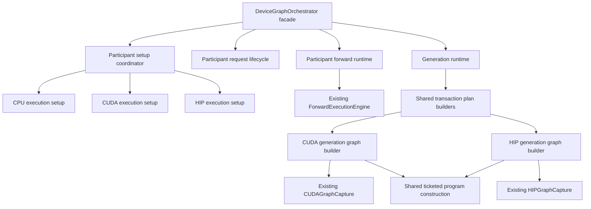

# DeviceGraphOrchestrator breakup and refactor plan

Date: 2026-10-13. Baseline source: `48235fb0cb1f7bd489dc4ca293eb8dc8b35cedb1`.
Status: planned implementation project.

Reduce DeviceGraphOrchestrator to a small participant facade with fewer than
3,000 physical lines across its header and every implementation file. Make CPU
execution preparation, CUDA graph construction, and HIP graph construction
directly discoverable. Move behavior together with its state and lifetime
contracts. Reuse substantial common production code while keeping backend
differences explicit.

The facade continues to implement `IInferenceRunner`. RankOrchestrator and
GlobalOrchestrator retain participant coordination and pipeline ownership.
Model builders remain declarative. This project preserves supported execution
policies, numerical behavior, physical admission, and economical communication.

## Completion requirements and line budget

The hard limit is **2,999 lines in total**, including comments, declarations,
includes, blank lines, inline bodies, and any companion implementations.
The intended final facade has exactly `DeviceGraphOrchestrator.h` and
`DeviceGraphOrchestrator.cpp`.

| Final facade file | Working budget |
|---|---:|
| `DeviceGraphOrchestrator.h` | 1,000 lines |
| `DeviceGraphOrchestrator.cpp` | 1,600 lines |
| Unallocated headroom before the hard limit | 399 lines |

P0 measures the retained declaration and delegate floor after assigning the
four infrastructure interfaces to their actual owners. The two file budgets
may be redistributed while retaining the 2,600-line working total and the
2,999-line combined ceiling. Do not compress formatting or remove substantive
documentation to fit an individual file's provisional budget.

The header contains interface declarations, complete inherited Doxygen through
`@copydoc` where appropriate, construction inputs, and opaque component owners.
The implementation contains dependency composition, short interface delegates,
and facade-level error attribution. Request reset and retirement delegate to a
typed participant lifecycle owner.

All remaining definitions of `DeviceGraphOrchestrator` and its nested types
count toward the limit wherever they are placed. Included implementation files,
generated delegates, forwarding base classes, macros that conceal method
bodies, and renamed private implementations do not make the class smaller.
There must be no relocated DGO implementation masquerading as another owner.

At final acceptance, a registered device-free Unit architecture gate enforces
the combined line count and allowed implementation inventory. It also rejects
new out-of-file DGO definitions. Introduce measurement in P0; enable the final
hard ceiling when P10 installs the completed facade, so intermediate feature
branches remain testable without granting exceptions to production invariants.

New components own coherent responsibilities and their state. Review any new
source file approaching 2,000 lines for a further ownership or construction
boundary. A component that receives the complete DGO state and implements its
old methods has not completed an extraction.

## Current source inventory

| Baseline file | Physical lines | Current responsibility |
|---|---:|---|
| `DeviceGraphOrchestrator.cpp` | 64,008 | Setup, forward assembly, graph families, MTP, publication, generation, prefix, MoE, sampling, diagnostics |
| `DeviceGraphOrchestrator.h` | 11,931 | Large public surface, inline lifecycle code, cache types, buffer views, and subsystem state |
| `DeviceGraphOrchestratorGeneration.cpp` | 550 | Ordinary generation composition and replay |
| `DeviceGraphOrchestratorMTPPublication.cpp` | 569 | Speculative state publication construction and execution |
| `DeviceGraphOrchestratorMovement.cpp` | 139 | Native MoE movement observation and archive publication |
| **Total** | **77,197** | One class spread across five files |

Source entry points for the implementation audit are the
[main implementation](../../../../src/v2/execution/local_execution/orchestrators/DeviceGraphOrchestrator.cpp),
[ordinary generation composition](../../../../src/v2/execution/local_execution/orchestrators/DeviceGraphOrchestratorGeneration.cpp),
[existing common generation lowering](../../../../src/v2/execution/mtp/DeviceGenerationGraphProgram.cpp),
[CUDA capture](../../../../src/v2/backends/cuda/CUDAGraphCapture.h), and
[HIP capture](../../../../src/v2/backends/rocm/HIPGraphCapture.h).

The main implementation contains over 500 method definitions, including nested
builder methods. Important source boundaries include:

| Method | Baseline lines | Required destination |
|---|---:|---|
| `initializeBuffers` | 1,665 | Shared resource declarations plus subsystem binding and backend setup |
| `executeMTPDepth0Batched` | 2,038 | Sidecar binding, graph construction, and sidecar runtime |
| `forwardImpl` | 1,309 | Participant forward admission and execution |
| `materializeMTPDeviceGenerationLoopGraph` | 976 | Transaction plan, backend generation builder, and graph family owner |
| `verifyStochasticDistributionsBatchOutcomeOnDeviceCommon` | 1,105 | Sampling and verifier outcome runtime |
| `finishDeviceResidentGeneration` | 974 | Generation terminal publication and validation |
| `exportCompletedDeviceMoERebalanceMaintenanceStats` | 1,415 | Completed maintenance evidence exporter |
| `prefixStateProbe` | 894 | Participant diagnostics using explicit observation leases |
| `harvestPrefix` | 821 | Participant prefix archive lifecycle |
| `resetInferenceState` in the header | 472 | Participant request lifecycle |

These are baseline method-body measurements; they are not independent estimates
of the number of lines a component will retain after deduplication.

The [current facade](../../../../src/v2/execution/local_execution/orchestrators/DeviceGraphOrchestrator.h)
implements `IInferenceRunner`, `IForwardExecutionHost`, the CPU current-batch
LLEP executor, and two MoE device publication interfaces. Its header contains
252 `override` markers after excluding comments. The broad
[runner contract](../../../../src/v2/execution/local_execution/orchestrators/IInferenceRunner.h)
is therefore a real constraint on the facade budget. Preserve supported runner
operations as short delegates; remove concrete setup and diagnostic convenience
APIs only after migrating their actual callers.

The final facade inherits only `IInferenceRunner`. The four infrastructure
interfaces leave DGO:

| Current DGO interface | Final implementation owner |
|---|---|
| `IForwardExecutionHost` | `ParticipantForwardHost` |
| `ICPUCurrentBatchLLEPPhysicalExecutor` | `CPUMoETransactionExecutor` |
| `IMoEOverlayDeviceInferenceBoundary` | The corresponding participant MoE owner |
| `IMoEOverlayDeviceInitialRuntimePublisher` | The corresponding participant MoE publication owner |

The baseline override signatures occupy approximately 627 nonblank physical
lines at current wrapping. Inherited documentation and spacing alone take that
past 1,100 lines before constructors and ownership fields. Consequently the
interface migration and concrete API retirement are required budget work.

## Architecture and visible entry points

Use three distinct construction layers:

1. Model graph builders declare participant-local `ComputeGraph` stages.
2. Shared program builders declare complete transactions, graph roles, and
   producer/consumer edges where CUDA and HIP already share those semantics.
3. Named CUDA and HIP builders lower those declarations using their native
   graph implementation and admitted execution policy.

CPU has an explicit preparation entry point and executes the production host
compute graph. It does not implement a dummy GPU graph API. Native graph
handles stay in the existing backend implementations.



The following names and locations are the proposed source map. A module may
use concrete functions instead of a class when that gives the same ownership
and testability with less machinery.

```text
src/v2/execution/
  local_execution/
    orchestrators/
      DeviceGraphOrchestrator.h
      DeviceGraphOrchestrator.cpp
      PipelineDeviceGeneration.*              existing rank composition
      PipelineMTPDeviceGeneration.*           existing rank composition
    participant/
      ExecutionResources.*
      ParticipantSetupCoordinator.*
      ParticipantRequestLifecycle.*
      ParticipantForwardRuntime.*
      ParticipantForwardHost.*
      PipelineGenerationParticipantBinding.h
      PipelineGenerationProgramLease.h
    setup/
      CPUExecutionSetup.*
      cuda/CUDAExecutionSetup.*
      rocm/HIPExecutionSetup.*
    engine/                                  existing forward cache and dispatch
    graph/                                   existing compute graph and capture lifecycle
      ForwardGraphBuilder.*
      ServingGraphFamilyBuilder.*
  gpu_graphs/
    GenerationTransactionPlan.*
    OrdinaryGenerationGraphBuilder.*
    MTPTransactionGraphBuilder.*
    GenerationGraphFamily.*
    DeviceGenerationGraphProgram.*            relocated shared lowering
    TicketedGenerationGraphBuilder.*
    cuda/CUDAGenerationGraphBuilder.*
    rocm/HIPGenerationGraphBuilder.*
  generation/
    GenerationRuntime.*
    DeviceLogicalSequenceState.*
    GenerationTerminalPublication.*
  sampling/
    ParticipantSamplingRuntime.*
    ParticipantLogitsPublication.*
    cpu/CPUSamplingRuntime.*
    gpu/GPUSamplingRuntime.*
  mtp/
    MTPSidecarRuntime.*
    MTPVerifierRuntime.*
    MTPStatePublicationRuntime.*
    MTPTerminalHiddenRuntime.*
  prefix_cache/
    ParticipantPrefixState.*
    ParticipantCheckpointPool.*
  moe/
    ParticipantMoERuntime.*
    MoEParticipantGraphBuilder.*
    CPUMoETransactionExecutor.*
    MoECompletedMaintenanceExporter.*
  debug/
    ParticipantDiagnostics.*

src/v2/backends/
  cuda/CUDAGraphCapture.*                     existing native implementation
  rocm/HIPGraphCapture.*                      existing native implementation
```

Shared forward assembly and complete CPU/GPU workspace-family declarations
live under `local_execution/graph/`. Native program construction and GPU
executable-family ownership live under `gpu_graphs/`.

This map assigns responsibilities, not a mandatory class inventory. Create
`TicketedGenerationGraphBuilder` only if retained-family composition adds
substantial shared code beyond the existing ticket publisher. Create separate
CPU/GPU sampling modules only where their actual execution/state ownership
requires them; otherwise retain existing host sampler, CPU primitives, kernel
interfaces, and concrete functions under the participant sampling owner.

Existing feature-specific helpers remain in their established directories
unless their semantics are shared by ordinary and speculative generation.
General generation construction currently under `execution/mtp/` moves to
the common graph directory. Update all includes and CMake registration;
retire the replaced paths and aliases in the same slice.

Discoverability is an acceptance requirement. Starting from the CUDA builder,
the reader must find initialization, native WHILE/selector construction,
maintenance edges, and terminal publication. Starting from the HIP builder,
the reader must find the retained transaction inventory, initial sampling,
ticket publisher, and authenticated submission contract. Both entry points
must name their shared transaction builder and graph lifetime owner.

A short backend entry point is legitimate when it delegates to substantial
shared construction code outside DGO. Duplicating common code to make backend
files look substantial defeats the reuse requirement.

## Code reuse rules and supporting evidence

An ownership extraction does not require a new polymorphic abstraction.
Prefer concrete owners and narrow typed references. Introduce a new shared
backend abstraction only after identifying substantive production code that
multiple supported implementations can use without hiding their differences.
Test doubles alone do not establish that reuse.

For each proposed shared helper, record the existing implementation and its
production consumers, the common operation, the explicit backend variation,
and the code that the extraction actually removes. Keep a backend-local helper
local when the commonality is only a similar name or function signature.

| Concern | Existing reuse evidence | Refactor decision |
|---|---|---|
| Arena and graph workspace | `BufferArena`, `WorkspaceAllocator`, and `DeviceWorkspaceManager` serve CPU, CUDA, and ROCm | Reuse their typed BOM and binding machinery; no new allocator or physical ledger |
| Forward dispatch and cache selection | `ForwardExecutionEngine` already consumes the same runner-supplied forward contract across devices | Keep one engine; move DGO callbacks into a composed host adapter |
| Ordinary and MTP generation lowering | `DeviceGenerationGraphProgram::native` shares predicate/fragment validation; ordinary and MTP callers already use it | Preserve this common lowering and relocate it out of the MTP-only directory |
| Ticket publication | `DeviceGenerationGraphProgram::ticketPublisher` serves HIP and declared heterogeneous execution, including CUDA | Share the ticketed construction and lifecycle; it is not HIP-exclusive machinery |
| Transaction ordering | DGO assembles the same sidecar, verifier, state-publication, terminal-publication, and maintenance semantics before native or ticketed lowering | Extract the common transaction declaration; retain backend construction and execution policy |
| Native graph operations | `IGPUGraphCapture` has real CUDA and HIP implementations | Keep this established interface; CPU does not acquire a synthetic implementation |
| Retained compute-graph execution | `DeviceGraphExecutor::GraphSegmentCache` already supplies native ownership, submission state, templates, and replay identity | Reuse it in forward/sidecar owners; the generation family aggregates its actual children instead of replacing all caches with a generic base |
| CPU execution setup | CPU uses common buffers/workspace/KV configuration but performs CPU packing and host graph preparation | Share the common setup operations and retain a visible CPU-specific preparation module |
| Sampling arithmetic | `SamplingMath`, CPU sampler primitives, kernel interfaces, and sampling stages already express numeric policy | Reuse exact arithmetic, seeds, tie breaks, and penalty semantics; keep CPU execution and GPU event submission separate |
| KV and recurrent state | `IKVCache`, `IHybridKVCache`, and `KernelFactory` already support backend-specific implementations | Reuse their reset/checkpoint interfaces; move runner ownership, not kernel implementations |
| Cross-graph ordering | `DeviceExecutionTimeline`, `DeviceEventEdge`, and hosted lifecycle types describe real GPU publication contracts | Reuse them across CUDA/HIP; CPU host execution does not create no-op GPU events |
| Prefix archives | Existing prefix cache, payload layout, storage tiers, and checkpoint types already separate storage from inference | Add participant integration owners around them; do not duplicate archive implementations |
| MoE participant services | Existing residency, migration, retained-parent composition, and expert participant runner classes own production mechanisms | Move DGO integration into those mechanisms where responsibility matches; do not create a second participant scheduler |

Shared plans are declarations of semantics and admitted immutable geometry.
They are not a new universal graph IR. Reuse `DeviceControlledLoopProgram`,
existing fragment descriptors, `OrdinaryGenerationGraphPlan`, and
`MTPGraphOwnerPlan` where they already express the required contract. Introduce
another plan type only for missing semantic ownership, with a concrete consumer
on each supported construction path.

`DeviceSampler` is an existing rank-level shard sampler. Its current host
merge/observation boundary is different from device-resident generation.
Audit real callers before reusing or retiring it; importing it into the GPU
generation runtime would not establish a valid common implementation.

## Ownership and migration map

Every member, nested type, anonymous helper, and public concrete helper receives
one destination in P0. The following map defines the major destinations.

| Destination | State or implementation that moves | Borrowed dependencies |
|---|---|---|
| `ExecutionResources` | Arena, device contexts, workspace lease/allocator, physical reservations, shared tensor bindings, main KV ownership | Existing memory authority, tensor factory, prepared stores, injected topology |
| Backend setup modules | Backend-specific materialization and preparation; CPU packing and CPU graph admission | Frozen setup plan and shared resource owners |
| `ParticipantForwardRuntime` | `forwardImpl`, prefill scheduling, request input admission/reuse, output selection, phase-specific assembly | Model builder, exact state/input bindings, forward host, engine |
| `ParticipantForwardHost` | Existing `IForwardExecutionHost` implementation | Narrow references to resources, publications, MoE, MTP, diagnostics |
| `ForwardGraphBuilder` and `ServingGraphFamilyBuilder` | Fluent sessions, shape materialization, complete serving inventory, workspace-family declarations | Model schemas/builders, canonical owner plans, pipeline bindings |
| `GenerationGraphFamily` | Generation parent/ticket owner, retained recordings, source identities, branch tables, initial-sampling and transaction captures | Exact context/stream and retained child-owner leases |
| Backend generation builders | Complete backend-specific construction policy and composition | Shared transaction plan and admitted stable bindings |
| `GenerationRuntime` | Request admission, controller and response views, hosted cursor, ticket authentication, launch and completion | Captured family, sampling/MTP/MoE contracts, terminal publisher |
| `DeviceLogicalSequenceState` | Device metadata storage, publication mailbox, reader/writer epochs, transaction leases | Arena backing and existing timeline edges |
| Sampling owners | Greedy/stochastic execution, distributions, sample banks, penalty inputs, readiness, argmax scratch bindings | Existing arithmetic/kernel policies and canonical sequence state |
| `ParticipantLogitsPublication` | Main/MTP/verifier output roles, surface selection, pending consumer handoffs | Exact producer publications and stable tensor bindings |
| MTP owners | Sidecar caches, verifier metadata, hidden selection/publication, shifted KV, accepted-state publication | Main KV, sampling outputs, logical state, checkpoint and graph owners |
| `ParticipantPrefixState` | Cache namespace, tier backends, lookup/harvest/restore, archive staging, payload aliases | Main/shifted KV checkpoint providers and publication contracts |
| `ParticipantCheckpointPool` | Recurrent/terminal payload slots, sequence metadata slots, reuse exclusion, retained physical leases | Memory authority, cache-owned checkpoint APIs, exact readiness publications |
| MoE owners | Maintenance captures, controller/runtime bindings, epoch leases, expert transfer activation, CPU LLEP, movement archives | Existing placement/residency authority and prepared expert stores |
| `ParticipantDiagnostics` and maintenance exporter | Snapshot callback integration, probes, mirrored digests, completed evidence formatting | Explicit observation leases and existing snapshot storage |
| `ParticipantRequestLifecycle` | Reset transaction phases, complete producer joins, request/session epochs, final retirement sequencing | Typed lifecycle participants for each actual owner |

`InferenceState` cannot remain a writable common bag passed to all extracted
owners. Partition it by authority. Main KV and ordinary activations belong to
resources; shifted KV and terminal-hidden publication belong to MTP; device
logical/controller state belongs to generation; archive slots belong to the
checkpoint pool. Export immutable or operation-specific borrowed views.
CPU committed sequence state remains host-owned; GPU state remains device-owned.

The physical backing owner remains `BufferArena`, a cache, prepared storage,
or the relevant existing allocation owner. New runtime classes may retain
typed views and lifetime leases without becoming a second allocation ledger.
All admission, reservation, allocation claims, and releases flow through
`PhysicalMemoryAuthority`. Preserve the canonical owner-plan arithmetic.

## Backend construction and setup contracts

### Shared participant preparation

Compile one frozen participant setup plan from the existing rank/model plan.
It names the exact device, layer interval, collective membership, model
precision, context/activation capacity, retained MTP capacity, prefix policy,
and complete graph/workspace family. Execution code does not rediscover
topology, parse CLI strings, or recompute memory capacity.

Each subsystem contributes its typed storage/workspace requirements through
the current schema/BOM authorities and binds its admitted persistent storage.
The setup coordinator orders those operations; it owns no parallel budget.
`initializeBuffers` is broken into these declarations and bindings rather
than moved wholesale into a general setup utility.

### CPU execution setup

`CPUExecutionSetup` explicitly prepares CPU packed GEMM bindings, main/shifted
KV and recurrent state through existing cache factories, host sampling state,
and the complete CPU graph/workspace envelope. It prepares the same supported
MTP and MoE operations as the CPU production path and seals the host forward
engine before admission.

CPU setup consumes the thread budget and NUMA backend installed by
`MPIBootstrapPhase` and `CPUBackend`. It does not establish a second affinity,
OpenMP, discovery, or worker-count policy. NUMA-local expert transfers retain
the configured CPU backend and current prepared-weight lifetime contracts.

Separate CPU-specific preparation from the substantial schema, cache, and
workspace operations already shared by all three backends. A virtual
`IExecutionSetup` hierarchy is unnecessary unless extraction exposes enough
common production implementation to justify that boundary.

### CUDA graph construction

`CUDAGenerationGraphBuilder` exposes the complete native conditional policy for
homogeneous supported CUDA execution. The builder shows entry/initialization,
ordinary or speculative transaction composition, WHILE continuation, bounded
dynamic-depth selection, optional maintenance, and terminal publication.
Native node construction remains in `CUDAGraphCapture`.

Declared heterogeneous CUDA execution uses the shared ticketed construction
when a complete native parent cannot represent the admitted boundary. Backend
identity alone must not select the execution policy.

### HIP graph construction

`HIPGenerationGraphBuilder` exposes retained complete transaction construction,
initial sampling where required, the admitted depth inventory, and the
immutable ticket publisher. The device controller retains all model/sampler/
verifier/KV/response decisions. The runtime authenticates the published ticket
and submits the named retained transaction through the existing typed cursor.

Native recording, instantiation, and submission remain in `HIPGraphCapture`.
The builder retains exact completion/event and borrowed-child contracts.
CPU stages or remote work appear only at the already-declared heterogeneous
boundary. Graph-family construction never turns a failed CUDA or HIP policy
into another execution mode.

### Builder inputs and returned ownership

Builders accept frozen plans and named stable bindings. They receive exact
device/context/stream ownership, model-state providers, workspace generation,
sampling policy, retained capacity, pipeline edges, and required child leases.
They do not accept `DeviceGraphOrchestrator&`, arbitrary getter bags, or
callbacks that expose every private subsystem through the old facade.

Construction returns a typed native-parent or ticketed-program owner with its
complete capture identity. Retained child recordings may have different
instantiation requirements from executable parents; preserve that distinction
instead of instantiating every child unnecessarily.

Native identity covers every embedded pointer, device, workspace generation,
geometry, static policy scalar, launch policy, collective binding, snapshot
topology, and recorded child identity. Request data changes behind stable
addresses do not change graph identity. Dynamic device depth/frontier values
remain data, with admitted bounds in the program contract.

Keep the algorithmic order visible in the shared MTP transaction builder:

```text
epoch acquire when applicable
  -> full sidecar and first draft publication
  -> admitted chained sidecar and draft publications
  -> verifier input preparation
  -> grouped main-model verifier
  -> stochastic target distribution and outcome when applicable
  -> accepted speculative state publication
  -> accepted terminal-hidden publication
  -> epoch release when applicable
  -> due maintenance
```

CUDA dynamic construction retains its selector-gated draft prefix with a shared
verifier/publication tail. HIP retains its admitted depth-specific transaction
directory. Those lowering differences remain explicit while using the same
mathematical body and publication contracts.

## Lifecycle and ordering

### Serving setup order

The existing production order is expressed through typed setup transitions:

1. Bind resolved topology, frozen weights, model schema, and physical admission.
2. Install exact participant/pipeline transport bindings before graph recording
   or forward-engine construction can freeze their addresses.
3. Declare and materialize the complete admitted resource/workspace family,
   including retained MTP capacity when MTP execution is disabled.
4. Bind persistent request inputs, logical state, sampler, verifier, checkpoint,
   prefix, MoE, and response storage; create required exact-stream events.
5. Prepare CPU host graphs or construct every required participant serving variant,
   including history-bearing decode and supported diagnostic topology variants.
6. Seal retained participant program leases, compose the declared rank/global
   parents from those leases, seal complete capture identities, and verify the
   resource capacity BOM.
7. Install external request-ticket authority and publish readiness.

No model arithmetic, synthetic request, mutable state readback, or execution
fallback is introduced to certify setup. Setup-only materialization and actual
request submission remain separate typed operations.

### Request reset

Move the complete reset transaction into `ParticipantRequestLifecycle`.
Keep `Request`, `PrefixRestore`, and `ServingGraphSetup` boundaries distinct.
Require the actual coupled KV, GDN, shifted-MTP, sampler, and logical state
owners to participate in one reset transaction.

On GPU, the lifecycle acquires one exact reset stream, joins all prior named
producer events, releases any owned overlay epoch, resets request contents and
session metadata, and publishes reset-ready after all mutations. Preserve
graph recordings, native executables, arena bindings, workspace generations,
and replay-safe kernel dynamic objects. CPU executes the equivalent host-owned
state transitions through its actual cache/reset contracts.

Each owner exposes checked lifecycle operations, with publication required
before completion. An abandoned or failed partially submitted transaction is
fatal. No participant can publish a successful reset while another owner still
holds an old-request reader or unjoined writer.

### Publications and reads

Keep producer state and its exact event with the owner that publishes it.
Use the existing `DeviceExecutionTimeline` and `DeviceEventEdge` manifest for
GPU cross-graph ordering. Consumers acquire a typed publication/read lease and
wait on the actual producer event on their exact stream. Multiple consumers
cannot retire each other's readiness edge.

Unify genuinely repeated CUDA/HIP handoff operations around the current
timeline API. Preserve distinct semantic publication types for logits,
logical sequence state, checkpoints, sampler outcomes, and maintenance.
A general event registry with anonymous validity flags would erase the
ownership contract.

### Retirement and reusable storage

Preserve the explicit sequence currently enforced by the DGO destructor:

1. Close request admission and retire each owner’s published device work.
2. Retain and finish the exact pending prefix restore/archive payload uses.
3. Retire runtime publications that borrow graph execution streams.
4. Destroy generation parents before the retained children they reference.
5. Destroy forward, sidecar, verifier, publication, and maintenance graph owners
   while their backing storage and exact contexts still exist.
6. Retire remaining dependent events/contexts, then publish reusable workspace.
7. Release backing allocations and their physical-memory leases through the
   actual owners after the last borrower retires.

Native driver/backend lifetime must outlive every handle deleter. Request
reset is not this final retirement boundary. Device-wide synchronization and
early arena reuse cannot substitute for the required event and lifetime edges.

Callbacks installed into builders, executors, or maintenance services retain
stable component identities. Audit the current default move operations and
`this` captures. Preserve a move only when every binding remains valid under
its typed contract; otherwise migrate its actual callers and remove that move
surface. Splitting files must not create dangling callback owners.

## Pipeline and caller migration

[PipelineDeviceGeneration](../../../../src/v2/execution/local_execution/orchestrators/PipelineDeviceGeneration.cpp)
currently has friend access to DGO graph families, state, arena, forward
engine, and publication storage. Replace that access with a setup-created
`PipelineGenerationParticipantBinding` retaining exact participant identity,
layer ownership, activation endpoints, checkpoint providers, publication
transport, and stable storage identity.

Freeze that topology/state binding before participant recording. Once the
participant programs are materialized, seal a separate
`PipelineGenerationProgramLease` bundle retaining the captured child owners
and their complete identities. Rank/global parent construction consumes both
immutable objects. Neither topology nor captured child identity can be mutated
after its corresponding seal.

These bindings grant no ownership of another participant's KV, sampler, or
controller. Pipeline retirement follows the borrowed-owner ordering instead
of depending on a friend declaration or incidental member layout. Migrate
`PipelineMTPDeviceGeneration` in the same ownership slice.

`InferenceRunnerFactory`, stage factories, RankOrchestrator, GlobalOrchestrator,
OrchestrationRunner, and active local strategy callers are migrated with the
concrete APIs they use. Keep the external `IInferenceRunner` behavior intact.
Move setup-only interfaces onto their actual resource/MoE/forward owners and
inject those owners into model builders explicitly.

The fluent attention/FFN/layer sessions and older orchestrator consumers get a
real caller inventory. Retire unused surfaces completely. Active consumers
receive the appropriate graph-builder or runner contract without retaining a
second DGO entry point. Isolated Unit construction remains an explicit typed
test boundary, separate from required production physical admission.

## Staged implementation

Each stage is a reviewable green feature-branch slice. A large stage may use
several PRs divided by an ownership boundary; every merged slice removes the
replaced production implementation and migrates its tests and callers.
Graph construction is the first substantive extraction.

### P0 Inventory and baseline

- Assign every DGO method, member, nested type, anonymous helper, and concrete
  public API to one final owner or an explicitly retained facade delegate.
- Record direct callers, installed callbacks, graph-borrowed pointers, physical
  leases, source-policy references, and construction/reset/retirement edges.
- Measure the complete current facade inventory and establish the line report.
- Produce a counted final facade interface sketch containing every retained
  runner signature, inherited documentation, construction dependency, component
  owner, and delegate body. Assign each removed infrastructure interface to its
  final implementor. Include the whole projected implementation inventory.
- Preserve baseline Unit/preflight receipts, graph-role inventories, resource
  BOMs, and matched Release generation/PerfStats evidence for affected paths.
  Use the canonical registered model definitions and reviewed controls.

Exit: the counted final facade sketch fits the 2,999-line ceiling without hidden
forwarding or reduced documentation; no implementation is unassigned or API
assumed unused; the owner/lifetime map supports P1/P2 without passing the entire
DGO to new classes.

### P1 Stable resource and lifecycle seams

- Establish narrow resource, state-provider, graph-owner, and pipeline binding
  contracts using existing arena, cache, timeline, and graph-plan types.
- Move persistent logical/controller binding and graph-owner identity into
  stable component objects where P2 requires it; preserve their existing code.
- Separate setup materialization, request admission, reset, and final retirement
  operations so a builder cannot accidentally launch inference or replace a
  live executable.
- Record the reuse evidence for each new cross-backend helper. Prefer concrete
  components over interfaces with a single production implementation.

Exit: exact streams, child leases, and physical owners can be passed directly
to builders; pipeline construction has a typed migration path.

### P2 Shared transactions and visible CUDA and HIP builders

- Extract ordinary generation assembly from the existing Generation companion.
- Extract `materializeMTPDeviceGenerationLoopGraph`, its transaction branch
  assembly, source identity, and complete native/ticketed construction.
- Reuse and relocate `DeviceGenerationGraphProgram`; retain shared native
  validation and the ticket publisher used by HIP and heterogeneous CUDA.
- Install `GenerationGraphFamily` ownership and the named backend builders.
  Move cache types, branch tables, retained child identities, and recordings
  with their construction code.
- Move authenticated hosted submission into `GenerationRuntime`, retaining the
  existing cursor and coordinator protocol. DGO submits a typed program rather
  than interpreting fragment kinds or assembling a per-token branch.
- Migrate pipeline composition to retained participant bindings alongside the
  owners it borrows. Retire `DeviceGraphOrchestratorGeneration.cpp`.

Exit: both backend builders are direct entry points; all program assembly is
outside DGO; ordinary/MTP construction shares verified common semantics;
complete capture/ticket policy and parent-before-child retirement are proven.

### P3 CPU preparation and shared execution resources

- Partition `initializeBuffers`, inference-state initialization, KV creation,
  prepared CPU weights, and workspace-family setup into shared declarations,
  subsystem bindings, and backend-specific preparation.
- Install visible CPU, CUDA, and HIP setup modules without copying the common
  schema/workspace/KV implementation three times.
- Move resource ownership and physical reservations to `ExecutionResources`.
  Subsystems retain views into that owner rather than independently sizing or
  allocating the same storage.
- Keep CPU NUMA/thread startup in its current authorities. Preserve retained
  graph capacity versus active MTP execution as separate policies.

Exit: CPU setup is readable without traversing GPU capture logic; all backend
setup uses the same canonical admission and shared resource machinery.

### P4 Forward assembly and serving graph family

- Extract `forwardImpl`, request ingress/reuse, prefill chunk assembly, and
  participant output selection into `ParticipantForwardRuntime`.
- Move graph sessions, `materializeForwardGraphForShape`, and complete serving
  inventory construction into named builders.
- Move `IForwardExecutionHost` implementation into `ParticipantForwardHost`;
  preserve `ForwardExecutionEngine` as the single cache/dispatch owner.
- Replace callbacks into DGO with narrow references to actual state owners.
  Retire unused layer/fluent surfaces after migrating verified callers.

Exit: graph assembly, state preparation/publication, and forward-cache selection
have distinct owners; no second forward engine or opaque DGO callback bag exists.

### P5 MTP sidecars and state publication

- Split `executeMTPDepth0Batched` into binding/validation, retained graph
  construction, and checked replay responsibilities.
- Move sidecar cache variants, shifted KV, verifier preparation, terminal-hidden
  selection/publication, and accepted-state publication to their MTP owners.
- Reuse `MTPSidecarCaptureLayout`, `MTPGraphOwnerPlan`, speculative metadata,
  KV/state publishers, and existing transaction/checkpoint policy.
- Preserve serial-row byte equivalence, all-position policies, full/chained/
  KV-only roles, request batches, and CPU shifted-prefill behavior.
- Retire `DeviceGraphOrchestratorMTPPublication.cpp`.

Exit: MTP owners expose retained program fragments and typed state publications;
no MTP cache layout or accepted-state implementation remains in the facade.

### P6 Sampling and sequence state

- Move sampling execution, processed distributions, penalties, sample banks,
  readiness, logits surfaces, and exact consumer handoffs to sampling owners.
- Reuse proven CPU/kernel sampling math. Share substantive layout/validation
  code while retaining CPU host operations and GPU event-bound submission.
- Complete logical sequence mailbox/read/write ownership and generation
  admission/terminal publication outside DGO.
- Preserve request-keyed seeds, draw positions, tie breaks, rejection/correction
  accounting, stop conditions, and compact response extent.
- Determine sampling coordination from the actual published logits layout and
  producer contract, including CPU full-vocabulary and GPU shard publications.
  Dormant allocation geometry does not establish which collectives are needed.

Exit: sampler and logical-state authority are explicit; GPU generation has no
new mutable host mirror, allocation, transfer, or synchronization boundary.

### P7 Prefix integration and checkpoint pools

- Move prefix fingerprint/tier integration, harvest/restore, staging, and
  payload retirement into `ParticipantPrefixState`.
- Move checkpoint slot ownership and reuse exclusion into the checkpoint pool;
  archive actual native main/shifted/recurrent state through existing APIs.
- Preserve persistent cache lifetime across request reset, RAM/disk/device-hot
  contracts, exact full-hit terminal state, and partial-hit decode bridges.
- Use typed state providers instead of a writable shared `InferenceState`.

Exit: prefix and checkpoint ownership are complete, physical leases survive
every pending alias/DMA, and restores preserve graph topology and exact tokens.

### P8 MoE participant integration

- Move controller bindings, maintenance graph construction, epoch leases,
  prepared expert activation/transfer, and CPU LLEP begin/restore to their owners.
- Reuse the existing placement/residency/migration/retained-parent services.
  Preserve the distinction between the continuation participant and the
  existing expert-only participant graph runner.
- Move completed native movement archive publication and maintenance evidence
  formatting; keep telemetry separate from placement/physical authority.
- Retire `DeviceGraphOrchestratorMovement.cpp` and move internal MoE/CPU executor
  interfaces off DGO onto their actual production owners.

Exit: ordinary forward stages contain only declared participant-local compute
and graph collectives; no second MoE scheduler, ledger, or padded transport exists.

### P9 Diagnostics and lifecycle completion

- Move snapshot configuration/context/filtering, mirrored digests, state probes,
  timing observers, and completed evidence export out of DGO.
- Reuse `SnapshotCapture`; preserve snapshot configuration identity and captured
  diagnostic variants across equivalent policy restatements.
- Complete `ParticipantRequestLifecycle` reset and final retirement using the
  extracted owners' typed operations. Remove inline lifecycle bodies from DGO.
- Keep explicit observation/terminal/storage boundaries distinct from inference
  publication. Preserve all reviewed synchronization budgets.

Exit: diagnostics cannot become a live-state authority or hot-path observation;
request reset and teardown have complete, independently tested owner sequences.

### P10 Facade completion and final qualification

- Complete every runner delegate and move remaining subsystem methods/types.
- Remove friend access, obsolete companions, compatibility aliases, dead setup
  entry points, and replaced CMake registrations.
- Enforce the combined 2,999-line facade ceiling and declarations-only header
  policy. Apply the size gate to every future PR touching the facade.
- Update current architecture, source maps, contributor instructions, and
  affected test documentation in the same change.
- Finish complete Unit/preflight and affected canonical Release qualification;
  archive evidence that all supported paths still exercise the intended owners.

Exit: every completion requirement and validation obligation below is green.
Moving 74,198 lines elsewhere without completing ownership and reuse does not
satisfy this stage.

## Validation and source policy migration

The [testing skill](../../../../.agents/llaminar-testing/SKILL.md),
[CTest registration](../../../../tests/v2/CMakeLists.txt), and
[production CI documentation](../../../production-ci.md) own exact commands
and current gate inventories. Do not copy a second model or test matrix into
the refactor tooling.

| Boundary | Required proof |
|---|---|
| Builders and admitted policy | Typed plan validation, exact graph-role/edge inventory, missing-binding rejection, native/ticket policy totality, unchanged supported geometry |
| CPU setup | Configured thread/NUMA authority, prepared CPU weights, shared resource BOM, main/hybrid/shifted caches, supported grouped/MoE host graph envelope |
| Capture identity | Changed pointer/device/workspace/policy/geometry/collective/snapshot identity rejects reuse; equivalent request data/reset preserves executables |
| GPU ownership | Exact non-null streams, producer events, reader/writer lifetimes, no hot-path allocation/readback/host callbacks, correct final retirement |
| Generation | Reviewed exact token controls, stochastic seeds, ordinary and dynamic MTP activity, stop/budget accounting, compact terminal extent, authenticated immutable tickets |
| MTP and sampling | Serial-row byte equivalence, request batches, accepted/rejected publications, shifted state, penalties, correction/bonus and terminal-hidden provenance |
| Prefix and checkpoints | Fresh/full/partial hits, large-to-small dirty reuse, delayed/out-of-order DMA, alias retention, stale namespace/slot rejection, storage tier persistence |
| MoE and transport | Static/Dynamic/LLEP supported contracts, real movement receipts, epoch interleavings, actual live communication extent for partial/skewed/empty/replayed cohorts |
| Pipeline and rank composition | Correct entry/exit frontiers, participant-local caches, retained transports, tail authority, homogeneous parents and declared heterogeneous boundaries |
| Diagnostics | Snapshot identity reuse, normalized filters, byte oracle, completed evidence completeness, no telemetry-driven execution decisions |
| Facade | Combined physical line count, allowed source inventory, no out-of-file implementation, no subsystem state/algorithm hidden behind generated forwarding |

Use focused existing tests first and extend them where an extraction changes
ownership. Relevant current registrations include
`V2_Unit_DeviceGraphOrchestrator`, its setup/snapshot/domain/streaming families,
`V2_Unit_MTPGraphConstruction`, `V2_Unit_DeviceGenerationController`,
`V2_Unit_OrdinaryGenerationController`, `V2_Unit_GpuWorkspaceAllocationPolicy`,
and the GPU stream/event/source-policy suites. Discover exact backend preflight
registrations from CTest rather than assuming a name from a source filename.

Examples of existing preflight coverage are
`V2_Integration_RankOrdinaryDeviceGeneration`,
`V2_Integration_MoEOverlayHostedOrdinaryGenerationLifecycle`,
`V2_Integration_PrefixFingerprintRequestReuse`,
`V2_Integration_PrefixExactTerminalArchiveReuse`, and
`V2_Integration_HIPMultiStreamGraphReplayLifetime`. Backend-conditional tests
run under their explicit registered CUDA/ROCm suites. Unit remains fast and
device-free.

Build the current complete executable inventory before claiming a prerequisite
pass:

```bash
cmake --build build_v2_integration --parallel \
  --target v2_unit_gate v2_production_test_preflight_gate
ctest --test-dir build_v2_integration \
  --output-on-failure --parallel --no-tests=error -R '^V2_Unit_'
ctest --test-dir build_v2_integration \
  --output-on-failure --parallel --no-tests=error \
  -L '^ProductionTestPreflight$'
```

Refresh receipts after source/test changes; reuse only a receipt whose build
and inventory freshness validator passes. Complete Unit/preflight is required
for each implementation slice. It does not certify real-model generation or
performance.

For changed runtime boundaries, run the affected canonical Release HTTP
generation cells with reviewed serial controls, MTP off and dynamic depth,
fresh/full/partial prefix probes, and exact repeatability. At project completion,
cover CPU, CUDA, ROCm, dense/MoE, supported TP/PP, and the declared heterogeneous
boundaries through the canonical eligible definitions. Retain all installed
optimization/precision policies and at least the generation minimum required
by those definitions. Fixed-depth and mathematical HF parity remain focused
diagnostic tools; the full mathematical matrix is explicit opt-in.

Compare matched unprofiled Release timing, setup duration, physical resource
BOMs, native graph memory, graph inventories, and PerfStats against the P0
baseline. Preserve the repository's benchmark ratchet. Kernel changes are
separate work unless an actual defect requires them; any new/changed kernels
inherit the backend profiling, complete shipped architecture compilation, and
spill guards. Do not advertise a performance gain from reduced source size.

Every discovered production defect gets a focused regression and explicit
`ProductionTestPreflight` registration, followed by its affected broader
backend/format/geometry invariant. A flaky lifetime case is reproduced in a
loop, up to 20 iterations when appropriate. No weaker thresholds, disabled
optimization, longer collective timeouts, or alternative execution modes are
used to make a refactor pass.

### Source checks that move with the code

Several Unit-side files bind directly to `DeviceGraphOrchestrator.cpp`, exact
method strings, or adjacent-method boundaries. Inspect and migrate:

- `tests/v2/unit/execution/local_execution/orchestrators/Test__DeviceGraphOrchestrator.cpp`
- `tests/v2/unit/execution/local_execution/orchestrators/Test__RankOrchestrator.cpp`
- `tests/v2/unit/mtp/Test__MTPGraphConstruction.cpp`
- `tests/v2/unit/stages/Test__GpuWorkspaceAllocationPolicy.cpp`
- `tests/v2/unit/execution/moe/Test__MoEGraphNative_ForbiddenDependencyScan.cpp`
- `tests/v2/unit/scripts/check_gpu_blocking_sync_policy.py`
- The CMake `LLAMINAR_DEVICE_GRAPH_ORCHESTRATOR_SOURCE` definition and related
  compile-time source identities.

Update scanned source inventories, method ownership, and exact allowed caller
counts in the same PR as each move. Preserve negative controls and coverage of
every new production file. Retain scans for structurally banned operations;
replace tests of textual statement order with typed plan/state-machine or
native graph evidence when that evidence actually enforces the invariant.
Delete an obsolete textual test only after its invariant has a stronger home.

## Build and documentation obligations

Use out-of-tree Ninja, ccache, the active recorded `CMAKE_MAKE_PROGRAM`, and
unrestricted `cmake --build --parallel`. Register persistent source files in
the canonical core target. Keep vendor compilation requirements in backend
files; common plan headers and Unit fixtures must not initialize or require
accelerators. Preserve the selected SDK, native runtime/library bindings,
spill guard, and production preflight compiler-resource proofs.

Each touched source file has a substantive Doxygen file header. Public and
nontrivial methods document ownership, arithmetic, lifecycle, and error
contracts. Delegates use the complete canonical interface documentation.
Document why each new shared abstraction is justified and where its backend
variation lives.

Update the active V2 architecture map and source map as components are
installed, including the distinction between model graph declarations,
program assembly, backend construction, and runtime ownership. Keep AGENTS
and testing instructions aligned with real interfaces and registered gates.
This dated plan holds progress/evidence; skills and AGENTS retain stable rules.

Ordinary production slices use `feat/...` branches from current `develop` and
the required feature-PR Unit/preflight gates. Documentation-only planning does
not authorize a release, ruleset bypass, or changed certification policy.
Preserve unrelated user changes, keep local results ignored, and do not
initialize or download the optional corpus submodule for ordinary builds or
Unit/preflight. Real-model control data uses only the explicitly selected
canonical corpus workflow when needed.

## Risks and review decisions

| Risk | Required design decision |
|---|---|
| Broad runner interface consumes the facade budget | Keep inherited delegates concise, move shared contract types to their canonical headers, and migrate concrete convenience/setup APIs; keep the hard combined ceiling |
| A new common abstraction hides backend differences | Demonstrate actual shared code and production consumers; keep CUDA conditional construction, HIP ticket policy, and CPU preparation visible |
| Shared state simply moves into another giant class | Partition live authority and typed bindings; split MTP, sampling, publications, and diagnostics by their real owner |
| Capture identity loses a field during extraction | Move cache identity and retained owner together, retain negative controls, and compare graph-role/resource inventories |
| Pipeline parents outlive children or callback targets | Factory-created retained bindings, stable component addresses, checked retirement order, and real native lifetime tests |
| Reset becomes independent best-effort owner calls | One typed reset transaction with complete producer joins and required final publication |
| Source-policy tests stop covering moved code | Update source inventory/caller counts and preserve negative controls before claiming a green extraction |
| CPU preparation acquires GPU requirements | Keep common headers device-free and CPU setup tied to its real host execution contracts |
| Generic setup duplicates memory/owner arithmetic | Existing typed BOM contributors and PhysicalMemoryAuthority remain the only admission/allocation authorities |
| Refactor changes arithmetic, communication, or execution policy | Matched exact-token/byte, transport-extent, and production-path proof; separate unrelated optimization work |

## Final acceptance checklist

- [ ] The complete DGO header and implementation inventory is at most 2,999
  physical lines, with a permanent device-free gate.
- [ ] DGO contains interface delegation and dependency composition; subsystem
  algorithms, cache types, and live state have actual independent owners.
- [ ] DGO inherits only `IInferenceRunner`; the four infrastructure interfaces
  have moved to the forward, CPU MoE, and participant MoE publication owners.
- [ ] CPU setup, CUDA generation construction, and HIP generation construction
  each have one obvious entry point with a documented path to shared code.
- [ ] Every new cross-backend abstraction has recorded substantial reuse
  evidence; backend-local operations remain readable in their own modules.
- [ ] Existing forward, native capture, sampling, KV, prefix, MoE, and physical
  memory mechanisms are reused without duplicate authority or execution paths.
- [ ] Parent/child/context/arena/physical-lease lifetimes are enforced through
  typed contracts and proven under reset, failure, and final retirement.
- [ ] GPU inference and decisions remain device-owned; only admitted immutable
  tickets, terminal results, and intentional archive/diagnostic boundaries cross
  to the host.
- [ ] Captured topology survives request reset and compatible prefix reuse;
  complete identities reject stale or changed bindings.
- [ ] Pipeline friend access and setup-time concrete DGO coupling are retired
  with their migrated callers.
- [ ] The three DGO companion implementations and all replaced aliases,
  registrations, and dead entry points are removed.
- [ ] Source architecture gates cover moved code with unchanged invariant
  strength and exact reviewed synchronization boundaries.
- [ ] Complete Unit and ProductionTestPreflight pass on current sources;
  affected canonical Release generation and performance evidence is complete.
- [ ] CPU/CUDA/ROCm, ordinary/MTP, dense/MoE, prefix, and supported collective/
  pipeline paths retain correctness, communication economy, and production
  execution proof.
- [ ] Active architecture, source maps, contributor instructions, CMake, and
  test documentation describe the installed implementation.
