# ExpertOverlay projection ownership expansion implementation plan

Investigation date: 2026-10-03. Source snapshot: `68e45ec35`.
Status: proposed implementation project. No production code was changed and no
runtime qualification was performed for this investigation.

Enable owner-local gate/up computation with down output columns distributed
across participants for CPU execution, heterogeneous GPU execution, and
multi-tier ExpertOverlay worlds. Preserve one placement authority, exact
serial-row arithmetic, captured GPU execution, economical communication, and
physical memory admission throughout promotion and demotion.

This requires extending the physical execution and residency contracts, not
just removing topology validation. The current implementation is deliberately
limited to one homogeneous, rank-local multi-GPU tier. Its useful foundations
are reusable, but its fixed down banks, participant coordinates, preparation,
transport, and movement measurements do not represent the requested worlds.

The recommended target keeps **within-tier participant movement gate/up-only**
and makes **cross-tier movement a transaction over gate/up plus the destination
tier's down slices**. Down column geometry remains fixed for each execution
group; which experts occupy those slices becomes epoch-owned tier residency.
This avoids requiring every capacity-limited accelerator tier to hold every
expert's down weights before admitting any gate/up owners.

## Scope and terminology

An output-column shard splits N in `W_down[N,K]`, equivalently columns of the
activation output. It retains the complete K dimension. Concatenating these
outputs needs no cross-participant floating-point reduction. Splitting K would
change the strategy and its exact-arithmetic proof.

A projection execution group is the immutable set of down-column consumers for
an expert executing in a tier. It must have an explicit mapping to physical
devices, execution domains, MPI ranks, and output intervals. This is proposed
layout metadata consumed by the existing authority, not a new controller.

| Requested world | Included implementation |
|---|---|
| CPU | Singleton CPU tiers and multi-NUMA CPU groups, including the existing CPU NodeTP process and affinity contract; host-owned routing, projection work, exchange, and residency |
| Unequal GPUs of one vendor | Existing CUDA or ROCm native domains with different capacity or performance; exact column intervals and economical scheduling rather than assuming equal-speed participants |
| Mixed CUDA and ROCm | Distinct vendor execution domains connected at an admitted, graph-visible boundary; an explicit logical projection group if down work spans those domains |
| Multiple tiers | CPU/GPU and all-GPU worlds, independently declared compute policies, within-tier balancing, cross-tier promotion/demotion, and closed cycles across two or three tiers |
| Distributed tiers | Cross-rank activation dispatch and weight movement through existing overlay protocols, including tiers on different hosts; CPU NodeTP necessarily includes a cross-process projection exchange |

A native NCCL/RCCL communicator remains one vendor's hardware group. Mixed
vendors must not be enabled by pretending they share a native TP communicator.
Homogeneous same-vendor GPU execution retains complete native capture. CPU or
mixed-backend execution can segment only at its declared physical boundary.

The first distributed target allows rank-local GPU projection groups and
node-local CPU groups, with cross-host movement between tiers. A down group
itself striped across hosts is a separate extension: it would require a new
per-route network fanout and its own economy certificate. It must remain an
explicit admission error until implemented. Dense PP, general K-sharded expert
TP, current-batch LLEP over partial experts, and automatic repartitioning of
column geometry during a request are outside this project.

## Findings from the current implementation

These are source-audit findings at the snapshot above. Existing test
registrations establish available proof surfaces, not a claim that they were
run during this investigation.

| Area | Current behavior and consequence | Code authority |
|---|---|---|
| Policy selection | `resolveRoutedComputePolicy()` selects projection ownership only for one rank-local homogeneous multi-GPU tier with uniform static-owner row assignment. Explicit projection declarations reject CPU and nonlocal or mixed-vendor membership. | [ExecutionDomainDefinition.cpp](../../../../src/v2/config/ExecutionDomainDefinition.cpp), `validate()` and `resolveRoutedComputePolicy()` |
| Layout | `MoEExpertProjectionOwnership` describes full gate/up matrices and equal, nonempty down output intervals. The original N/K geometry is retained. There is no tier-resident down inventory or unequal interval table. | [MoEExpertProjectionOwnership.h](../../../../src/v2/execution/moe/MoEExpertProjectionOwnership.h) |
| Preparation | `buildProjectionPartitioned()` requires one tier, homogeneous GPUs, and all model experts assigned to tier zero. It prepares a down slice for every expert on every participant. | [MoEExpertOverlayPreparationPlan.cpp](../../../../src/v2/execution/moe/MoEExpertOverlayPreparationPlan.cpp) |
| CPU preparation | CPU preparation groups are derived from gate requests and expect complete gate/up/down triplets. Projected registration in `ExpertGemmRegistry` rejects CPU. A participant with no gate owners would therefore miss its independent down obligations. | [WeightManager.cpp](../../../../src/v2/loaders/WeightManager.cpp), `prepareMoEExpertOverlayWeightsFromPlan()`; [ExpertGemmRegistry.cpp](../../../../src/v2/loaders/ExpertGemmRegistry.cpp) |
| Residency | Prepared payloads already distinguish `CompleteExpert` and `GateUp`. However, gate/up participant residency and fixed down bank resolution require a GPU. The registry currently selects one movable family for all endpoints from the presence of projection preparation. | [MoEOverlayPreparedExpertPayload.h](../../../../src/v2/execution/moe/MoEOverlayPreparedExpertPayload.h); [MoEOverlayParticipantResidency.cpp](../../../../src/v2/execution/moe/MoEOverlayParticipantResidency.cpp) |
| Down lifetime | `MoEOverlayFixedDownProjectionBank` has model lifetime and no arrival, eviction, or epoch API. It cannot represent an expert entering or leaving a tier. | [MoEOverlayFixedDownProjectionBank.h](../../../../src/v2/execution/moe/MoEOverlayFixedDownProjectionBank.h) |
| Admission | `MoEOverlayCapacityAdmission` rejects projection ownership when the physical residency fabric is required. `fixedDownCharges()` requires one homogeneous GPU tier, prices every down expert unconditionally, and uses GPU prepared bytes. CPU and cross-tier BOMs need a different contract. | [MoEOverlayCapacityAdmission.cpp](../../../../src/v2/execution/moe/MoEOverlayCapacityAdmission.cpp); [MoEOverlayCapacityResolver.cpp](../../../../src/v2/execution/moe/MoEOverlayCapacityResolver.cpp) |
| Graph execution | The six-phase projection DAG uses `DeviceMoERuntimeTable`, device descriptors, GPU-only local stages, native column publication, and exact communicator-local runtime coordinates. `Qwen35MoEGraph::bindProjectionArena()` requires local TP. | [MoEProjectionPipeline.cpp](../../../../src/v2/execution/compute_stages/stages/MoEProjectionPipeline.cpp); [Qwen35MoEGraph.cpp](../../../../src/v2/models/qwen35moe/Qwen35MoEGraph.cpp) |
| Compact transport | `DeviceCountedAllGather` supports only distinct homogeneous rank-local GPUs with proven absent P2P. Its underlying captured TransferEngine channel accepts distinct local GPU endpoints without a same-vendor check, which is a reusable boundary, not qualification of mixed projection execution. | [DeviceCountedAllGather.cpp](../../../../src/v2/collective/DeviceCountedAllGather.cpp); [CapturedTransferChannel.cpp](../../../../src/v2/transfer/CapturedTransferChannel.cpp) |
| Physical movement | The fabric stages three projections per expert, requires a complete source payload, and models one source owner and destination owner. This does not describe down slices arriving at several destination participants or repartitioning between tier widths. | [MoEOverlayPhysicalResidencyFabric.cpp](../../../../src/v2/execution/moe/MoEOverlayPhysicalResidencyFabric.cpp); [MoEOverlayResidencyAuthority.h](../../../../src/v2/execution/moe/MoEOverlayResidencyAuthority.h) |
| Movement measurements | Transport measurements and economy profiles assume three projection observations. The transport indexes operations using `/ 3` and `% 3`; its measurement sink rejects another cardinality. Changing `projections_per_expert` to two is insufficient. | [MoEOverlayTierMigrationTransport.cpp](../../../../src/v2/execution/moe/MoEOverlayTierMigrationTransport.cpp); [MoEOverlayMigrationMeasurementLedger.cpp](../../../../src/v2/execution/moe/MoEOverlayMigrationMeasurementLedger.cpp) |
| Authority location | All-GPU worlds select the device-resident authority, including mixed vendors and multiple tiers. Any CPU routed participant selects the existing host-resident authority. A transport worker does not become a policy owner. | [MoERoutedExpertPlacementPlan.h](../../../../src/v2/execution/moe/MoERoutedExpertPlacementPlan.h), `resolveMoEOverlayAuthorityExecutionKind()`; [MoEOverlayDeviceControllerTopology.cpp](../../../../src/v2/execution/moe/MoEOverlayDeviceControllerTopology.cpp) |

### Two prerequisites found during the audit

The native intermediate path currently gathers `layout.packetBytes()` from
each participant. `packGroupedIntermediateKernel()` fills unowned routes with
zeros, while the compact path publishes only actual owner-local records.
Extending the fixed packet path would violate the communication-volume maxim.
The project must add a native compact/count-aware protocol for enabled P2P
membership and retire production use of the padded intermediate exchange.
Enabling the existing no-P2P transport everywhere would also contradict its
declared physical contract. See [the packet kernels](../../../../src/v2/kernels/common/MoEGroupedIntermediateExchangeDevice.inl)
and [native gather lowering](../../../../src/v2/execution/compute_stages/stages/MoEProjectionPipeline.cpp).
This is a source-level extent finding; actual transport receipts are the
required runtime regression.

`availableMoEOptimizationMovementAxes()` recognizes participant movement only
for `Apportioned`, so projection ownership can report no participant axis
despite its movable gate/up owners. Add the projection case and a focused
preflight regression before relying on HTTP movement-topology evidence. See
[MoEOptimizationMovementTopology.cpp](../../../../src/v2/execution/moe/MoEOptimizationMovementTopology.cpp)
and [its unit tests](../../../../tests/v2/unit/execution/moe/Test__MoEOptimizationMovementTopology.cpp).

## Recommended residency design

### Where down weights live

There are three materially different designs. They cannot be selected silently
after an allocation or execution failure.

| Design | Cross-tier payload | Memory and service consequence | Recommendation |
|---|---|---|---|
| Full fixed down inventory in every tier | Gate/up only | Every tier holds a complete logical down inventory, distributed internally. This imposes a large memory floor even for a tier with zero gate/up quota. | A possible separately authored policy, but not required for this project |
| Down inventory resident with the expert's execution tier | Gate/up plus all destination down intervals absent from that tier | Total logical down inventory follows tier quotas. Every consumer in the selected tier has the required slice. Down slices stay put for within-tier owner swaps. | Implement this for capacity-oriented multi-tier worlds |
| One world-wide fixed down group independent of expert tier | Gate/up only | No per-tier replication, but every route depends on the global down group. Promoting gate/up to a GPU can leave CPU or remote down work on the critical path. | Separate architecture and economy study; not an implicit meaning of promotion |

For illustration only, let one layer have E experts, prepared gate/up bytes
G per expert, and full prepared down bytes D. With identical representations,
full fixed inventories across T tiers cost `E*G + T*E*D`; tier residency costs
`E*G + E*D`, before replicas, preparation padding, concurrency storage, and
transport. These formulas explain the design tradeoff and are not admission
arithmetic. Actual CPU and GPU bytes differ and must come from the canonical
prepared-footprint contributors into `PhysicalMemoryAuthority`.

### Typed layout and payload contracts

Extend the existing projection ownership value, or replace it with one shared
typed layout value, to retain original source geometry, arithmetic identity,
an immutable ordered column interval table, execution group membership, and
the relationship between owner-local projections and tier-resident down slices.
Validate full coverage, nonoverlap, nonempty intervals, per-format packing
constraints, and exact rank/device identity before preparation or admission.
Equal intervals remain a supported native specialization. Unequal intervals
must use exact lengths rather than padded allgathers.

Make down residency an explicit typed property of the frozen plan: a full fixed
domain inventory or the recommended tier-resident inventory. Preserve the
current complete single-tier contract. Resolve any omitted request intent once
at setup, serialize the concrete result, and reject missing implementations;
never choose another residency strategy after admission fails. Update the
policy enums, parser/CLI help, validator, lossless config document, `README.md`,
`AGENTS.md`, architecture docs, and source sanitizers together when that public
contract is installed. Final spelling belongs to the P1 interface review.

Bind the layout per `(domain, participant, layer)`. Remove the registry-wide
assumption that any projection preparation makes every endpoint gate/up-only.
Projected GPU tiers must coexist with whole-expert CPU or GPU tiers, and a
physical device shared by declared roles must retain their distinct logical
contracts while receiving one physical BOM.

Keep the immutable partition recipe separate from mutable residency. Retain
the current fixed bank for a complete single-tier inventory. Add an
authority-owned, epoch-pinned resident down bank for tiered execution, with
preallocated stable descriptor storage and inactive arrival slots. A captured
stage reads the selected bank through the existing epoch ticket; it must not
embed a pointer that needs rebinding when an expert changes tiers. The new bank
does not choose owners or keep another allocation ledger.

### Exact projection execution

Use the existing [MoEPrefillProjectionExecution](../../../../src/v2/kernels/common/MoEPrefillProjectionExecution.h)
boundary: gate/up and SwiGLU produce the already-consumed activation bytes;
down consumers execute their original full-K dots and preserve original full-N
dispatch identity. Regrouping changes storage order, not arithmetic.

CPU already has `GPUAlignedExpert` numerical policy, GPU-aligned Q8 publication,
and economical batched prequantized projection primitives. Reuse these rather
than introducing another numerical mode. The missing implementation is an
explicit split transaction, host projection bindings, and compact packet
publication/import. CPU Q8_1 blocks and GPU separated values/scales need a
lossless representation adapter, including exact scale widening and auxiliary
sum reconstruction where required. Never dequantize and requantize at exchange.
See [the arithmetic contract](../../../../src/v2/kernels/common/MoEProjectionNumericalContract.h),
[CPU Q8 publication](../../../../src/v2/kernels/cpu/primitives/GPUAlignedExpertQ8Primitives.h),
and [CPU batched execution](../../../../src/v2/kernels/cpu/gemm/CPUNativeVNNIGemmKernel.h).

Keep original router slot IDs through every packet. Down dots may run
concurrently, but per-token contributions must fold in original top-k order.
If a token's routes span multiple tiers, a tier-local aggregate cannot be
arbitrarily summed with other aggregates and assumed byte-equivalent. Publish
the needed per-route column contributions to their canonical fold owner, then
assemble completed columns for the actual continuation consumers. Preserve
the original shared-expert reduction, gate, and add order as well.

```mermaid
flowchart LR
    R[Router and pinned placement epoch] --> G[Selected owner computes gate and up]
    G --> P[Compact original route records and exact activation bits]
    P --> X[Explicit exchange to selected tier down consumers]
    X --> D[Participant local full K down column dots]
    D --> F[Original route order fold at canonical column owners]
    F --> C[Publish live completed columns to continuation consumers]
    C --> O[Shared branch and final output in original arithmetic order]
```

### Cross tier movement and publication

Represent each logical expert migration as a typed projection-operation plan,
derived by the existing placement authority and immutable layout. Operations
identify role, expert, source and destination interval, representation,
physical endpoints, and exact bytes. Do not infer them from a scalar operation
count or fabricate down measurements for a gate/up-only swap.

For each closed capacity-preserving wave:

1. Freeze the existing authority's candidate epoch and operation plan. Reserve
   the exact gate/up arrival slot and every required destination down slice
   through PMA-backed persistent pools before submitting work.
2. Stage gate/up at the destination owner and down slices at all actual down
   consumers. Whole-to-projected, projected-to-whole, and differently sharded
   projected tiers require explicit interval intersection and repacking.
   Reconstructing a complete down matrix must write the admitted destination
   representation directly, without an uncharged full host mirror.
3. Retain old source banks while inference readers hold their tickets. Require
   all projection receipts, prepared engines, descriptor generations, and
   destination consumer banks to be ready before marking the candidate ready.
4. Publish owner/tier selection and down-bank readiness as one inference-visible
   epoch transaction. A GPU controller retains decision authority in all-GPU
   worlds; physical host workers execute only authenticated commands.
5. Retire source owner payloads and obsolete tier down slices only after all
   readers and transfer consumers finish. Abort before publication leaves the
   old complete epoch authoritative; stale receipts and generations fail hard.

Example: moving expert A from a two-GPU tier to a four-GPU tier moves its gate/up
pair once and redistributes its full down matrix into four destination output
intervals. A reciprocal expert B closes the live quota cycle. Moving A between
two owners inside the same tier transfers only gate/up; the down intervals and
resident slice identities stay unchanged.

Logical quota balance is necessary but insufficient. A cross-tier move consumes
down arrival capacity on every destination consumer, including consumers with
no incoming gate/up owner. Admission and backpressure must account for that
fanout, differing prepared formats, and old/new bank overlap. They must not
reuse the existing one-owner shadow demand as proof of full readiness.

### Communication and economy

Separate three graph-visible transfers: hidden/router input dispatch to gate/up
owners, intermediate fanout to down consumers, and column/route publication to
continuation fold consumers. The existing root-to-expert-to-root whole-FFN
packet does not describe the extra middle boundary.

Reuse compact original-route records, TransferEngine publication, mapped
node-local channels, and existing MPI progress machinery. Extend their typed
plans and BOMs for the required consumers. A local producer consumes its own
bytes without a self-transfer. Empty producers send only progress metadata;
inactive capacity and routes belonging to another tier never cross transport.
GPU counts remain device-authored and CPU counts remain host-owned. Cross-rank
GPU metadata handling must retain the existing immutable protocol boundary,
without reading mutable routing/model state back to the host.

Use native counted/compact communication for eligible same-vendor P2P groups,
explicit mapped channels for mixed vendors or declared no-P2P groups, and the
declared MPI boundary for remote tiers. Transport selection is authenticated
at setup; a failed native path cannot retry through a different transport.
Share channels across sequential layers and graph families only when their
actual concurrency permits it.

Extend measured service and migration identities to include layout, projection
family, interval geometry, backend/ISA, actual worker budget, transport, and
production phase. Within-tier projected moves can claim only changes in gate/up
service and communication; fixed down work is not a movable saving. Cross-tier
moves change down service, input/intermediate/output communication, and
repacking costs. Model their overlapping critical path and measured inference
interference rather than adding all operation timings or counting fewer moved
bytes as automatic speedup.

Maintain separate decode, prefill, and grouped-verifier service evidence. Update
CPU setup service measurement, the migration measurement ledger and exchange,
host economy composition, device economy ABI, planning communication samples,
and automatic request cost estimates together. A fast gate/up owner does not
remove a slow down consumer from the critical path.

## Implementation work packages

Every package includes complete Doxygen and ownership comments for touched
sources, focused regressions, and explicit model-free
`ProductionTestPreflight` registration for production invariants. Keep unsupported
topologies rejected until each complete implementation and its gates exist.

| Package | Work and principal code boundaries | Completion evidence | Dependency |
|---|---|---|---|
| P0 Baseline and existing gaps | Capture matched whole-expert/projection Release controls; fix projection movement-axis reporting; replace native padded intermediate publication with an economical live-count native protocol. Extend `MoEOptimizationMovementTopology`, intermediate ABI/kernels, native collective lowering, and transport accounting. | Focused source-audit defects have regressions; both native GPU backends prove partial, empty, skewed, and large-to-small actual wire extents; existing numerical and capture controls remain green. | None |
| P1 Layout and memory contracts | Add explicit group membership, output intervals, singleton layout, per-endpoint payload contract, and tier-resident down obligations. Extend preparation identities, capacity resolver/admission, local planner, activation geometry/BOM, graph identity, and configuration serialization. | Device-free totality and negative tests; preparation and admission describe identical physical bytes for CPU/GPU, zero-owner/zero-tier-quota cases, replicas, arrival pools, and concurrency. | P0 audit; implementation can overlap P0 transport |
| P2 Projection-aware physical fabric | Replace triplet-only operation ordering with typed role/interval operations; support GateUp CPU payloads and CPU/GPU representation lanes; update measurement cardinality, progress diagnostics, calibration, and reusable prepared-context sealing. | Same-tier moves on CPU and across declared GPU boundaries transfer only gate/up; exact byte receipts and destination prepared identity; event-driven abort/retire tests. | P1 |
| P3 CPU split execution | Prepare down independently from gate/up owner lists, slice before packing, implement CPU split projection stages and compact import/export, and use real NUMA worker/NodeTP boundaries. Extend shared assembly interfaces and service measurements. | CPU singleton and two-NUMA production graphs; all native/floating formats, both ISAs, positive thread-count dispatch, grouped row equivalence, actual compact exchanges, and post-move reuse. | P1 and P2 |
| P4 Heterogeneous projection execution | Generalize the reusable pipeline to typed group mappings and declared transfers. Add mixed-vendor compact exchanges and exact unequal column publication; extend sparse participant graph runners and rank-batch scheduling. Keep native and heterogeneous capture policies explicit. | Unequal same-vendor GPUs and CUDA/ROCm groups produce serial-equivalent columns, live extents, device-owned all-GPU placement, and retained captured graph replay at each permitted boundary. | P1 and P2; shares exchange work with P3 |
| P5 Cross tier down residency | Add epoch-pinned resident down banks, down fanout reservations, interval redistribution, whole/projected transitions, and atomic readiness/publication through both host and device authorities. Extend distributed proposal/command fingerprints and remote manifests. | Two-/three-tier closed cycles across unequal degrees; no partially ready expert is routable; CPU/GPU and mixed all-GPU promotion/demotion run under their required authority; post-move prefix/MTP/reset and retirement are exact. | P2 through P4 |
| P6 Distributed qualification | Integrate projection groups into remote tier dispatch, node-local CPU exchange, and cross-host tier migration. Extend activation-channel planning, MPI transport/progress, retained tickets, and endpoint drain. Do not create multi-device compute stages. | Reordered-rank/NUMA ownership, exact remote payloads, finite progress with empty/skewed participants, ordinary 30-second collective policy, complete shutdown, and authenticated remote HTTP movement evidence. | P3 through P5 |
| P7 Economy and release integration | Finish projection-aware service/cost evidence, profiling, canonical model/topology definitions, public movement diagnostics, explicit whole-expert controls, docs, and certified image gates. Expand `Automatic` only for fully qualified topology classes. | Exact outputs and economical production kernels; matched default-policy Release throughput including migration interference; complete Unit/preflight and appropriate HTTP/remote/benchmark/image receipts for AVX2 and AVX512. | All previous packages; evidence work starts in P0 |

### First reviewable implementation slices

1. P0's movement-axis fix with a focused preflight entry, then the native compact
   extent proof for both GPU backends. These are independently reviewable and
   prevent the extension from inheriting misleading observability or padding.
2. A shared CPU/GPU layout and preparation/BOM contract with backend-free tests;
   new execution topologies remain rejected.
3. Complete single-tier CPU projection execution and within-tier movement under
   existing host authority, followed by a complete mixed-GPU implementation.
4. A two-tier CPU/GPU promotion/demotion implementation with tier-resident down
   banks and a reciprocal closed cycle; extend to different projection degrees,
   mixed whole/projected tiers, and three-tier worlds using the same machinery.
5. Distributed and production-economy completion before changing automatic
   defaults for any newly supported topology class.

## Validation and acceptance

Extend the existing canonical matrix and reusable fixtures. Do not create an
independent project-specific model runner or silently change baseline tokens.
The existing [CMake inventory](../../../../tests/v2/CMakeLists.txt),
[parity contract](../../../../tests/v2/integration/parity/README.md), and
[testing skill](../../../../.agents/llaminar-testing/SKILL.md) own registration
and execution procedures.

| Proof area | Required cases and assertions |
|---|---|
| Layout and admission | Singleton, degrees 2/3/4/8 and dispatch beyond sampled degrees; nondivisible full N, unequal intervals, format constraints, main/MTP layer geometry, zero gate owners, zero initial tier quota, same physical resource in multiple roles, and overflow/missing authority rejection |
| Numerical execution | Every supported native codebook and FP32/FP16/BF16 family, independent gate/up/down format combinations accepted by production, M=1 through supported grouped M, representative N/K, exact intermediate bytes and full-K dot order, original top-k fold, shared branch, and serial-row byte equivalence after movement |
| CPU economy | AVX2/AVX512 runtime dispatch, all positive thread counts with representative physical-core scaling, rank-affined OpenMP execution, NUMA first touch, no serial-row production loop, and no inactive-column compute used to simplify padding |
| Movement lifetime | Gate/up-only same-tier swaps; CPU/GPU conversion; whole-to-projected and projected-to-whole arrival; unequal-degree down repartition; reciprocal and three-tier cycles; delayed one-slice completion; stale generation; abort; readers pinned through publication; both retirement orders; old source storage remains valid |
| Communication | Partial buckets, empty participants, highly skewed owners, large-to-small replay, routes split between tiers, unequal column extents, zero-valued live tensors, and local producer reuse; receipts prove exact actual bytes and destinations rather than allocation sizes or output correctness alone |
| Capture and scheduling | Exact non-null GPU streams/events, no hot allocation/rebinding or GPU route/count readback, retained capture across requests and changed residency, conditional CUDA parent or authenticated HIP retained transactions, declared heterogeneous segmentation only, and producer-before-consumer submission across ranks |
| Integration | CPU-only, CUDA/CPU, ROCm/CPU, CUDA/ROCm, CUDA/ROCm/CPU, unequal GPU degrees/capacity, rank reordering, and remote tier placement; both continuation vendors where supported; dense/shared policy remains independent |
| User-visible evidence | Static ledger empty and all movement counters zero; Dynamic completed physical moves with nonzero bytes, published destination banks, correct authority, both available objective axes, transport receipts joined to immutable movement history, truthful graph counters, and no unintended GPU D2H |
| Request lifecycle | Fresh request, exact repeat, full and partial prefix restore, stochastic sampling, production KV formats including TurboQuant, long-context generation, MTP off and adaptive depth, focused fixed depths 1/2/3/15 for diagnostic coverage, model reuse, and final memory/worker retirement |

Build the canonical Unit and production-preflight targets with out-of-tree
Ninja, ccache, and unrestricted parallelism, then run their complete inventories.
New GPU execution tests remain Integration tests; Unit tests stay device-free.
Extend existing `MoEProjectionPreparation`, `MoEProjectionCapacity`,
`MoEProjectionPhases`, `MoEProjectionPipeline`, participant-residency, tier
migration, remote-projection, and epoch-publication fixtures. Every newly
discovered production defect gets a focused preflight entry. Loop a flaky
lifecycle regression up to twenty times when appropriate.

The routine production chain is Unit, production preflight, HTTP token
generation regression, long-context/needle E2E, cross-host E2E where applicable,
matched Release benchmarks, and image certification. Routine generation uses
MTP off and adaptive MTP. Full mathematical parity is explicit diagnosis, not
an additional routine gate; fixed-depth and exact mathematical cells remain
available to diagnose this project's arithmetic boundaries. New canonical
generation controls require explicit acquisition/review and corpus publication
through the optional `Llaminar/corpora` boundary, never automatic token renewal.

Profile every new GPU kernel with the appropriate CUDA/ROCm skill and every new
CPU kernel with the CPU skill. Retain per-candidate resource/ISA evidence,
occupancy or IPC/cache behavior, memory efficiency, thread scaling, and zero
spill proof across the complete shipped GPU architecture set. Timings used for
acceptance must be unprofiled. Benchmark whole-expert and projected policies
with identical models, precisions, placement order, request/MTP/prefix policy,
and production movement defaults. Include long enough cohorts to repay movement
and distinguish projected savings from realized end-to-end speedup.

The extension is complete only when its admitted worlds execute the real path,
publish complete ownership, satisfy exact communication extents and PMA BOMs,
and demonstrate economical kernels and amortized movement. Explicitly rejected
economically incompatible geometry is preferable to padded communication or an
automatic switch to whole-expert compute.

## Effort estimate and project risks

The following are planning estimates inferred from the audited boundaries,
not measured task durations. They assume reuse of the current transfer,
arithmetic, MPI, and epoch foundations; access to CPU NUMA, CUDA, and ROCm
hardware; and prompt availability of real-weight certification artifacts.

| Work | Estimated engineering weeks |
|---|---:|
| P0 existing gaps and P1 shared layout/admission | 4 to 6 |
| P2 projection-aware fabric and measurements | 3 to 5 |
| P3 CPU execution and NUMA exchange | 3 to 5 |
| P4 heterogeneous GPU execution | 3 to 5 |
| P5 tier-resident down migration and publication | 5 to 8 |
| P6 distributed integration | 2 to 4 |
| P7 final economy and release qualification | 3 to 5 |
| Total | 23 to 38 |

These estimates include testing within each package; P7 covers the final
integrated qualification. Backend work can overlap once P1/P2 contracts are
stable, but cross-tier publication and end-to-end certification remain on the
critical path. Same-tier CPU or mixed-GPU support is a smaller independently
usable milestone; it must not be presented as completion of multi-tier support.

The largest uncertainty is an economical native variable-extent protocol that
preserves capture and enabled P2P behavior. Next are byte-exact cross-tier route
folding, interval repacking without transient full matrices, and synchronizing
all consumer arrivals with existing device-controller publication. Measure
these with production-shaped components in P0 through P2 before fixing a
calendar schedule. CPU savings and mixed-GPU speedups are workload-dependent:
extra intermediate fanout can outweigh better down work distribution.

Record the following decisions in P1's implementation review: exact supported
execution-group scopes; the immutable interval selection rule for unequal
devices; the tier-resident down-bank ABI; whole/projected transition manifests;
and the native compact transport protocol. Decide from source contracts and
early physical evidence. Do not introduce another controller, full host weight
mirror, uncharged reserve, request-time topology rebuild, row replay, or enlarged
timeout to resolve an implementation difficulty.
