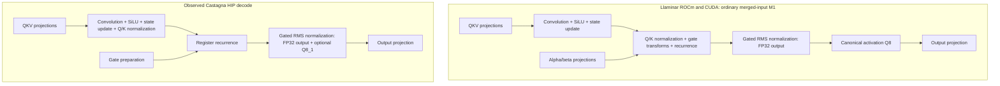

# QFN GDN execution structure: Llaminar and Castagna

## Scope and conclusion, 2026-10-24

The Sol 6.1 source review maps Llaminar's current ROCm and CUDA decode
implementations against pinned Castagna. GDN was selected because the fresh
checkpoint180 comparison identifies it as the largest directly comparable
decode gap. This note covers convolution, normalization, gates, recurrence,
state publication and output preparation; it is not a claim to have mapped
every model kernel.

Llaminar source is checkpoint `819496597dff8926294832aff485b9dc37c73f51`.
Castagna source is `3483d462715d61f21ed5877836be35a724446359`. The observed
fork execution is HIP on MI50. Its source resides in `ggml-cuda`, but that
directory name does not establish a working CUDA build. CUDA observations
below concern Llaminar on Ampere SM86, including the RTX 3090.

Castagna's recurrence uses FP32 state and arithmetic. Its smaller register
footprint comes with a different lane assignment, state layout, reduction
tree and distribution of work among kernels. Its convolution normalizes Q/K
once per original key head, while Llaminar repeats that normalization in each
recurrence column block. These are concrete structural targets. Copying the
fork's arithmetic verbatim would change Llaminar's numerical contract.

No production code, arithmetic policy or default changes follow from this
review. The next candidate must demonstrate complete-operation and model
benefits with the existing accuracy and grouped-equivalence gates.

## Measured location of the gap

The [fresh checkpoint180 comparison](QFN_CASTAGNA_STAGE_COMPARISON.md#fresh-checkpoint180-attribution-2026-10-24)
authenticates four physical GPU pairs, 512 prompt tokens and 255 after-prefill
forwards. Each operation below executes 36 times per decode step per GPU.

| Operation | Llaminar median kernel service, µs/step/GPU | Castagna median kernel service, µs/step/GPU | Median paired difference, µs |
|---|---:|---:|---:|
| Convolution | 230.949 | 293.726 | -66.497 |
| Recurrence | 682.274 | 221.521 | +460.129 |
| Gated output normalization | 235.751 | 170.362 | +65.389 |

These component values are **sums of recorded kernel durations**, not exclusive
intervals, critical-path latency or predicted removable time. The separate
three-operation union comparison is 1154.170 versus 689.602 µs/step/GPU,
with a median paired union difference of 459.134 µs. Medians of sums,
unions and paired differences must not be interchanged. Recurrence is the
dominant component deficit; the other two component differences nearly offset.

The physical boundaries differ. Llaminar recurrence includes Q/K normalization
and gate transforms. Castagna moves normalization into convolution and accepts
prepared gates. Its output normalization also writes optional Q8_1 activation
blocks. Projection and quantization costs outside these three kernels are not
included. Complete-operation tests must retain those costs.

## Dataflow and execution

Both diagrams abbreviate the separate Z projection feeding output gating.
Llaminar's current merged-input M1 path already removed deinterleave; proposing
its removal again would not be a new optimization. Identity mappings and
optimized multi-row programs retain their own explicit implementations.

Castagna's named `gdn_ab_dec` fused projection/gate kernel occurs only once
per step per GPU in the retained trace. It must not be credited with all 36
layers' gate preparation. Other layers use other projection/preparation work.

## State layout, work assignment and resources

The common comparison uses key width 128, value width 128 and 12 local value
heads. Actual Llaminar TP4 ROCm has 12 value heads and 4 key heads per device;
TP2 CUDA has 24 value heads and 8 key heads. CUDA H12/keyH4 component evidence
is also available for a common shape.

| Property | Llaminar ROCm, MI50 | Llaminar CUDA, RTX 3090 | Castagna observed HIP, MI50 |
|---|---|---|---|
| State within a head | `[key][value]` | `[key][value]` | `[value][key]` |
| Contiguous dimension | Value | Value | Key |
| Work assignment | 4 key partitions × 32 value columns | 8 key partitions × 32 value columns | 32 value columns × 16 key lanes |
| Threads per block | 128 | 256 | 512 |
| Blocks at H12 | 48 | 48 | 48 |
| Waves/warps at H12 | 96 wave64 | 384 warp32 | 384 wave64 |
| State values per lane | 32: 22 register values and 10 explicit LDS values | 16 register values | 8 register values |
| State source accesses | Scalar loads across contiguous value lanes | Scalar loads across contiguous value lanes | Two explicit `float4` loads/stores per lane |
| Compiled vector/thread registers | 119 VGPR used, 120 allocated | 122 registers, SM86 | 28 VGPR reported |
| Shared memory | 7184 B dynamic LDS | 3072 B dynamic plus 12 B static section | 0 B |
| Spills/private storage | Zero | Zero local/stack storage | Zero scratch |
| Recurrence synchronization | CTA barriers and LDS partials | CTA barriers and shared partials | Subgroup exchanges; no CTA barrier or LDS |

Actual CUDA H24 launches 96 blocks and 768 warps. Cross-vendor register counts
are resource observations, not directly comparable occupancy measurements.
The 22 values in the ROCm source array are not its total VGPR count. Its ten
LDS values per lane are intentional state storage, not compiler spills.
CUDA's compiled static section is 12 B; the historical loaded-kernel query
reports 16 B required static storage. Neither includes its dynamic allocation.

Llaminar keeps state resident through the causal row loop, reads each state
element initially and publishes final state under the existing live,
speculative or snapshot owner. Castagna's observed specialization retains
final state only; its snapshot specialization is separate. This review does
not justify removing any Llaminar snapshot or raw-checkpoint obligation.

## Arithmetic and duplicated work

For H12/keyH4, each original Q/K head feeds three value heads, each with four
column blocks. Llaminar therefore computes its normalization **12 times per
key head**. H24/keyH8 has the same ratio. Castagna computes normalized Q/K at
the convolution producer once per original head, then reuses those outputs.
It retains both raw SiLU output and separate normalized Q/K planes.

ROCm normalization uses the two physical wave64 reductions and the historical
four-leaf ascending fold, with the two absent leaves explicitly positive zero.
At DK128, each of the 128 threads contributes one key element. CUDA uses one
warp32 with four ascending key elements per lane, followed by its fixed XOR
tree, separately for Q and K. Moving either operation must preserve that
backend's own tree, epsilon and square-root/division rounding boundaries.

Llaminar evaluates the state recurrence in this order:

1. Round each state element after multiplying by decay.
2. Compute the K dot product from that rounded, decayed state.
3. Form the beta-scaled residual and update state.
4. Compute output using the already scaled normalized Q.

Castagna's observed non-KDA kernel dots the **undecayed** state, multiplies
that dot by decay when forming the residual, and applies query scale at the
final output. It uses four accumulator chains and a 16-lane reduction.
Llaminar preserves sequential key-partition sums followed by an ascending
four-part ROCm or eight-part CUDA fold. These transformations are equivalent
over real numbers, but not under the current floating-point rounding order.
FP32 storage alone does not establish byte equivalence.

The fork issues state, Q/K, value and gate loads before first use and keeps
them in registers. Llaminar already preloads state, so a scheduling experiment
must identify remaining dependencies and prove the actual instruction change.
The fork's vector access follows its different persistent layout; adding a
transpose to every request or token would not reproduce its advantage.

## Approved transposed-state experiment, 2026-10-24

The next priority is Castagna's persistent `[head,value,key]` state layout and
register/shuffle execution, with no shared-memory state or partials. The user
approved this structural change while requiring Llaminar's existing reduction
order. The measured185d scalar scheduling candidate is retained as a reference:
its complete synthetic convolution/recurrence boundary improves24.976%, but
still uses2064 bytes of shared memory for Q/K and reductions. It is not the
requested no-shared-memory architecture and has no new model score.

The first ROCm layout candidate gives16 lanes to each value column, as in the
fork, while assigning consecutive key ranges to preserve the existing four
partitions. At DK128, each lane owns8 state values. Four consecutive lanes own
one original32-key partition. The partial accumulator must pass through those
four owners in order; adding four independently accumulated8-key sums would
change rounding. The four completed partition values then use the original
ascending fold. Rounded decay, delta, state update, output dot and snapshot
publication retain their existing arithmetic. CUDA must preserve its own
eight-partition contract rather than inherit ROCm's four-partition tree.

Q/K normalization can reuse the existing ROCm prefill technique: two separate
wave64 square-sum trees, lane-zero values, the original four-leaf fold including
zero leaves, and the existing square-root/division boundaries. The lexical
contraction constraint is necessary; a helper's apparent FP32 expressions do
not alone prevent LLVM from contracting the first square/add. Registers and
shuffle instructions replace shared publication, without replacing the norm
tree with the fork's arithmetic.

Prototype setup may author the candidate's transposed initial bank and compare
logical state after download. That is diagnostic preparation, not a proposed
production transpose. Production requires one persistent layout across every
prefill/decode/verifier producer and consumer, with these integration checks:

| Boundary | Current authority and required proof |
|---|---|
| Live state and request banks | `HybridGDNDeviceStateArena`, `GDNDeviceStateBinding`, `HybridGDNStateGeometry`; preserve one cache owner and unchanged physical capacity, with an explicit layout contract. |
| Scalar, grouped and long prefill | CUDA/ROCm GDN kernel families must address the same persistent bank; preserve each backend's existing arithmetic and prove grouped/serial equivalence. |
| Snapshots, acceptance and reset | `GDNRecurrenceStage`, speculative workspace and native state restore must retain the selected physical layout through partial/empty/rejected histories and request reuse. |
| TP state movement | `GDNLinkedLiveStateGeometry` and `GDNLiveStateAllGatherStage` move whole head blocks; audit CPU/hybrid consumers before assuming their inner matrix order is opaque everywhere. |
| Prefix persistence | Hybrid cache export/import and `PrefixCacheFingerprint` must reject incompatible old state using metadata before payload access. No model or cache-blob hashing is needed. |
| Numerical diagnostics | Adapt explicit state views to their documented logical axes so canonical layer/stage comparisons continue to measure the same values. |

Measure the complete convolution/recurrence boundary against both frozen180
and185d, then profile the exact candidate. Cover DK64/128, rectangular value
widths and tails, both norm policies, head offsets, request holes, in-place and
distinct state, retained snapshots and dirty replay. The transposed layout must
also pass the canonical numerical panel and matched model benchmark after
production wiring; no conversion cost may be hidden outside those measurements.

## Earlier transfer priorities and acceptance

1. **Reduce live ranges and improve independent load scheduling.** Preserve
   the current state layout, arithmetic and ownership. Inspect emitted load
   widths and wait instructions; a source `float4` is not sufficient proof.
   Any change to the register/LDS split needs spill and occupancy evidence.
2. **Compute Q/K normalization once at the existing convolution producer.**
   This can remove duplicated arithmetic and recurrence barriers without
   adding a launch. It requires explicit prepared-output ownership, retention
   of the original raw convolution checkpoint and each backend's literal norm
   arithmetic. Include producer work, additional bytes and all state writes
   in the measured boundary.
3. **Reduce shared partial traffic while preserving the ordered fold.**
   Reassigning lanes must retain every sequential partial and positive-zero
   leaf. The fork's 16-lane tree is not a drop-in replacement.
4. **Revisit the complete output-normalization/quantization/projection seam.**
   The [existing SingleQ8 experiment](QFN_ACTIVATION_PREPARATION_TUNING.md)
   records a 13.26% synthetic complete-boundary gain, with exact bytes and zero
   spills. That archived component result is separate from production180 and
   from the HC fold/publication experiment182. Castagna's Q8_1 rounding and
   scale/sum format are not Llaminar's canonical activation format.

The [earlier GDN experiments](QFN_GDN_RECURRENCE_TUNING.md#earlier-component-experiments)
constrain the next trial. Candidate176's preparation/recurrence pair retained
two launches, matching its old deinterleave/recurrence control, but lost 0.97%
at M1. It would add a launch relative to today's one-kernel merged path.
The176b and176c exchange/layout variants also lost M1 performance despite
removing barriers or LDS conflicts. Repeating those unchanged is not justified.

Focused regression coverage must include actual ROCm H12/keyH4 and CUDA
H24/keyH8 plus common H12; DK64/128 and value tails; signed head offsets;
multiple requests and inactive rows; normalization enabled/disabled; in-place
and distinct state; retained verifier envelopes and restore; and dirty
full-to-empty-to-full replay. Outputs, terminal state, snapshots and raw
checkpoints must match their declared contracts. Grouped rows must remain
byte-identical to the corresponding serial program.

Timing must cover the complete changed operation with fixed inputs and routes,
capture inspection, and byte checks before and after timing. Profile isolated
ROCm candidates separately, retain all shipped-target spill checks, then run
affected regressions, canonical QFN numerical panels and matched unprofiled
Release A/B/A. CUDA uses compiler/native-event evidence while the existing
profiler stop rule remains active. This mapping supplies no new model score.

## Source and evidence index

Llaminar production source:

- [ROCm recurrence, normalization and state publication](../../../../src/v2/kernels/rocm/gdn/ROCmGatedDeltaNetKernels.hip):
  constants at 79; merged body at 162; normalization at 334; recurrence at 409;
  convolution at 1586; output normalization at 2086.
- [CUDA recurrence, normalization and state publication](../../../../src/v2/kernels/cuda/gdn/CUDAGatedDeltaNetKernels.cu):
  constants at 54; state mapping at 267; normalization at 383; recurrence at
  440; convolution at 1103; output normalization at 1629.
- [GDN recurrence stage](../../../../src/v2/execution/compute_stages/stages/GDNRecurrenceStage.cpp):
  mandatory merged-input submission at 991 and original state publication.

Pinned Castagna source:

- [Recurrence and state ownership](https://github.com/benpeterson40/castagna-veloce/blob/3483d462715d61f21ed5877836be35a724446359/ggml/src/ggml-cuda/gated_delta_net.cu#L410),
  with subgroup reduction at 203 and host-side strides/cache selection at 698.
- [Convolution and Q/K normalization](https://github.com/benpeterson40/castagna-veloce/blob/3483d462715d61f21ed5877836be35a724446359/ggml/src/ggml-cuda/ssm-conv.cu#L375).
- [Named fused alpha/beta preparation](https://github.com/benpeterson40/castagna-veloce/blob/3483d462715d61f21ed5877836be35a724446359/ggml/src/ggml-cuda/hc-dec.cu#L234).
- [Output normalization and optional Q8_1 publication](https://github.com/benpeterson40/castagna-veloce/blob/3483d462715d61f21ed5877836be35a724446359/ggml/src/ggml-cuda/hc-persist.cu#L1876).

Local retained evidence:

- `/tmp/qfn-gdn-three-way-structure-private/REPORT.md` and
  `source-evidence.json`: agent map and six bounded source excerpts.
- `/tmp/qfn-direct180-independent-audit-private/gdn-and-query-service.json`:
  per-PCI component service totals and dispatch geometry. Root independently
  recomputed all component medians and paired differences.
- `/tmp/qfn-gdn184-baseline-private/isa/result.json`: five current ROCm bodies
  and resource records equal the frozen180 equivalents. The fresh build and
  metadata dry-run pass; native baseline execution remains held.
- `parity-results/qwen-flash-next/gdn177-cuda-compiled-resources-r1/result.json`:
  compiled SM80/86/89/90 resources; the SM86 entries are used above and their
  source identity matches the current CUDA file.
- `gdn177-final-cuda-h24-events-r1` and
  `gdn177-final-cuda-h12-events-readmitted-r1` under the same local result root:
  historical complete deinterleave/recurrence versus merged-input timings of
  5.776 to 4.2715 µs at H24 and 5.104 to 3.568 µs at H12. These are component
  measurements, not CUDA model-stage timings or a fork CUDA comparison.
