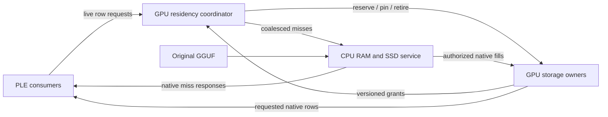

# QFN distributed and adaptive ngram storage

Status: implementation plan, 2026-10-19. This document extends
[Qwen Flash Next implementation and qualification](QWEN_FLASH_NEXT_IMPLEMENTATION.md).
It records the requested target; it does not advertise unfinished runtime modes.

Current repair slice, build42: the adaptive fixture now retires its previous
public request before retaining the source, preserves its forward-only
observations, and starts a separate ordinary-generation observation window on
the same owners. Both native backend retirement regressions and the fast
counter-window tests pass in the
[821/821 focused gate](../../../../parity-results/qwen-flash-next/focused42/result.json),
which includes complete Unit and all affected lifecycle tests. There are no
skips or driver faults. The complete all-target build and no-work repeat pass.
The two retained-source regressions also pass
[20 repetitions per backend](../../../../parity-results/qwen-flash-next/adaptive-retirement-repeat42/result.json)
with clean driver retirement.
The worker's strict idle/joined guard is unchanged. Actual full-model generation
activity and a fresh complete prerequisite gate remain pending.

Previous repair slice, build41: the two cold-capture regressions pass on CUDA
and ROCm, along with all 814 registrations in the
[focused run including complete Unit](../../../../parity-results/qwen-flash-next/focused41/result.json).
The complete rebuild and no-work check pass; original-code controls reproduce
both the premature protocol read and the independent admitted-only gather
rejection. Full prerequisites and the five targeted model reruns have completed.
No numerical arithmetic or cache-policy optimization changes in this slice.

Latest complete gate, build41 (2026-10-20): the prerequisite gate passes
747 Unit and 1,528 production-preflight registrations, with 29 explicit hardware
skips, no failures and clean driver retirement. Its
[canonical receipt](../../../../parity-results/qwen-flash-next/prerequisites-main-41/prerequisites.json)
applies only to that source/binary. Fresh source repairs need a fresh gate.

The four build41 real-model adaptive cases now pass cold capture and complete
all eight canonical numerical/prefix/path artifacts on CUDA and ROCm, at both
C0 and C64. The later fixture observer incorrectly requests retained source
ownership while the suffix-prefill worker is still active. Its strict idle/joined
guard remains correct. Build42 implements the existing public request reset,
preserves forward-only evidence separately, and then invokes actual public
generation on the same retained owners before checking the complete GPU/source counters.
Current runs do not publish that complete activity proof. The exact cells,
remaining numerical failures and clean retirement are recorded in the
[model41 results](../../../../parity-results/qwen-flash-next/model41-runtime-repairs-summary.json).
C64 means 64 slots per tier with a 1 MiB physical budget. Reported KL is identical
between capacities within each backend; no full-model cache benefit is inferred.

Build39's lexical cache-control optimization passes all
[28 native component cases](../../../../parity-results/qwen-flash-next/adaptive-component-timing39-a/result.json)
with exact outputs, ordered policy and traffic. Warm-VRAM prefill time improves
about 25% on ROCm and 6–8% on CUDA, but remains slower than source-only. Cache
economy is still open; these Integration measurements do not qualify Release
or full-model performance. Further cooperative policy candidates remain private
and unexecuted while the runtime blockers are repaired.

The completed main-model and hybrid controls remain numerical red. The
[main plan's current evidence](QWEN_FLASH_NEXT_IMPLEMENTATION.md#current-evidence)
records their KL and the router/QKV decompositions, including actual operand
attribution and the measured two-term Q8 component improvement. The CPU MTP
zero-normalization repair now reaches a later one-row projection rejection.
No thresholds or defaults change.
Native variable-size collectives and pooled adaptive TP remain uninstalled;
component work does not qualify distributed storage, MTP serving or HTTP.

## Next distributed runtime slice

The first complete pooled slice will use one homogeneous, rank-local full-main
TP domain, including zero-capacity GPU members. Actual TP members own their
physical slots; one coordinator owns policy and one existing CPU RAM/SSD service
handles source misses. PP, EP and heterogeneous ownership remain later explicit
slices, with their own functional and performance gates below.

The implementation review identifies three production responsibilities still
missing beyond the existing physical-owner components:

- Separate the coordinator's row directory and policy from owner-local slot,
  pin and generation authority. Compose their typed BOMs into the same PMA;
  do not also charge or retain the combined single-GPU ownership structure.
- Issue one device-owned lookup-frame ordinal for every invocation, including
  empty and all-hit frames. The source request sequence advances only on misses
  and cannot serve as that ordinal. Peers adopt the coordinator's frame identity;
  original source, admission and full slot generations remain distinct.
- Add directed commands with device-owned live counts through the existing
  native transport boundary. Each owner receives only its commands. The ragged
  reply AllGather is appropriate only when all authenticated TP consumers need
  those native rows. Broadcasting otherwise unused commands for convenient
  validation, padded sends and host count readbacks are not acceptable.

Connect these through the original `ModelContext` storage roots, Rank-issued
`Qwen4ExpReplicatedPLECohort`, DGO-issued query/history and participant-local PLE
stages. Owner fill validation must distinguish the opaque global promotion token
from owner-local slot generation. Qualification must cover repeated all-hit/U0
frames, coordinator C0, unequal capacities, duplicate pins, stale ACKs, failure
retirement and actual live wire extents before this mode becomes selectable.

### Fixed-phase captured allocation protocol

The coordinator implementation must use a bounded set of collective phases on
both CUDA and HIP. A per-miss free-probe/reply loop whose collective count depends
on device results is not a valid HIP graph implementation. After all initial
hits are pinned, free capacity can only decrease within that admitted lookup
frame. Therefore the first F distinct initial misses in observation order are
exactly the misses that can receive the F available free slots.

Use owner-issued availability leases to freeze actual free allocation while
the coordinator forms one free-allocation plan. Owners remain the sole slot,
pin and generation authority. Commit actual free commands, consume actual
grants, then replay frequency/recency metadata in original observation order
and publish one distinct-victim plan. Unobserved free grants are not directory
hits and must be included in cancellation retirement. Pending victim records
may identify the old occupied slot; they must not invent a new generation or
publish readiness before the owner grants and fills it.

Cancellation stops new source requests and readiness publication, but drains
an already accepted immutable allocation plan under its original frame and
leases. An accepted victim eviction is a legitimate committed action. Before
plan acceptance, close the unused lease without victim mutation. Stale identity,
validation failure and a poisoned frame are fatal states, not permission to
enter this cancellation drain. Tests must cover both sides of each acceptance
boundary, duplicate misses, free-before-victim ordering and all receipt cleanup.

Directed transport also needs one cold-admitted operation identity minted by
the original `LocalTPContext`. Bind its complete ordered participant set and
common transport-bank stride there; reject conflicting declarations before any
enqueue. Payload extent still comes only from device-live counts. Independent
per-stage capacities cannot define chunking on two endpoints. Qualify unequal
capacity rejection, foreign/replaced handles and replay with live empty peers.
Transport banks, connection storage and endpoint lifetime need canonical PMA
ownership before this becomes a selectable distributed mode. Existing ring
readiness is not proof that directed P2P connectors have been materialized.

### DeepInfer-informed economy work

The [DeepInfer research](DEEPINFER_INFERENCE_RESEARCH.md) adds two relevant
experiments while the distributed QFN implementation is being completed:

- Schedule device-counted communication beside independent participant-local
  work through explicit graph edges. Compare the serialized dependency path
  with actual overlap and include transport SM use and contention in the
  critical-path measurement. Commands go only to their owners; native row
  replies reach only authenticated consumers. Reuse an existing exchange only
  when its participants, data dependencies and publication boundary match.
- Use measured per-step demand and service cost to evaluate later placement
  changes. VRAM/RAM/SSD budgets, original bytes, source-read cost and promotion
  traffic remain part of the comparison. Better hit rate or balance alone does
  not demonstrate a faster cache. This experiment extends the existing typed
  policy and PMA inputs; it adds neither a host-owned routing mirror nor a
  second capacity ledger.

The immediate DeepSelect sparse-attention experiment belongs to the
[main QFN plan](QWEN_FLASH_NEXT_IMPLEMENTATION.md#deepinfer-informed-optimization-slice--2026-10-20).
Its top-512 attention pools are independent of ngram-cache admission. Keep
selector, expert scheduling and storage-policy comparisons separate, with the
same prompt tokens, arithmetic, topology, cache budgets and warm/cold state.
Continue the functional/performance matrix below: exact original-format
outputs, captured cancellation/retirement, full/small/empty replay, actual wire
bytes, bounded tier occupancy and complete-request Release time. New production
defects receive focused preflight regressions. These additions do not qualify
the still-private distributed implementation or relax numerical gates.

## Explicit single-GPU diagnostic selection (installed, model-unqualified)

The installed bounded mode provides lossless `gpu-adaptive-vram-ram-ssd` CLI/YAML
selection and four canonical main-model diagnostics: CUDA+CPU and ROCm+CPU,
StaticOrdinal/MTP-off, each C0 and bounded positive GPU/RAM caches. Positive
cells require actual nonzero grants in both tiers. Their GPU eight-expert
quota is selected before planning; cache pressure cannot reduce frozen expert,
KV or graph grants. These use the existing main-GGUF discovery, production
runner, checkpoints, prefix/reset and path gates. Original main20, host-adaptive20
and fixed-head64 remain distinct. No Auto/default/E2E eligibility changes.
CLI, typed admission and component lifecycle regressions pass. The four real
model attempts complete numerical/prefix work and expose the observer lifecycle failure above;
no full-model numerical, serving or economy pass is claimed by this inventory.

## Required outcome

Serve one immutable native ngram table across multiple devices and storage tiers.
At the same time, some rows may live in VRAM, others in RAM, and the remainder
may be served from the original SSD-backed GGUF. Prefer VRAM, then RAM, then
SSD. Ngram bulk storage remains the lowest-priority VRAM admission obligation.
After admission, promote useful rows and evict colder rows within bounded
reserved capacity. Replication remains an explicit supported placement policy;
sharding must make the capacity of several cards useful without requiring a
complete table copy on every consumer.

Support CPU-only, CUDA+CPU, ROCm+CPU and composed CUDA+ROCm+CPU execution. TP,
PP and expert-parallel placement must distinguish storage owners from lookup
consumers. Piggyback on existing communication where ordering, participants and
payload semantics permit it. Otherwise declare the required lookup exchange in
the graph and measure its cost.

The implementation must preserve original quantized rows, captured execution,
exact stream/event ownership, and the single PhysicalMemoryAuthority ledger.
It must remain economical under cold starts, skew, cache churn, empty owners,
small budgets and requests whose working set exceeds every cache tier.

## Current baseline and the gap

The current `ImmutableRowTablePolicy` selects one concrete tier for a whole
table. `ResolvedImmutableRowTablePlacement` records complete VRAM copies at
actual GPU PLE consumers, or a rank-owned RAM/mmap table. Expert-only devices
and PP stages without PLE are not currently storage participants. This cannot
represent partial tier residency or distributed row ownership.

The source table has 320,001,536 rows, each containing 160 IQ4_NL elements in
90 native bytes: 28,800,138,240 bytes in total. Its size makes full replication
impractical on many useful topologies. It also makes accounting for cache
metadata and communication amplification material.

Current admission evidence, build29:

- All 32 real-source setup cases pass: 20 main RAM/mmap configurations, nine
  paired-source MTP cases and three serving-tier cases, with clean driver
  windows and teardown. The shifted-prefill read/write distinction and resolved
  singleton-domain fixture checks have explicit preflight regressions.
- Whole-table CPU and CUDA automatic RAM placement pass. The complete table in
  VRAM passes in ROCm0/ROCm1/CPU0 PP with layer counts 1/1/46; ROCm1 alone owns
  the table, with no full host mirror.
- All 50 focused registrations have passing evidence across the original run
  and the corrected singleton-fixture follow-up. The subsequent build30 gate
  passes 746 Unit and 1,365 preflight registrations, with 26 explicit hardware
  skips. Fresh CUDA/ROCm numerical attempts expose a missing storage-service
  terminal retirement at standalone-prefill request reset. Its installed repair
  passes build31 captured RAM/mmap lifecycle regressions on CUDA and ROCm;
  current-source full prerequisites and model reruns remain pending. Setup success does not
  certify numerical inference, dynamic MTP execution or end-to-end performance.

The native layout metadata foundation is installed with a 19-case explicit
preflight regression. It validates separate owners/consumers, fixed ranges and
replicas, adaptive slot counts, allowed zero-capacity tiers, exact source extent,
explicit SSD service and directory bounds. It does not choose free capacity,
materialize storage or duplicate PMA accounting. The existing whole-table
placement uses it for construction validation only; public policy/wire round
trips and mixed/distributed runtime integration remain to implement. Adaptive
no-SSD configurations fail precisely until their last-readable-copy protocol
exists.

A bounded CPU RAM-over-SSD component and closed provider have passed 24 focused
tests repeated 20 times, plus four independently compiled assertion-failure
controls. Original canonical table/ModelContext tests, the additional actual-lease
owner-observation cases and complete serving integration remain pending. Its candidate
policy uses aged frequency for admission and probation/protected logical recency
for eviction; it does not claim a global aged-frequency victim order. Comparative
trace/economy tests and integration must qualify the eventual serving policy.
No adaptive serving mode or default is advertised by the metadata foundation.

The next complete serving slice is one CPU-owned adaptive RAM/SSD provider shared
by direct CPU and hosted GPU consumers. It must extend the existing requested and
resolved placement alternatives, include mandatory source/request scratch before
cache capacity selection, and select fitting optional cache slots through the
existing complete PhysicalMemoryPlan and its source-owned BOM. Retained reuse
must observe actual storage and staging leases on the original PMA. Adaptive
operation must have its own truthful observations rather than be labelled as
whole-table mmap. GPU adaptive ownership, remote owners and sharding remain later
slices with their own native protocol and economy qualification.

The first fixed-head sharding components compile, and their checked-source-range
and CUDA/ROCm native primitive regressions pass in build31. Checked original-source
ranges divide the 16 head groups across homogeneous rank-local TP degrees 2/4/8,
preserving unequal vocabulary sizes, internal gaps and trailing source bytes.
Range uploads retain full-source metadata identity and use the existing PMA and
bounded TransferEngine loader staging. CUDA/HIP primitives validate exact local
IDs, exchange a fixed 8-byte validation header, pack live native rows and decode
rank-strided results. The primitive fixture stages peer data explicitly; it does
not certify a collective or selectable sharded serving mode. Actual cohort/rank,
replicated query/history, source-generation, graph and transport composition
remain required before exposing this policy.

The same 65-registration focused run passes 50 and fails 15, with no skips or
driver findings. Host-adaptive admission, stage and captured-lookup cases expose
one shared validation defect: a host request-row bound must price host execution
scratch without implying any GPU directory records. Build32 repairs that rule,
retains rejection of a foreign GPU coordinator and rejects attempts to reprice
an already declared host envelope. Its new device-free regressions are explicitly
registered in preflight. A separate exact typed ngram E2E selector is installed
for future qualification; QFN has no eligible E2E tag until model gates pass.

Build32 passes 65 of 69 focused registrations; the four remaining failures share
two CPU fixtures missing explicit worker/cache/ISA metadata. Their scoped repair
and all four reruns pass, including the complete affected Unit targets. Adaptive
CPU-stage/protocol/ModelContext and actual captured CUDA/ROCm lookup cases now
have focused passing evidence. The full unchanged build32 transaction now passes
746 Unit and 1,413 preflight registrations, with 26 explicit hardware skips,
no failures, and a clean driver window. CPU RAM/mmap and single-GPU hosted mmap
numerical campaigns complete all canonical artifacts, but strict numerical
checks remain red. Both complete and partial prefix restores reproduce fresh
native state exactly. The experimental CPU two-term HC/GDN candidate has
identical observations in all six numerical CSVs across RAM and mmap; worst
decode KL falls from 1.07722 to 0.053912. It remains experimental and unqualified
for performance. The main implementation document records the complete numbers.

The next coherent source batch builds and has focused native qualification.
It connects original fixed-head source ranges to actual native TP2/4/8 cohort
collectives, explicit VRAM selection, PMA admission and the canonical model
inventory. Native packets retain original quantized rows and exact live extents.
The first slice is homogeneous rank-local TP; it does not establish PP, EP or
heterogeneous distributed lookup support. Full-model distributed serving still
needs its own passing evidence.

Three actual model-run defects are included in the batch: workspace declarations
are explicitly nonexecutable while real nonchunked prefill borrows original
request geometry; hosted lookup admission publishes its retained protocol Tensor
on the exact native producer stream; and the parity fixture distinguishes exact
request-reset lifecycle counters from lookup-work counters. The hybrid model run
previously failed the first prefill frontier because that protocol owner remained
host-authoritative. Its focused regression uses the same strict executor check.

Fixed-head collective receipts additionally prove actual outgoing ring-send
bytes before projecting logical contribution bytes. Native counters accumulate
across launches; each participant and reset window is checked independently.
All defects have focused preflight registrations. Build33's complete focused
native run observes 232 registrations: 221 pass, eight fail and three skip,
with no driver findings. Captured sharded lookup passes on CUDA TP2, ROCm TP2
and ROCm TP4; the unavailable CUDA TP4/TP8 and ROCm TP8 cases remain unqualified.
Actual peer-failure cleanup and native ring-receipt tests pass.

Build34 repairs the remaining failures: exact three-query-head TP8 intervals
must retain original global GQA mapping instead of rounding local widths to
the replicated KV count; repeated hosted fixture capture must prepare its
current publication frontier; each deliberate host-poison overwrite must
publish host authority. GDN integrality and strict executor checks remain
unchanged. Nine new explicit preflight aliases cover original-head mapping on
CPU/CUDA/ROCm. Build34 compiles and completes 986 focused registrations:
982 pass, one stale Unit expectation fails and three hardware cases skip;
all nine new aliases and all eight prior failures pass, with clean driver health.
The fixture repair proves valid one-query replicated-KV TP8 capacity and rejects
genuinely empty query participants, adding one exact preflight registration.
The complete repaired MemoryPlanner target and that alias pass, including exact
CPU host-owner aggregation and distinct GPU-owner capacity.
A fresh full prerequisite transaction, real-model sharding, numerical parity
and Release economy gates remain required. These native component passes do not qualify
PP/EP, heterogeneous distributed lookup or serving-time VRAM promotion.

## Current implementation update — 2026-10-20

The repaired build34 transaction is green: 746 Unit and 1,489 preflight
registrations, with clean driver health. CUDA/ROCm hosted mmap numerical
controls complete, but strict mathematical parity remains red. Hybrid prefill
now completes; its first decode exposed a separate 512-expert runtime descriptor
publication bug on both GPU backends. The main implementation document records
its safe reproductions and pending corrected-core qualification. No storage or
model mode is certified by those partial results.

Build35 installs the first bounded single-GPU adaptive native component after
its CPU subordinate-read prerequisite. One source-issued prepared-storage owner
retains the original cache/frame/protocol roots and complete immutable plan.
Original native rows are preserved. Mandatory protocol/frame storage is separate
from optional cache payload and metadata; both contribute typed inputs to PMA.
All-hit frames issue no CPU request and do not advance source sequence counters.
Misses exchange only unique live native rows and required intent/ACK metadata.
Captured tests cover all 23 source formats, zero/one/bounded cache capacity,
full/partial/zero and large-to-small replay, hot replacement, all-pinned rows,
reset preservation and source/controller failures. These tests are authored
and in the coherent rebuild; their execution and economy evidence are pending.

The remaining single-GPU serving slice connects the explicit requested and
resolved layout to those same source-owned roots and actual physical claims.
The existing retained boundary will own the service interval, and the model
graph will borrow its original IDs/count/control owners. The optional cache
must consume only capacity left after frozen KV, row and expert obligations.
This work must not replace PMA, infer ownership from pointer equality, construct
per-graph cache copies, or turn a component-only factory into a selectable mode.
Distributed adaptive owners, PP/EP/hybrid exchange, live communication proofs
and the full functional/performance matrix below remain required after this
first integrated slice.

## Storage and ownership model

### One source, explicit layouts and bounded residency

The original GGUF remains the durable immutable backing for every row. Reuse
the existing source/tensor/format/extent and file-metadata identity. Do not make
new disk copies, hash the table payload, requantize rows, or retain a full RAM
mirror to support a GPU layout.

Keep three concepts separate in typed interfaces:

1. **Source identity:** original file, tensor extent, row format and row stride.
2. **Admitted layout:** storage participants, lookup consumers, distribution
   policy, allowed tiers, per-owner capacity and execution/transport resources.
3. **Live residency:** which source row occupies a reserved slot, its generation,
   publication state and outstanding readers.

Replace the single-tier placement contract with a sealed layout capable of
describing all these owners. Preserve exact single-tier operation as explicit
configurations of the new contract. Remove obsolete assumptions that one
consumer implies one full-table allocation.

Distribution and tier policy are independent:

| Policy | Required behavior |
|---|---|
| Replicated residency | Explicit copies at selected lookup participants or replica groups; every copy is charged. |
| Sharded residency | Native rows distributed across selected storage participants; consumers request only rows they need. |
| Fixed residency | Admitted ranges stay at their selected locations for the model lifetime. |
| Adaptive tiering | Bounded residency changes within allowed tiers; the original GGUF serves runtime misses only when SSD service is enabled. |
| Strict tier selection | Use the specified tier/layout and fail admission precisely when it cannot fit. |

The final CLI/config schema must express these choices and budgets losslessly.
Exact option names follow the code-owned configuration review. No configuration
may silently enter another execution mode after allocation or transfer failure.

The source GGUF may be read during initial preload for any layout. Disabling
runtime SSD service means the allowed RAM/VRAM tiers must retain complete source
coverage. Movement must reserve and publish an allowed-tier destination before
retiring the last allowed-tier copy. Such a layout may move or replicate rows,
but may not drop its only readable copy and later fetch it from disabled SSD.

### Rows for data, slabs for allocation

The original native row is the lookup, validity and transfer unit. Allocate
bounded slabs and slot directories before capture. Coalesce adjacent requested
rows where useful, while retaining original row IDs and exact output ordering.
Do not make a one-row lookup transfer an entire cache page for convenience.
SSD mapping/page-fault amplification is a separate storage cost and must be
reported separately from requested native bytes.

Full-resident contiguous ranges may keep implicit direct indexing. Adaptive
caches need explicit row tags and slot generations. Price those tags, indexes,
pins, free-slot structures, queues and replacement metadata for their admitted
maximum capacity. Measure the metadata cost against the 90-byte payload; avoid
a compulsory table-sized mutable directory for a small cache.

### One authority for each kind of state

PhysicalMemoryAuthority remains the authority for physical admission, leases,
materialization and release. Cache occupancy is a subdivision of already leased
storage, with no independent free-memory ledger.

GPU cache directories, request routing, slot reservation, pins and replacement
decisions remain device-owned. CPU cache metadata belongs to the explicit CPU
storage service. Communication between these authorities uses versioned,
bounded requests and acknowledgements. The ordinary host must not maintain a
mutable shadow of GPU residency or read device counts to decide routing.

For the initial adaptive implementation, select **one explicit GPU residency
coordinator per lookup domain**. It owns the bounded row-to-residency directory
and replacement scores. CPU-only domains use a host coordinator. A CPU service
must never coordinate or mirror mutable GPU slot locations. Fixed full-resident
layouts retain their direct lookup path where mutable routing is unnecessary.

The GPU coordinator's directory capacity is bounded by admitted GPU cache
slots plus mandatory in-flight requests, rather than by the entire source
table. Its record maps a row to an immutable grant from a physical owner. That
owner alone controls its free slots, slot generations and reader pins; the
coordinator does not keep a second pin count. RAM services retain their own
host-owned row directories and do not retain GPU location state.
Every consumer in a GPU-cache lookup domain, including a CPU PLE consumer,
uses that coordinator or an authenticated explicit replica. An independent RAM
lookup/re-admission path must not bypass exclusive-promotion invalidation.

Any row may occupy a slot on any eligible storage GPU. Prefer a suitable local
slot, then available slots elsewhere in the admitted pool, before evicting a
useful row. Source-range assignment must not impose a per-home cache quota that
strands another GPU's available space. The coordinator sends bounded native
reserve/pin/fill/retire requests; owners return generation-scoped grants. Data
can move directly from the storage owner to the actual consumer without passing
through the coordinator.

This deliberately bounds the first protocol's complexity. Charge the directory
once and every owner's slot/grant metadata once in the PMA capacity solve.
Coordinator memory and throughput are explicit capacity/economy constraints.
Measure them before considering a distributed-directory implementation; such an
implementation would require a separate ownership proof. Participant-local
graphs perform the work, with movement and coordination as explicit graph edges.

The coordinator carries bounded routing metadata. Payloads take their declared
owner-to-consumer or promotion route. Every box uses PMA-admitted storage; the
diagram does not introduce an independent allocation authority.

The default sharded policy should maximize unique cached rows across VRAM and
RAM. Extra hot replicas require an explicit replication policy and separately
charged slots. Temporary source/destination overlap during a transfer is safe
only while both slots are reserved and their publication/retirement is ordered.

## Admission and capacity fitting

Plan in this order using typed BOM inputs to the existing authority:

1. Include mandatory lookup execution in the candidate's fixed BOM before
   expert quotas and graph rows are finalized: maximum-live counted packets,
   native-row scratch, deduplication/order restoration, routing metadata,
   service queues, graph storage, transfer staging and bounded in-flight work.
   Use the existing typed execution envelope where candidate modes differ.
2. Resolve and freeze the engine plan with that complete fixed BOM: model
   weights, routed-expert quotas, KV/recurrent state, graph rows, prefix-cache
   commitments and other mandatory engine resources.
3. Fit ngram storage into the remaining permitted VRAM budgets, then RAM
   budgets. When runtime SSD service is enabled, the source supplies the
   remaining logical table. Otherwise require complete allowed-tier coverage
   or fail admission.
4. Seal exact source coverage, owners, consumers, replica groups, capacity,
   NUMA policy, transport membership and graph identities before materializing.

Capacity-dependent slot tags, generations, pins and replacement metadata must
be part of the same checked bulk-capacity solve; they cannot appear as a late
unpriced execution obligation.
All tiers and replicas count their real physical bytes. Do not reduce already
frozen expert quotas or admitted context merely to retain more ngrams.

Users need bounded per-tier budgets and explicit storage-participant selection.
Automatic placement uses actual remaining admitted capacity within those limits.
Unequal cards receive unequal shares; a shard must not assume an even split.
CPU execution uses RAM/SSD without inventing a VRAM participant.

Admission reserves capacity. Adaptive caches fill on demand, with a separately
declared bounded warmup policy if requested. Fixed resident layouts may preload
their ranges. Warmup is initial I/O and must retain its own measurement boundary.
Runtime promotion changes contents within the reservation. Capacity changes
require an explicit quiescent PMA readmission and authenticated graph identity.

## Runtime cache policy and lifecycle

Use a bounded frequency-and-recency policy with aging, a probationary region,
and scan resistance. Fill available higher-priority slots first; once full,
admit/promote candidates according to their value relative to replaceable
residents. Each residency owner publishes its policy order. The CPU service
mints an ordinal under its existing owner mutex for each successful call; callers
and independent hosted channels cannot supply a global sequence number. GPU
coordinators likewise own their published ordering, using authenticated request,
participant and logical token/head identities within a batch. Admission and aging
follow that owner order, with explicit ties for eligible victims. The CPU candidate
uses aged frequency for admission and probation/protected logical recency, row ID
and slot ID for victim ordering; it does not implement global LFU eviction. Native
lookup bytes and model results remain invariant under every legal interleaving.
Benchmark actual QFN traces and alternative policies before fixing constants or
promoting this candidate into serving defaults.

A promotion follows this lifecycle:

1. Locate the authoritative row record and coalesce duplicate demand.
2. Reserve a destination slot and acquire the necessary source/read leases.
3. Transfer the original native bytes on the exact producer stream/service.
4. Publish the destination generation only after the transfer completion edge.
5. Route new reads to the published residency; retire the old residency after
   its final reader releases it.

For an exclusive RAM-to-VRAM promotion, the host service supplies a row read
lease and acknowledges a generation-matched invalidation of new RAM reads
before the coordinator publishes the GPU locator. Existing readers may finish
on the retained old slot. A delayed host fill cannot re-admit an obsolete row
generation. Copies, directory publication and physical retirement are distinct
operations with distinct acknowledgements; their ordering must avoid waiting
for a consumer that is itself waiting for publication.

Model this with typed states such as empty, filling, ready/pinned and retiring.
Prevent stale completions, ABA reuse, duplicate ownership, eviction of readers,
and partially published rows. A failed transfer fails the request explicitly;
it does not publish a ready slot or switch execution modes.

VRAM eviction may demote a still-useful row to RAM. With SSD service enabled,
RAM eviction may drop its cached copy; the immutable source already exists on
SSD. Without SSD service, eviction requires another published allowed-tier
copy, or a completed migration to a reserved allowed-tier slot. There is no
dirty writeback. Promotion and demotion have bounded work/byte budgets and must not
starve inference. Distinguish a cache miss from a prefetch or promotion when
recording statistics.

An admitted batch may be larger than available cache capacity, and all cache
slots may temporarily be pinned. The tiered protocol must still serve that
batch through its mandatory bounded response scratch, with pins released at
explicit consumption boundaries. Read an existing allowed-tier residency, or
the original source only when SSD service is enabled. With SSD disabled,
admission and movement must have preserved a readable allowed-tier residency.
Caching an additional answer copy is optional; satisfying the lookup is
mandatory. This avoids circular waits for evictable cache space.

GPU graphs retain stable slab/directory pointers. Kernels resolve live slot
generations at execution time. Cache replacement must not rebind embedded
pointers, allocate GPU memory, recapture graphs or synchronize the host on every
lookup. Request reset preserves valid warmed table residency. Model/source
retirement and cancellation drain readers/transfers before releasing leases.

Keep three generations distinct: immutable source identity, physical
arena/storage generation, and mutable per-slot residency generation. Source,
physical storage, topology, capacities and policy constants authenticate graph
identity. Slot generations are execution operands that change safely during
replay; changing a cached row does not invalidate a captured graph.

## Topologies and communication

| Topology | Storage and scheduling contract |
|---|---|
| CPU-only | Shared rank-owned RAM cache and bounded SSD service, with explicit NUMA placement. |
| Homogeneous TP | Shards or replicas across declared storage GPUs; each PLE consumer obtains its own ordered rows. Existing token distribution may make another row-ID broadcast unnecessary. |
| PP | A stage without PLE may own storage. Its lookup service must run before the PLE consumer waits for data, independently of that stage's ordinary activation receive. |
| Expert parallel | Expert-only participants may store rows without becoming PLE compute owners. Lookup service membership is separate from routed-expert assignment. |
| Hybrid CUDA/ROCm/CPU | Explicit heterogeneous transport boundaries and admitted native-row staging; each backend retains its own captured transaction and exact event ownership. |

Storage-only participants need complete participant-local service transactions,
launched and joined by the existing orchestration machinery. Do not hide a
multi-device service inside an ordinary compute stage or attach it behind a
receive that depends on the lookup completing first.

Requests carry row IDs, live counts and the metadata needed to restore order.
Replies carry requested native row bytes and publication metadata. Deduplicate
within an admitted batch where worthwhile; fan out a row only to actual
consumers. Empty participants exchange only progress metadata. Storage capacity,
query bucket size and unused slots never determine communication extent.

Use existing communicator/transport ownership. Piggyback is allowed only if:

- the exchange is before the consumer's lookup dependency;
- its participant set contains the required storage owners and consumers;
- its payload supports counted native bytes without altering arithmetic; and
- its capture/liveness protocol supports the extra producer and completion edges.

QFN PLE precedes layer1 attention and expert routing. Ordinary MoE dispatch and
return exchanges therefore occur too late to carry this lookup's answers.
Appending quantized rows to a floating-point allreduce is also invalid. Existing
input distribution, eligible earlier-stage exchanges and explicit worker-control
messages are candidates for sideband integration; each requires a concrete DAG
and measured byte/launch comparison. A shared communicator alone is not proof
that an additional collective has been avoided.

Establish the correct compact exchange first. Install a piggyback optimization
only after proving the same ordering, payload, empty-owner and replay contracts.

### Concrete TP optimization

The current QFN schema replicates PLE computation and its hash/gather outputs
inside a TP domain. When the actual token-count and accepted-history contracts
prove that queries are identical, shards aligned with the source's hash-head
ranges can compute their requests locally. They then exchange only the owned
native results, eliminating a separate query exchange. Restore the canonical
head/row order before decoding on each actual consumer.

Equal owned-head counts can use the existing equal-live-prefix byte gather.
Unequal ownership requires an explicitly counted varying-size exchange; never
pad fake head slots. Generic row sharding and adaptive remote residency still
need their own authenticated routing protocol. This optimization reduces
communication without changing the table's native arithmetic.

An early query producer is another candidate: hashes depend on token IDs and
prior lexical history, rather than hidden activations. Hoisting that producer
requires an explicit history read lease across prefill, verification and rollback.
Only then can an earlier existing exchange be considered as its sideband anchor.

## Code-owned integration boundaries

- `ImmutableRowTablePolicy`, `ResolvedImmutableRowTablePlacement` and
  `ImmutableRowTableAdmissionWire`: evolve the existing policy/placement/wire
  authority; replace scalar whole-table tier assumptions coherently.
- `ImmutableRowTableExecutionProvision` and
  `ImmutableRowTablePlacementPlanner`: contribute complete typed execution and
  storage BOMs to PMA, including capacity-dependent metadata.
- `ImmutableRowTable`, `ResidentImmutableRowTable` and `ModelContext`: retain
  source authentication, exact setup events and source-wide preparation/failure
  lifetime, while materializing the actual storage owners and native slices.
- `Qwen4ExpPLEBuilder` and reusable graph machinery: declare lookup work and
  lower it into local probe/pack/read/decode stages plus explicit exchanges.
  Model files must not orchestrate remote devices imperatively.
- `TransferEngine`, native collective interfaces and captured channels:
  retain exact producer-owned extents and events. `NativeCollectiveRows`
  currently describes equal live prefixes; it is not a ragged all-to-all ABI.
  Add the necessary typed counted-packet operation instead of weakening that
  contract. Current same-process captured channels do not certify cross-rank
  transport; global TP/EP needs its own complete transport and lifecycle gate.
- Pipeline and expert-worker orchestration: launch independent lookup service
  branches before any dependent activation/route receive, and join every branch
  at transaction retirement. Do not hide a new service in an existing activation
  payload or expert residency epoch.

Service progress is part of the protocol proof: a receive/poller must not block
the stream that launches its producer, and waiting gathers must not occupy all
execution resources needed by service kernels. Test these conditions with
delayed publishers and constrained resources, using immutable phase/ticket
ordering and the existing complete-transaction execution policies.

## Observability

Publish immutable terminal observations through PerfStats and `/stats`, with
the existing reset epoch and freshness contracts. Include:

- configured budgets, leased/occupied bytes, unique native rows, replica bytes
  and metadata bytes for each tier/device;
- lookups, unique requested rows, local VRAM hits, remote VRAM hits, RAM hits,
  SSD-service misses and uncached responses;
- promotions, demotions, evictions, rejected admissions, pinned-victim skips,
  stale-publication rejections and in-flight high-water marks;
- logical requested bytes versus actual transfer bytes per route, metadata
  bytes, exchange launches and proven piggyback counts;
- lookup wait, transfer, service and promotion time, plus warm/cold prefill,
  decode and TTFT measurements.

Define row hit rate as hits divided by requested rows, with tier categories
that sum correctly. Keep mmap-window hits separate from OS page-cache hits or
physical SSD reads. Stats reads must not probe or synchronize devices, and
resetting measurement counters must not flush table residency.

## Implementation sequence and gates

1. **Close the current admission slice — complete for setup in build29.**
   The shifted-prefill repair and domain-identity regressions are installed;
   all 32 MTP/main/serving admissions pass. Preserve their exact RAM/mmap/VRAM
   evidence while qualifying numerical execution separately.
2. **Replace the placement contract — metadata foundation installed.** Checked
   owners, consumers, native ranges/slots, allowed tiers and directory bounds
   have focused regressions. Complete exact planning, physical BOM, public
   wire/document round trips and negative controls, then remove the remaining
   whole-table/single-tier assumptions from the shared execution boundary.
3. **Build the adaptive cache core.** Implement bounded CPU RAM/SSD service and
   residency lifecycle, then the equivalent CUDA and ROCm slot/directory kernels
   and exact event publication. Prove single-device mixed-tier execution before
   adding remote service.
4. **Implement distributed lookup.** Add explicit compact request/reply stages
   and storage-only participant scheduling. Qualify TP, PP and EP placements,
   uneven budgets and mixed backends. Prove unique capacity and actual wire
   extents under skew before exposing sharded adaptive configurations.
5. **Optimize eligible communication.** Measure standalone exchange overhead,
   implement proven sideband opportunities, and retain exact byte/order tests.
   Tune CPU threading/NUMA and CUDA/ROCm kernels with production compiler and
   spill settings; retain a direct fast path for fully resident layouts.
6. **Qualify the complete model.** Run same-GGUF PyTorch parity for integer
   lookups and model stages, serial/grouped MTP, resets, prefix reuse and long
   sessions across every supported placement. Keep complete Unit and relevant
   backend gates green, then run production preflight and Release benchmarks.

Each step ends in a small coherent tested slice. Unfinished selectable modes
fail precisely until their implementations and gates exist. Use focused gates
during tuning; broaden qualification when the integrated slice is ready.

## Functional and performance qualification strategy

Comprehensive coverage means every supported execution configuration has a
functional proof and a performance record, with exhaustive cheap contract
tests underneath it. It does not mean multiplying every synthetic row size by
every expensive model load. Factor a dimension out of a full-model campaign
only when the same tested primitive, descriptor and ownership protocol execute
in both cases. Record that equivalence; a new implementation branch creates a
new test obligation. Pairwise sampling cannot replace coverage of different
tier, transport, ownership or captured-execution protocols.

This section specifies work to implement. It does not claim that the new
configurations, registrations or benchmarks already exist. The canonical
[testing workflow](../../../../.agents/llaminar-testing/SKILL.md),
[parity framework](../../../../tests/v2/integration/parity/README.md) and
[production CI workflow](../../../production-ci.md) retain authority over
commands and certification.

### One typed configuration inventory

Extend the existing framework instead of creating a QFN-specific matrix runner:

1. Extend `ModelParityDefinition`'s `features.ngram_storage` with the complete
   typed storage profile: allowed tiers and budgets, fixed/adaptive residency,
   distribution/replicas, owners/consumers and warmup policy. The present field
   selects only a whole-table tier. Production policy types, not duplicated
   test enums or generated-name parsing, own compatibility and validation.
2. Use the QFN definitions in `tests/v2/integration/parity/qwen4exp/`,
   `expandModelParityDefinition()`, `ModelParityCase`, and
   `discover_v2_parity_tests()`. Preserve the existing 20 main mathematical
   declarations, three serving-admission declarations and nine paired-source
   MTP-admission declarations, then assert the exact intended additions. Setup
   declarations are not numerical passes.
3. Carry the profile through `ModelParityRuntimeExport.h`, configuration
   documents, startup resolution and `model_parity_inventory.py` without losing
   policy, budget or physical endpoint identity. Add round-trip tests and
   malformed/missing-field negative controls. Production-default benchmark
   projection may remove stress-only settings; it must retain the storage
   configuration that gives the benchmark its identity.
4. Extend `ModelParityE2ESelection` to match the exact storage profile before
   adding QFN HTTP/benchmark tags. It currently lacks an ngram selector and
   requires exactly one match: tagging the existing RAM/mmap definition would
   match both. Test ambiguous, missing and overlapping selections explicitly.
   QFN currently has no eligible E2E tags, so adding a microbenchmark alone
   cannot qualify it through the canonical Release benchmark runner.
5. Derive the expected inventory from the typed valid records and assert exact
   equality with GoogleTest, generated CTest and exported campaign identities.
   Report coverage by configuration and scope, including requested/completed
   subsets. Reject duplicates, missing cells, unexpected skips and empty
   selections. Do not maintain another Python/workflow topology list or invent
   a future total before the typed definitions exist.

The source-authored inventory enumerates each supported combination and each
explicitly rejected combination. Numeric budgets and sizes use exhaustive small
domains and checked boundaries. An infinite integer range is not an infinite
benchmark matrix; dispatch totality beyond measured points is still required.

### Configuration dimensions and required combinations

| Dimension | Required coverage |
|---|---|
| Tiers | All seven nonempty VRAM/RAM/SSD masks, with supported configurations executed and invalid ones precisely rejected. Without SSD service, admitted fixed coverage must satisfy every possible source lookup; the durable GGUF's existence is not permission to use a disabled tier. Include strict whole-VRAM, whole-RAM and mmap operation. |
| Layout | Replicated, disjoint sharded, and explicit bounded replicas of shards where supported; fixed and adaptive policies have distinct identities. Exercise automatic priority fitting and strict manual placement. |
| Capacity | Zero optional cache slots; less than one row plus metadata; one slot; exact fit and one row over; below/equal/above the live working set; unequal per-owner budgets; table larger than aggregate fast tiers. Mandatory execution scratch remains separately admitted. |
| Owners and consumers | Same-device, remote owner, consumer with no payload, storage-only owner, CPU PLE consumer inside a GPU-cache domain, unequal owner/consumer counts, empty owner and skew concentrated on one source range. |
| Topology | CPU-only; CUDA+CPU; ROCm+CPU; CUDA/ROCm/CPU; local, TP, PP, EP and supported compositions. Separate rank-local, cross-rank, peer and explicitly supported no-peer transports. PP coverage places PLE and its storage before/after other stages; EP includes expert-only storage participants. |
| Native data | Every supported format/codebook from `EmbeddingVerifierFormats.h`, valid row/block widths, and exact integer IDs. QFN's IQ4_NL width160/90-byte row is mandatory. Unsupported geometry fails explicitly. |
| Work shape | Decode M1, every supported small grouped-verifier row count, all supported M in the declared correctness sweep, tile/bucket boundaries and admitted maximum. Include M512, M1024 and M2048 where supported; live0/1/partial/full, empty participants and dirty large-to-small-to-zero replay. |
| Execution | Ordinary prefill/decode; supported MTP off/fixed/dynamic modes; zero/partial/full acceptance; request reset; fresh/full/partial prefix restore; static/dynamic expert placement and ordinal/random ownership through the standard profiles. |
| Host policy | AVX2/AVX512, every positive supported thread count for component correctness, exact CPU/NUMA placement and both RAM and actual SSD sources. |

Cross storage profiles with each supported topology/execution family through
the canonical expander. Exercise coupled risks together: adaptive tiering with
MTP rollback and prefix restore; remote storage with expert movement; PP service
with a waiting activation receiver; and mixed backends with simultaneous RAM
and SSD misses. Testing those features separately is insufficient.

Do not infer general MTP support from the nine admission tests. The present
main-model parity definition disables MTP. Extend source prerequisites and
reference bindings for the authenticated predictor sidecar before registering
active numerical cells. The standard fixed-depth diagnostic profile includes
1/2/3/15 where supported; routine generation certification remains off/dynamic.

### Device counts and hardware obligations

Metadata/planning/protocol-state tests cover 1, 2, 4 and 8 participants, with
owner counts independent of consumer counts. Include uneven budgets, empty
owners and concentrated demand at every count. These tests require no GPUs.

Native qualification on the current hardware uses CPU-only, one CUDA, one
ROCm, two CUDA, two ROCm, four ROCm, mixed two-CUDA/two-ROCm, asymmetric mixed
one-CUDA/three-ROCm, and the full two-CUDA/four-ROCm pool. CPU RAM/SSD services
remain explicit participants. Use legal homogeneous TP groups and declared
heterogeneous boundaries; do not invent a mixed NCCL/RCCL communicator. Vary
storage-owner counts independently of compute counts and test storage-only
PP/EP participants.

Register native eight-GPU cases with exact hardware requirements and run them
on an eight-GPU worker when available. This host has six GPUs; synthetic-eight
success is not native-eight or performance evidence. Missing required hardware
is a visible pending qualification obligation, never a green skip. A supported
transport needs its own real multi-rank test; same-process channels do not prove
cross-host behavior.

Full-model cases must also satisfy QFN head/layer/expert divisibility and actual
admission. A lookup test with eight storage owners does not establish TP8 model
support. Keep the same model for scaling comparisons; report a precise capacity
failure rather than substituting a smaller model under the same identity.

### Fast contracts and admission tests

Extend `v2_test_memory_planner`, `v2_test_qwen4exp_metadata`, existing parity
definition/export tests and the CPU primitive fixtures. Unit remains device-free
and completes in seconds. Use complete products of the small policy, topology,
row-geometry and state-machine domains to prove:

- lossless config/wire round trips, source identity, complete/disjoint native
  coverage, intentional replica accounting and rejection of gaps or overlaps;
- exact PMA BOMs for mandatory lookup execution before quotas freeze, followed
  by capacity-dependent payload/metadata fitting with VRAM > RAM > SSD priority;
- unchanged higher-priority context, graph rows, KV and expert quotas when
  optional ngram capacity changes; no duplicate accounting or anonymous reserve;
- exact owner/consumer role binding, row alignment, checked arithmetic, boundary
  capacities, source/arena/slot-generation distinctions and strict failure;
- an aggregate sharded fit when no individual consumer can hold the full table,
  and use of another GPU's free slots despite demand concentrated on one home;
- exact inventory/export consistency and graph identity changes only for the
  appropriate physical/source/policy changes, not ordinary slot replacement.

Use independent expected byte equations and small explicit layout fixtures, not
an assertion that merely calls the same planning helper twice. Restore the old
defect or remove an obligation as a negative control: the focused test must fail.
Real-model initialize/retire tests then prove the resolved layout materializes
under actual capacity. They are a fast filter before inference, not a substitute
for it. Reuse the existing QFN admission bodies and typed cases rather than
adding an unrelated admission matrix.

### Native functional, lifecycle and communication tests

Extend `v2_test_qwen4exp_primitives`, `v2_test_qwen4exp_device_primitives` and
`v2_test_transfer_engine` using small original-format sources. CPU, CUDA and
ROCm exercise the actual lookup stages, loaders, owners, services and capture
machinery. The native fixtures exhaust supported categorical protocol
combinations and the finite shape/format sweeps; batching cases in one process
may amortize setup without removing individual assertions or evidence.

| Invariant | Oracle and adversarial cases |
|---|---|
| Native row correctness | Compare each returned native row byte-for-byte to the immutable source slice and decoded values to the independent CPU reference. Verify exact integer IDs, duplicate fanout and original output ordering. Poison free/evicted slots, inactive IDs and output suffixes. |
| Ownership/publication | Exhaust small state-machine schedules, then seeded longer interleavings: simultaneous duplicate misses, fill/pin/evict races, ABA, stale completion, replica invalidation, generation exhaustion, reset/cancel and model retirement with pending work. Validate exclusive grants and final lease retirement. |
| Exclusive tier movement | Delay RAM invalidation acknowledgements and old readers independently; allow a late source fill after promotion. Include a CPU consumer in the GPU domain. No stale RAM re-admission or independent bypass is allowed. |
| Disabled SSD service | After successful preload, install a source-service trap and exercise promotion, eviction, all-pinned responses and resets. Any runtime SSD fetch fails the test. Reject removal of the last allowed-tier copy before mutation. |
| Bounded progress | With SSD enabled, serve all-miss requests larger than total cache capacity using admitted miss-response scratch. With SSD disabled, prove complete allowed-tier coverage and forbid dropping its last copy. Both must serve requests while every cache slot is pinned. Delay PP/EP storage-only producers; constrain execution resources so a waiting gather cannot conceal a stream or occupancy deadlock. |
| Communication economy | Observe actual submitted transfer/collective bytes and launches. Derive expected native rows plus required headers from actual consumers. Cover zero/partial/full packets, skew, unequal owners and large-to-small replay. No capacity/padding traffic or count readback; disabled counters are missing evidence, not zero work. |
| TP optimization | Compare the query-elision path to the independent source oracle; require authenticated common tokens, counts and accepted lexical history. Deliberately mismatch one history/count to reject it. Unequal shard results require exact ragged lengths. |
| Capture/reset | Replay stable pointers and graph identities over at least 20 request resets, with hits, misses and movement. Reject wrong ordinal/source/arena, missing producer events and stale grants before enqueue/publication. No hot allocation, rebind, recapture, default stream or blocking host synchronization. |
| Failure/unwind | Inject I/O/copy/publication failures, dropped acknowledgements and cancellation. Reject partial results, drain outstanding transfers and release every lease exactly once. Use existing protocol timeouts, not extended retries or tier substitution. |

Capture tests must execute complete production transaction policies, including
HIP's authenticated retained-transaction scheduling where applicable. Serial
row replay remains an oracle only. Extend structural sanitizers for prohibited
host shadows, hot allocations, blocking synchronization and direct coherence
mutation; source checks supplement actual execution/byte proofs.

Register every discovered defect's focused regression explicitly in
`V2_PRODUCTION_TEST_PREFLIGHT_TESTS`, with the proper native resource locks and
backend requirements. Reuse the existing resident-lookup, owner-stage and
mandatory-execution aliases as registration patterns. Use 120-second-or-shorter
budgets for these new focused registrations; ordinary collective timeout remains
30 seconds. Partition large sweeps into exact named cases
instead of extending a timeout or silently sampling away coverage.

### Full-model parity, HTTP and serving lifecycle

Use `run_production_parity_campaigns.py` and the canonical QFN production body
against a CPU/FP32 PyTorch reference made from the **same four GGUF shards**,
plus the explicit predictor source when active. Compare every published
prefill/decode layer and stage, especially exact `PLE_HASH_INDICES`, native
gather, gate/convolution, QSA selections and final logits. Preserve canonical
CSV files, numerical thresholds, `prefix_restore.csv`, `production_path.csv`
and MTP transaction evidence. Debug the first divergent checkpoint rather than
loosening tolerances or changing saved tokens.

Row location, sharding and cache interleavings must not change native bytes or
the same-backend arithmetic results. Grouped MTP must retain serial-row byte
equivalence, including rejection, shifted continuation and restored lexical
history. Fresh/full/partial prefix probes already occur inside each generated
production cell; do not create a competing prefix matrix.

For each distinct supported storage/distribution/topology execution family,
require a real-model numerical cell and a Release generation/HTTP path. Extend
the standard feature axes rather than selecting only convenient successful
cells. Tiny component tables supply exhaustive capacity/format boundaries;
they do not certify full-model equations. Reuse immutable model setup through
the canonical campaign while keeping per-cell state and complete identity exact.

Use `run_model_parity_generation.py`, `run_model_parity_e2e.py` and
`run_production_cross_host_e2e.py` for their existing scopes. Approved serial
controls are acquired/reviewed through the corpus workflow only after numerical
qualification; drift must not silently regenerate them. Force tier hits,
misses, promotions, evictions and remote replies with declared cache budgets
and deterministic row traces in native tests. HTTP workload cases additionally
prove those events occur under real prompts, cancellation, request reset,
prefix compaction and expert movement. A session with no observed churn cannot
certify active tier movement.

Supply the required `PRODUCTION_PERF_STATS_FILTER` domains. Extend
`server_execution_contract.py`, `runtime_feature_perf_policy.py` and ranked
terminal-artifact validation to assert selected policy, exact storage owners,
actual cache/collective paths and complete retirement. Extend the existing
HTTP runtime stats accounting, freshness, responsiveness and epoch-reset tests
for new counters. `PUT /stats` resets measurements without evicting rows; an old
active request must not repopulate the new epoch. Passive reads must not cause
device probes, service traffic or synchronization.

Run the existing OpenCode app harness after benchmark qualification for blessed
cells. Retain phase progress, protocol correctness, resource bounds and driver
evidence; tolerate the framework's stochastic model tool-error budget without
allowing a transport, parser, lifecycle or cache error. Pair this model-driven
session with deterministic native churn tests: stochastic prompts alone cannot
guarantee every cache transition. Repeated sessions must plateau at admitted
RAM/VRAM/cache bounds after warmup and retire model-owned resources on shutdown.

### Performance experiments for every supported configuration

Use three distinct measurements: component/service timing, complete captured
lookup timing, and end-to-end Release model timing. Each supported categorical
configuration needs performance evidence at the relevant levels. A raw local
gather cannot stand in for a distributed service or a complete inference result.

Extend the existing `v2_perf_immutable_resident_lookup` target with typed physical
endpoints, storage profiles, workload traces and actual production service
bindings. Its current GPU0/IQ4_NL160 fixed-ID two-kernel measurement is useful
but does not exercise adaptive routing, distributed service or full inference.
A table larger than L2 does not establish a live working set larger than L2.
Report both. Reuse `EmbeddingVerifierFormats.h` and the production configuration
types; do not introduce a second format/topology catalog or timer runner.

| Experiment | Required measurements/comparisons |
|---|---|
| Batch and live rows | Decode M1, supported grouped MTP sizes, prefill M512/1024/2048 and tile boundaries; empty, single-row, partial and full live extents. Retain live15 at capacity1024 and large-to-small replay as known-sensitive points. |
| Cache/memory regimes | Warm fixed IDs fitting L2/LLC; disjoint rotating IDs exceeding those caches; working sets below/equal/above VRAM capacity and above VRAM+RAM capacity; all-hit, mixed-tier and all-miss requests. |
| Access patterns | Uniform random; repeat duplicates; skew/Zipf and one hot row/head range; stable hot set interrupted by a scan; changing/alternating hot sets; burst reuse. Fixed seeds and trace identities allow matched runs. |
| Movement | First touch, bounded prewarm, promotion/demotion saturation, all-pinned uncached response, and active adaptation. Measure cumulative cost until the new hot set stabilizes, not only its eventual hit rate. Compare fixed/adaptive policies under the same budgets. |
| Distribution | Replicated versus sharded with equal total physical budgets, plus separately identified per-consumer replication budgets; equal/unequal owner capacities; local versus remote hits; peer, supported no-peer and hybrid transport; storage-only PP/EP owners. |
| Scale | One/two/four native GPUs, mixed four and full six on this host; eight on suitable hardware. Report unique capacity and per-consumer latency as well as aggregate throughput; extra capacity is useful even when communication prevents linear speedup. |
| CPU/NUMA | Both ISAs; physical-core scaling at 1/2/4/8, half/full socket and justified cross-socket points; actual selected NUMA placement for RAM, SSD service and pinned staging. Avoid SMT as the default worker budget. |
| Model workload | Canonical production-default benchmark unchanged, plus separately identified long-context and churn diagnostics at fresh, 8K, 16K, 32K and 64K context where admitted. Match prefill/decode work, MTP and prefix state. |

For comparable cells, use the unchanged explicit resident/RAM/mmap behavior as
the baseline, then fixed sharding and adaptive layouts. Preserve exact source,
tokens, sampling, activation/KV precision, MTP policy and accepted work, context,
graph rows, expert quotas, device identity, NUMA policy and warmup conditions.
If the old replicated configuration cannot admit, report a capacity improvement
and its absolute performance; there is no valid speed ratio against a failed run.

SSD qualification must use the actual SSD-backed source and record filesystem,
device and page-cache condition. Mathematical parity's tmpfs model cache is not
SSD performance evidence. Separate graph/code warmup from cache-data warmup:
use disjoint trace rows or an explicit cache-data lifecycle operation outside
timing. Resetting stats does not make a cache cold. Distinguish process-cache
misses, OS page faults/page-cache hits and observed physical I/O; if cold media
cannot be established safely, label it unmeasured. Do not globally drop host
caches or infer SSD bandwidth from logical requested bytes.

Report per-cell TTFT, prefill/decode tokens/s, request and lookup latency
distributions, service wait/overlap, source reads/page faults, useful versus
actual transferred bytes, communication launches, hits/misses/deduplication,
promotions/demotions/evictions, unique capacity versus replicas/metadata, queue
and pin high-water marks, PMA leases and observed RSS/RAM/VRAM/disk use. Account
for cold-start and scan costs. Concurrent peer spans must not be summed as wall
time, and aggregate throughput must not hide a starved consumer.

Use repeated unprofiled Release trials with recorded variability and paired
A/B plus B/A ordering for tuning. Follow the existing canonical runner's scoring
for certification. Do not claim an improvement inside measurement noise or
select the best retry. Preserve `production_artifacts.py`'s ratchet and
`benchmarks/production/high_water.json` rules for comparable identities; new
policy/budget/workload identities need new baselines, not borrowed thresholds.
Any added percentage tolerance needs measured noise evidence and a reviewed
policy, not an arbitrary target written before measurement.

Hard economy gates are independent of timing noise: exact live-byte traffic,
bounded physical capacity/in-flight work, no extra host routing readbacks,
no capture allocation/recapture and complete terminal retirement. Adaptive
policy must demonstrate reduced lower-tier work and improved cumulative request
cost on its targeted reuse traces. Report cold/scan regressions and coordinator
bottlenecks openly. Keep the full-resident direct path economical.

Profile every new CPU/CUDA/ROCm kernel, including directory, coalescing and
service kernels, using the applicable tuning skill. Record exact symbol/ISA/
shape, geometry, registers, occupancy, spills/scratch, memory efficiency and
CPU IPC/cache/NUMA behavior. Compile the complete shipped architecture set with
the spill guard. Keep isolated profiler launches separate from clean timing
and certify complete graph/model behavior afterwards. The current host's CUDA
profiler attachment restriction remains in force; compiler/native-event evidence
does not silently replace required profiling on a suitable host.

### Gate placement, iteration and acceptance record

| Layer | Canonical integration and completion condition |
|---|---|
| Fast local iteration | Focused Unit, typed admission and native component registrations for the changed slice. Exercise all failures in that slice and retain exact case results; rebuild coherently after ABI changes. |
| Model-free prerequisites | Complete Unit and `ProductionTestPreflight` through `run_production_prerequisites.py`. Every new defect has an explicit preflight alias. No model downloads, full-model runs or timing ratchets in Unit/preflight. |
| Feature numerical qualification | QFN exact cells/campaigns via `run_production_parity_campaigns.py`, including new storage, MTP and topology paths. Full mathematical parity is explicit feature validation/diagnosis, not a new default CI gate. Amortize setup while preserving all CSV/path comparisons; the framework's time target must not truncate correctness. |
| Release serving proof | Same typed inventory through generation, HTTP/long-context and applicable cross-host runners, with exact controls, tier/capture/path counters and completed lifecycle evidence. |
| Release performance | `run_model_parity_benchmarks.py` consumes eligible exported cells and matching E2E receipts. Keep `benchmarks/production/workload.json` unchanged; use its existing versioned `--workload` mechanism or canonical HTTP workload extension for additional diagnostics. Local `--diagnostic --diagnostic-binary` results do not certify an image. |
| CI and images | Feature PR to develop: complete Unit/preflight on its canonical AVX512 test image. Develop push: both ISA image gates. Master PR: exact published image pair, full blessed HTTP E2E, then benchmarks, then OpenCode on both ISAs. Extend the shared matrix/export/validators; do not add a workflow-local QFN list or move long sessions into feature preflight. |

During implementation, run focused gates until each coherent slice is ready,
then refresh complete Unit/preflight before model and Release qualification.
Reuse approved receipts only for unchanged source/build/inventory identities.
Do not rerun the full model suite for each private tuning candidate; do not
carry an obsolete green receipt across production changes. Use resource locks
and clean driver windows; concurrent jobs must not contaminate timing.

The campaign produces a coverage manifest derived from canonical case IDs.
For each required configuration record implementation status, admission,
native byte/lifecycle/traffic proof, full-model parity, HTTP path, performance,
hardware prerequisites and artifact identities. Report pass, fail, pending or
contractually unsupported explicitly. Required missing hardware/evidence keeps
that scope unqualified. Retain exact source/build/dependency/model/profile and
ISA identities, original CSVs, counter snapshots, timings and negative controls.
Local artifacts remain ignored; published corpus payloads belong in the optional
`Llaminar/corpora` repository, not the source tree.

Completion requires all declared supported combinations to have their required
proofs, not just a green aggregate count. In particular: simultaneous three-tier
serving with active churn; useful aggregate capacity without whole-table
replication; storage-only TP/PP/EP participants; exact compact communication;
captured reset/MTP/prefix correctness; and bounded resources must each be
demonstrated on the relevant CPU, CUDA, ROCm and hybrid production paths.

## Decisions to settle in the focused prototype

The requested behavior and ownership rules above are fixed. Measurements must
settle slot packing and directory representation, replacement-policy constants,
the value of bounded prewarming, topology-specific routing and which sideband
opportunities actually reduce end-to-end cost. Hot-key skew must also prove
that distributed residency can use the admitted storage pool rather than strand
capacity behind an overloaded shard owner. Record these choices with focused
evidence before promoting defaults.

## Build35 focused results and build36 integration (2026-10-20)

The complete Unit plus affected native/ownership run in `focused35/` executes
1,028 CTest entries in 388.6 seconds: 1,017 pass, eight registrations fail and
three explicitly skip unavailable CUDA TP4/TP8 and ROCm TP8 hardware. Driver
diagnostics are clean. The original selection report is retained; its separate
expanded-inventory audit accounts for one implicitly added model setup fixture.
The two model-free MoE compaction registrations now explicitly declare
`NO_MODELS`, removing that unrelated fixture from subsequent focused runs.

The 512-expert descriptor publication and actual captured decode regressions
pass on both CUDA and ROCm, including upper-half expert IDs. Existing adjacent
MoE checks, grouped two-term Q8 kernels, FA-output stages/composers, CUDA/ROCm
TP2 and ROCm TP4 fixed-head lookup checks also pass. Full hybrid-model decode
remains to be rerun after current-source prerequisites.

The eight red registrations reduce to two fixture defects: the FA workspace
oracle omitted compact-family storage and misattributed an HC family, while
all six adaptive native registrations used the independent CPU cache factory
for a subordinate GPU source. Build36 includes exact family-envelope tests and
the canonical subordinate provider factory. No numerical thresholds or
production workspace accounting change in these repairs. Their execution is
pending; fixture setup failure did not exercise the adaptive native arithmetic.

Build36 also integrates the explicit single-GPU adaptive VRAM/RAM/SSD request,
source-owned mandatory BOM, lowest-priority GPU-then-RAM cache fit, retained
PMA-backed roots, actual model-context and participant-local stage wiring. One
model-owned source/cache boundary is shared across serialized graph families.
Setup and admission retain their exact completion events through exceptional
retirement. Nine owner-authored work counters use the existing canonical
terminal controller copy, including real hits, misses, promotions and evictions.

These changes have source review and focused regressions authored; compilation,
native admission/stage/retirement tests, current-source complete prerequisites,
full-model parity and Release economy/performance qualification are pending.
The explicit mixed GPU mode is not selected automatically or advertised by a
new CLI/E2E profile. Distributed adaptive ownership and final MTP/HTTP coverage
remain open parts of the plan.

## Build36 component results and build37 model-cell integration (2026-10-20)

The coherent build36 and collected fixture-API repair compile successfully for
CUDA SM80/86/89/90 and HIP gfx906 with the spill guard enabled. The complete Unit
plus affected preflight/native run in `focused36/` accounts for all 1,057 exact
CTest registrations: 1,043 pass, 11 fail, and three explicitly skip unavailable
CUDA TP4/TP8 and ROCm TP8 hardware. Elapsed time is 415.6 seconds; driver
diagnostics are clean. This focused run is not a full prerequisite certificate.

Every new adaptive admission, source ownership, stage, exact-original-root,
submission retirement and terminal counter regression passes on both CUDA and
ROCm. The existing adaptive native all-format, live-row/reset/U0 and failure
isolation tests also pass. The prior FA workspace and subordinate-provider
fixture failures are resolved. The 11 red registrations reduce to three stale
test assertions: total controller extent still expected 72 rather than 90 words,
and two shared readmission fixtures expected a lifecycle exception instead of
the retained fatal source diagnostic. Build37 updates those assertions without
changing production arithmetic, admission policy or numerical thresholds.

Build37 adds four explicit real-GGUF canonical adaptive GPU cases: CUDA+CPU and
ROCm+CPU, each with zero optional cache slots or bounded positive VRAM and RAM
cache ceilings over the mandatory SSD source. The new suite prefix is short
enough for the canonical flat artifact directory; regressions retain complete
configuration identities and reject the original overlong positive names. They use the existing main 48-layer
prefill/decode/prefix comparisons, not an alternative runner. Ordinary CLI/YAML
projection and strict actual-owner/device-terminal/CPU-source evidence accompany
the cases. Exact executable-family PMA admission is also added to native test
fixtures, including their additional warm graph. These additions still require
compilation and execution; four passing model admissions or numerical gates are
not yet claimed. Automatic selection, distributed adaptive topology support and
E2E eligibility are unchanged.

Next qualification is focused current-source regressions, then one fresh full
Unit/production-preflight transaction before the canonical real-model campaign.
Numerical diagnosis, distributed adaptive placement, MTP/HTTP coverage and matched
Release performance remain open work toward the full QFN goal.

## Build37 focused qualification and cancellation control (2026-10-20)

`focused37/` accounts for all 1,063 selected Unit and affected native/preflight
registrations: 1,060 pass, none fail, and three explicitly skip unavailable CUDA
TP4/TP8 and ROCm TP8 hardware. Driver diagnostics are clean. The new adaptive
model-inventory, CLI, owner-evidence and artifact-name checks pass alongside
the repaired existing fixtures. This is component and contract evidence, not
passing real-model adaptive inference or a full prerequisite certificate.

The native cancellation regression passes on both backends, including bounded
and zero-slot caches and repeated large-to-small frames. Removing only the two
Ready-publication cancellation guards produces the intended first failure:
the cancelled row is promoted and remains in the Ready directory. Restoring
the exact source, rebuilding the complete closure and rerunning both aliases
returns them to green. Both driver windows are clean; all CUDA SM80/86/89/90
and HIP gfx906 targets retain the spill guard. The separate evidence is in
`ready-cancellation-negative37/`; no negative source is retained in production.

The next gate is one fresh complete Unit/production-preflight transaction,
followed by canonical full-model cells using its genuine receipt. Numerical
qualification, distributed adaptive owners, serving lifecycle coverage and
Release economy remain outstanding.

## Original-format service lifetime qualification (2026-10-20)

The complete build37 prerequisite transaction failed one ROCm original-format
registration. Focused repetition reproduced an unserved first request followed
by the standard 30-second device timeout and a blocked source-worker join.
The cause was a construction race in the shared retained-parent ticket worker,
which could observe a previous lifetime's `Stopping` state before initialization.
Its thread now starts only after every lifecycle member is initialized.

A deterministic device-free regression reproduces the original early exit on
the first reuse of actual worker storage and passes 20 times with the fix. Both
CUDA and ROCm original-format tests also pass 20 times, covering all 23 native
formats, zero/one GPU cache slots and retained readmission, with clean driver
diagnostics. The regression is explicitly registered in production preflight.
The fixture emits the first failed protocol observation before close and stops
before any purported success replay. See the implementation document's build37
worker-repair section and the `worker-construction-{negative,positive}37/`
artifacts for the exact source-bound evidence.

The failed full-gate receipt remains failed. A new complete prerequisite gate
is required before real-model adaptive cells. These component results do not
qualify distributed adaptive placement, model numerics or serving performance.

## Build38/39 current qualification and cache economy (2026-10-20)

The replacement complete build38 prerequisite transaction is green: all 747
Unit and 1,547 production-preflight registrations are accounted for, with 29
explicit unavailable-hardware skips and no failures. This supersedes the
failed build37 transaction; it does not waive the red full-model numerical
controls documented in the implementation plan.

The first real adaptive CUDA zero-slot case reached an initialization-order
defect: arena declaration tried to acquire the source before ordinary model
loading prepared it. Build39 separates declaration from the existing strict
source/root binding at stage construction. Actual ModelContext native tests
cover both zero and positive capacities, missing/foreign sources, original
PMA-owned roots and owner retirement. All 807 selected Unit/affected integration
registrations pass; the four real-model adaptive cells still require a fresh
full prerequisite receipt and post-repair execution.

The lexical control-access optimization retains the same ordered policy and
persistent BOM. All 28 matched native cases pass byte equality and traffic
checks. Warm-VRAM complete transaction time falls about25% on ROCm and6–8% on
CUDA at512/2048 live rows. It still exceeds source-only time, so this is measured
progress, not an economy certificate. At512 rows the CUDA policy still consumes
about19.4ms of25.9ms; finish consumes about5.0ms in its separate observation.
Zero-spill all-target object evidence and one-kernel native-event observations
are recorded with the uninstrumented component timings in the implementation
plan. Cooperative C0, further ordered-policy improvements and distributed
ragged transport remain separate, uninstalled candidates.

Next qualification combines the declaration repair with the focused CPU MTP
bootstrap publication repair, refreshes complete prerequisites, and executes
the existing four CUDA/ROCm adaptive cells with mandatory SSD plus zero or
positive VRAM/RAM grants. Full numerical correctness, distributed adaptive
ownership, HTTP lifecycle and matched Release performance remain required.
