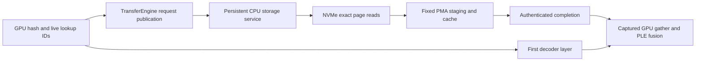

# Qwen3.8 Flash Next inference and SSD ngram storage

Research date: 2026-10-13. Llaminar source inspected at
48235fb0cb1f7bd489dc4ca293eb8dc8b35cedb1. This is an implementation proposal;
the SSD estimates below are calculations, not Llaminar measurements.

Qwen3.8-Flash-Next needs a new **qwen4exp** model family. Llaminar can reuse
Gated DeltaNet, MoE compute, quantized projections, orchestration and sampling,
but it needs gated residuals, Qwen Sparse Attention, learned ngram lookup and
their complete state lifecycle. Its device MoE ABI must also grow from 256 to
512 experts. The existing Qwen3.8 dense 27B tests cover a different model.

The ngram table is a good candidate for SSD storage because each token reads
only sixteen short rows, once near the beginning of the forward pass. Treat it
as an immutable row store with explicit SSD, host and device placement. The
most portable GPU design is a declared heterogeneous storage service using
bounded, preallocated buffers. A file-backed GPU pointer is a separate,
hardware-specific implementation that must prove its physical-memory bounds.

## Published model and export contract

The official checkpoint is a multimodal model and an early release of the
Qwen4 architecture. It has a 125B main model with 6B active parameters, an
additional 51B ngram table and approximately 4B of MTP parameters. Its native
context is 262,144 tokens. [Official model card](https://huggingface.co/Qwen/Qwen3.8-Flash-Next/blob/de4b8e4d43b917e7706784d8bb445c9af86a3540/README.md)

| Contract | Published value |
|---|---|
| HF architecture | Qwen4ExpForConditionalGeneration; qwen4_exp / qwen4_exp_text |
| GGUF architecture | qwen4exp |
| Main layers | 48: twelve groups of three GDN layers and one QSA layer |
| Compute hidden width | 2,560 |
| Residual branches | Four; trunk width 10,240; gate bottleneck 320 |
| MoE | 512 routed experts, top 10, one shared expert; intermediate width 640 |
| GDN | 16 Q/K heads, 48 V heads, dimensions 128; convolution kernel 4 |
| QSA core attention | 24 Q heads, two KV heads, dimension 256; rotary dimension 64 |
| QSA indexer | Four Q heads, one K head, dimension 128; compression ratio four |
| QSA selection | 512 complete blocks, 2,048 tokens, plus the incomplete tail |
| Ngram lookup | Eight bigram and eight trigram heads; 160 values per row |
| PLE location | HF layer ID 2 is one-based: decoder index 1, before its attention |
| PLE convolution | Kernel four, dilation three; nine prior positions |
| MTP | One QSA/MoE decoder block, trained for multiple draft steps |
| Vocabulary | 248,320 padded tokens |

These are checkpoint geometry, not optional deployment settings.
[Pinned configuration](https://huggingface.co/Qwen/Qwen3.8-Flash-Next/blob/de4b8e4d43b917e7706784d8bb445c9af86a3540/config.json),
[GGUF converter](https://github.com/ggml-org/llama.cpp/blob/1b70350c92563449576bcbbf552994b1d1ed847d/conversion/qwen4exp.py)

Muon belongs to training and requires no new inference operator.

GGUF conversion preserves exact 64-bit hash multipliers, head offsets and
prime-sized head ranges; converts the PLE layer ID to zero-based indexing;
splits the indexer Q/K projection; and applies zero-centered norm conversion
where required. Its 128 checkpoint table parts are **row shards**, combined
lazily into per_layer_token_embd.weight with GGML dimensions
[160, 320001536]. A converter that materializes the entire table in FP32 would
create about 190.7 GiB of temporary payload.
[Conversion and lazy shard handling](https://github.com/ggml-org/llama.cpp/blob/1b70350c92563449576bcbbf552994b1d1ed847d/conversion/qwen4exp.py#L57)

Metadata-only HTTP range inspection authenticated the table in both Unsloth
UD-Q4_K_XL and UD-IQ1_S exports as **IQ4_NL**, GGML type 20. It is not Q4_K:
each 160-value row contains five 32-value blocks, 18 bytes each. The table is
28,800,138,240 bytes, or 26.822 GiB. The overall model quantization label must
never determine this tensor's format.
[Pinned Q4_K_XL shard](https://huggingface.co/unsloth/Qwen3.8-Flash-Next-GGUF/blob/766911a6b7369840a91dbcd95f9f997acaab6cd6/UD-Q4_K_XL/Qwen3.8-Flash-Next-UD-Q4_K_XL-00002-of-00004.gguf),
[IQ4_NL block definition](https://github.com/ggml-org/llama.cpp/blob/1b70350c92563449576bcbbf552994b1d1ed847d/gguf-py/gguf/quants.py)

## New arithmetic and state contracts

### Gated Residual

Keep compute width and residual width separate. Each attention and MoE block
reads four independently normalized residual branches through low-rank,
elementwise sigmoid gates, then writes its output back through four scalar
gates. With normalized branches N, the operations are:

- Read gates: sigmoid(W_up · SiLU(W_down · flatten(N) / 4)).
- Block input: mean over branches of read_gate × N.
- Write gates: 2 × sigmoid(W_inject · flatten(N) / 4).
- Updated branch: original_branch + write_gate × block_output.

The final mixer performs a read without a write. HF norm gains are
zero-centered, using 1 + gamma. Exported norm semantics must be authenticated
so conversion and execution do not apply that offset twice.
[Residual implementation](https://github.com/vllm-project/vllm/blob/698e79f3bdbbe4fe7d6be6d91b358a7f430753ab/vllm/models/qwen4_exp/common/hyperconnection.py#L195)

Existing ordinary pre-attention normalization and residual-plus-FFN-norm
wrappers cannot surround these blocks unchanged. Setting d_model to 10,240
would also break every attention and expert projection. Add typed trunk,
compute and terminal-head geometries. At current FP32 activation precision,
one trunk row is 40 KiB; carrying it through PP is four times the ordinary
2,560-wide row. Reference FP8 residual optimizations would require a separate
qualified precision policy in Llaminar.

### Qwen Sparse Attention

QSA compresses **indexer keys**, while core attention retains the original
token K/V. Pool four visible raw indexer keys in FP32, cast to the configured
representation, normalize, then apply RoPE at the first token's position.
Queries retain their own positions. Sum four ReLU Q·K head scores, scaled by
1/sqrt(128), and select the best 512 complete blocks. Expand those blocks to
original token indices and always append the zero-to-three-token incomplete
tail. The actual core-attention extent can therefore reach **2,051 tokens**.
[Reference indexer and attention](https://github.com/huggingface/transformers/blob/28034545c35acac05793695bd5c878f66e6b544e/src/transformers/models/qwen4_exp/modeling_qwen4_exp.py#L664)

Implement true selected-index attention with device-owned live counts,
compressed-key cache, partial-block state and deterministic selection/order.
A full-KV scan with a sparse mask does not deliver the required economy.
Sparse computation also does not remove the full KV capacity requirement:
the twelve main QSA layers alone need 12 GiB for raw FP32 K+V at 262,144
tokens, before indexer, MTP, recurrent, arena or archive storage. This estimate
is for one unsharded request and excludes format-specific layouts.

Selection and pooling must remain causal for every prefill chunk and verifier
row. Cover ties, all four tail lengths, the 2,048-token threshold, nonzero
cache origins and rollback across a block boundary. Reusing a later row's
selected blocks for an earlier row is invalid.

### Learned ngram embeddings

PLE hashes raw token suffixes with the exact checkpoint integer constants:
XOR the per-position token × multiplier products, take the appropriate prime
modulus and add that head's offset. Do not import another Engram model's
token-normalization/compression policy. Hash history uses EOS 248044 for
padding/reset; generation stopping additionally includes 248046.
[Exact integer hash kernel](https://github.com/sgl-project/sglang/blob/2341e647d36f7e3b588b9711012faf5236bf228b/python/sglang/kernels/ops/embeddings/qwen4_ngram.py),
[Generation configuration](https://huggingface.co/Qwen/Qwen3.8-Flash-Next/blob/de4b8e4d43b917e7706784d8bb445c9af86a3540/generation_config.json)

Concatenate sixteen gathered rows into 2,560 values. Project a key for each
residual branch and a shared value. Normalized branch/key similarity, followed
by signed square root and sigmoid, gates the value. Add the gated value and
the SiLU output of a dilated depthwise convolution of its normalized form.
The convolution spans all 10,240 branch channels and needs nine prior
positions: 360 KiB of FP32 history per request before speculative copies.
[PLE fusion and convolution](https://github.com/vllm-project/vllm/blob/698e79f3bdbbe4fe7d6be6d91b358a7f430753ab/vllm/models/qwen4_exp/amd/ple_layer.py)

The immutable lookup table is separate from mutable execution state. Each
request owns its two-token hash context and convolution history. Prefix
restore, grouped verification, partial acceptance, correction and reset must
restore the same history that serial execution would have produced.

## Llaminar gaps and reusable components

| Area | Existing authority | Required extension |
|---|---|---|
| Model registration | [ModelRegistrations.cpp](../../../../src/v2/models/ModelRegistrations.cpp), line 34 | New qwen4exp schema/config/graph builders; no alias to qwen35moe. |
| GGUF metadata | [ModelLoader.h](../../../../src/v2/loaders/ModelLoader.h), line 117; [ModelLoader.cpp](../../../../src/v2/loaders/ModelLoader.cpp), line 2547 | Preserve numeric-array element subtype and expose checked 64-bit array access. Parse HC/QSA/PLE geometry and integer constants. Existing split-file and row-slice infrastructure is reusable. |
| Frozen weights | [WeightIdentity.h](../../../../src/v2/loaders/WeightIdentity.h), line 31; [GraphTypes.h](../../../../src/v2/models/GraphTypes.h), line 1024 | Add GR, indexer, PLE and predictor roles, immutable bindings, preparation identities and sharding policies. Keep a row-store handle distinct from a prepared GEMM weight. |
| Residual wiring | [GraphSchema.h](../../../../src/v2/execution/local_execution/graph/GraphSchema.h), line 50 | Add GR read/write/final-mixer stages and explicit activation geometry; reuse GEMM and norm kernels. Replace ordinary residual/norm wrappers declaratively. |
| Expert count | [MoERuntimeTable.h](../../../../src/v2/execution/moe/MoERuntimeTable.h), line 102; [DeviceMoERuntimeABI.h](../../../../src/v2/execution/moe/DeviceMoERuntimeABI.h), line 103 | Extend 256-expert placement/router/histogram/LLEP/transfer tables to 512, including duplicated CUDA/ROCm constants and ABI offsets. Top-10 already fits the top-k ceiling of 16. |
| Sparse attention | [AttentionDeviceParams.h](../../../../src/v2/kernels/attention/AttentionDeviceParams.h), line 78 | Add typed selected-index/count contracts, indexer/pooling/top-k kernels, native sparse KV readers and cache state. |
| PLE gathering | [EmbeddingStage.h](../../../../src/v2/execution/compute_stages/stages/EmbeddingStage.h), line 40; [KernelFactory.cpp](../../../../src/v2/kernels/KernelFactory.cpp), line 3557 | Add immutable row-table providers and hash/fusion kernels. Ordinary GPU embedding preparation uploads the entire shard and cannot implement SSD lookup. |
| Dilated history | [ShortConv1dStage.h](../../../../src/v2/execution/compute_stages/stages/ShortConv1dStage.h), line 59 | Add explicit dilation/state geometry; the existing GDN kernel-minus-one history is insufficient. |
| Prefix archives | [PrefixPayloadLayout.h](../../../../src/v2/execution/prefix_cache/PrefixPayloadLayout.h), line 30 | Add PLE history, QSA complete/partial key state and HC-wide terminal state; version layout/fingerprints and retain exact restore events. |
| MTP | [MTPWeightManifest.cpp](../../../../src/v2/execution/mtp/MTPWeightManifest.cpp), line 50; [QwenGraphBase.cpp](../../../../src/v2/models/qwen/QwenGraphBase.cpp), line 1985 | Add Qwen4 predictor semantics, 10,240-wide trunk publication/draft chaining and 2,560-wide head output. Preserve depth controller and stochastic verifier. |
| PP and admission | [PipelineDeviceGeneration.cpp](../../../../src/v2/execution/local_execution/orchestrators/PipelineDeviceGeneration.cpp), line 152; [ModelMemoryProfile.h](../../../../src/v2/planning/ModelMemoryProfile.h), line 50 | Use graph-role activation widths and metadata-only HC/PLE/QSA profiles in transport, workspace, archive and graph-family BOMs. |
| Prompt policy | [Qwen35GraphConfigBuilder.cpp](../../../../src/v2/models/qwen35/Qwen35GraphConfigBuilder.cpp), line 276 | Select the authenticated Flash-Next template and reasoning/tool grammar; do not inherit the Qwen3.5 template override. |

Blindly doubling thread-local expert arrays risks register spills. Extend the
typed ABI and economical kernels together, then compile and profile every
shipped CUDA/HIP architecture. Continue using the existing ExpertOverlay
placement and movement authority; 512 experts do not justify a second router
or residency ledger.

MTP is more than loading an extra layer. The predictor consumes the
pre-final-mixer 10,240-wide trunk, mixes token embeddings with branch hidden
state, emits a collapsed 2,560-wide LM-head state and retains a 10,240-wide
state for the next draft. It does not perform PLE lookup. In the inspected
vLLM predictor, the first draft step selects QSA indices and later steps reuse
them; batch compaction preserves their identity. This is an engine
optimization to evaluate, rather than an extra checkpoint requirement. The
main verifier still needs serial-equivalent PLE and QSA state for every
candidate row.
[vLLM predictor implementation](https://github.com/vllm-project/vllm/blob/698e79f3bdbbe4fe7d6be6d91b358a7f430753ab/vllm/models/qwen4_exp/nvidia/mtp.py)

For TP, declare ownership of residual branches/channels, indexer scores, table
rows and sparse KV explicitly. For PP, transmit 10,240 live trunk elements
where that graph role requires them, while attention/MoE projections remain
2,560-wide. Empty owners exchange required metadata only. Retained storage
capacity must never become the row, KV or collective communication extent.

Full multimodal support additionally needs a vision encoder, patch merger,
image/video preprocessing, multimodal positions and PLE masking. No production
vision path was found in Llaminar. A text-only milestone should reject image
and video requests explicitly; full conditional-generation support is a
separate implementation milestone.

## SSD as a supported inference tier

### Placement and physical ownership

Add a typed immutable lookup-store contract with **device-resident,
host-resident and SSD-backed** implementations. Storage identity is separate
from compute DeviceId and expert placement: SSD does not execute experts.
Neither --expert-tier nor --prefix-cache-disk-* describes this table's role.
[Current expert tier contract](../../../../src/v2/config/ExpertTierDefinition.h),
[Current disk prefix lifecycle](../../../../src/v2/execution/prefix_cache/DiskPrefixStorageBackend.h)

The store binds checkpoint/shard identity, tensor/codebook/scales, exact row
geometry, hash policy and retained file coordinates/inode generation. Prepare
or open it once, outside inference. Keep quantized rows quantized until the
small live gather is decoded. Authenticate reusable converted files by content
and conversion identity so startup neither rewrites the entire table nor
mistakes another same-shaped checkpoint for it.

Extend the canonical physical-resource/BOM machinery with a storage identity
and file-extent lifecycle. [PhysicalMemoryResource](../../../../src/v2/planning/PhysicalMemoryBOM.h),
line 127, currently accepts CPU/GPU allocators only. PhysicalMemoryAuthority
must remain the authority for all owned RAM/VRAM, including row/page caches,
mapped protocol rings, registered aligned I/O slabs, gathered rows and graph
storage. File capacity, virtual mappings and resident RAM are distinct charges;
sharing one file or one host cache must not duplicate its physical ownership.

For a strict bounded implementation, use a preallocated cache and I/O arena,
with registered files/buffers and exact page-range reads. An io_uring service
is a reasonable portable first backend. Direct-I/O alignment and supported
filesystem/device geometry belong in admission. A cache miss issues a read
within the selected SSD implementation; an I/O/backend failure fails the
request with a precise diagnostic. It must not switch to a full host table.

### GPU publication and generation

The proposed discrete-GPU path keeps hashing, tokens, sampling, verifier and
loop decisions on the GPU. A setup-created CPU service owns only immutable
I/O requests and storage completion. It reads into PMA-admitted mapped/pinned
slices and publishes a generation-bound completion. Captured GPU gathering
acquires that exact publication before PLE fusion; acknowledgement protects
reuse. Deduplicate pages while preserving canonical logical row order.

This is an explicit **heterogeneous storage boundary**. Its request metadata
and payload transfers require counters; absence of an API D2H call is not
absence of host-boundary traffic. Declare the boundary in graph policy and
complete the full ordinary/MTP generation composition. Do not create a host
token mirror, insert per-token callbacks, recapture on misses or add an eager
homogeneous path.

Useful infrastructure already exists in
[TransferEngine timeline APIs](../../../../src/v2/transfer/TransferEngine.h),
line 1012, and the
[retained CPU service worker](../../../../src/v2/execution/local_execution/graph/RetainedParentTicketServiceWorker.h).
However, [deviceLoopGraphTemplate](../../../../src/v2/execution/local_execution/graph/DeviceGraphExecutor.h),
line 2017, excludes parents requiring host service. A new lookup stage alone
would leave generation incomplete. The integration must prove retained parent
ordering and progress on both CUDA and ROCm, including MTP rejection/reset.

| Backend route | Applicability and remaining proof |
|---|---|
| CPU plus bounded SSD service | Host owns CPU execution and I/O. Batch exact reads and prefetch known prompt rows with bounded physical-core concurrency. |
| Discrete CUDA/ROCm plus storage service | Portable proposed route using explicit heterogeneous publication and fixed buffers. Requires complete captured generation integration. |
| Pageable file mapping on a unified GPU | Hardware-scoped option where the GPU uses host page tables. Needs strict page/cache admission and capture-safe prefetch; current ROCm startup forbids the HMM/SVM registration that a naive implementation would require. |
| GPU-initiated NVMe | Longer-term route for a device-controlled native storage path. Specialized drivers/queues and graph lifecycle must be implemented and qualified. |

GPUDirect Storage removes a CPU payload bounce, but NVIDIA explicitly states
that cuFile APIs are issued from the CPU. Stream-ordered asynchronous APIs
alone do not prove GPU-authored dynamic offsets or retained graph compatibility.
ROCm now has hipFile asynchronous APIs, so investigate the pinned SDK rather
than assuming no AMD storage API exists. Both libraries need exact capture,
allocation and direct-transport proofs, with compatibility/POSIX substitution
disabled. [NVIDIA cuFile API](https://docs.nvidia.com/gpudirect-storage/api-reference-guide/index.html),
[AMD hipFile asynchronous I/O](https://rocm.docs.amd.com/projects/hipFile/en/latest/tutorials/async-multistream-io.html)

### Expected SSD traffic

The padded table has 320,001,536 rows of 160 values. The following estimates
assume a compact table with a page-aligned base, independent uniformly
distributed cold row IDs, 4 KiB reads and no hits, deduplication or readahead.
FP8 storage excludes ancillary scale metadata. Row straddling is included.

| Table format | Table size | Logical bytes per token | Cold page traffic per token |
|---|---:|---:|---:|
| BF16 | 95.368 GiB | 5,120 | 68 KiB |
| FP8 | 47.684 GiB | 2,560 | 66 KiB |
| Authenticated IQ4_NL GGUF | 26.822 GiB | 1,440 | 65.375 KiB |

For row size s, expected pages per token are
16 × (1 + (s - gcd(s, 4096)) / 4096). A straddled row can use one 8 KiB
operation, so these page counts describe traffic/effective 4 KiB IOPS rather
than necessarily the number of submitted requests. Required block alignment
is I/O protocol geometry; it does not permit shipping unused page bytes as
GPU or network tensor payload.

At an illustrative **100 decode tokens/s**, FP8 needs about 1,650 effective
4 KiB IOPS and 6.45 MiB/s. At **20,000 cold prefill tokens/s**, it needs about
330,000 IOPS and 1.26 GiB/s. Decode therefore looks favorable on bandwidth;
latency, queue depth and overlap determine the actual penalty. Quantization
shrinks capacity greatly while barely shrinking cold page traffic.

Prompt IDs are available at admission, allowing bounded ahead-of-time
prefetch. Generated IDs become available after sampling: because PLE executes
before the second decoder layer, only roughly the first layer's compute can
hide that step's read. Grouped verification knows its candidate rows earlier,
but must not commit their PLE history until acceptance. Measure cold prefill,
warm prefill, decode and MTP separately, including concurrent requests and SSD
contention; no near-zero SSD penalty is established for Llaminar yet.

## Reference engines and what to borrow

| Engine and inspected revision | Useful implementation | Constraints relevant to Llaminar |
|---|---|---|
| [Transformers](https://github.com/huggingface/transformers/blob/28034545c35acac05793695bd5c878f66e6b544e/src/transformers/models/qwen4_exp/modeling_qwen4_exp.py) 28034545c35a | Independent GR/QSA/PLE math and multimodal semantics. | Data-dependent QSA uses eager/SDPA reference logic; generation compilation and cache cropping are restricted. Use as an oracle, with explicit reference state handling for MTP. |
| [vLLM](https://github.com/vllm-project/vllm/tree/698e79f3bdbbe4fe7d6be6d91b358a7f430753ab/vllm/models/qwen4_exp) 698e79f3bdbb | Optimized QSA, branch kernels, ngram table ownership and MTP state/index reuse. | Current source has pinned-host PLE on NVIDIA and AMD; NVIDIA wires asynchronous prefetch with capture-break hooks, AMD has same-stream UVA lookup. Some recipe text still says NVIDIA-only. Pinned RAM is not SSD. |
| [SGLang](https://github.com/sgl-project/sglang/blob/2341e647d36f7e3b588b9711012faf5236bf228b/python/sglang/srt/models/qwen4_exp_ple_table.py) 2341e647d36f | Actual file-backed PLE, row/page prefetch and native QSA/MTP serving. | File path requires cudaDevAttrPageableMemoryAccessUsesHostPageTables. Prefill prefetch calls .cpu() outside capture; periodic RSS trimming is advisory and leaves page-cache pages. |
| [llama.cpp](https://github.com/ggml-org/llama.cpp/blob/1b70350c92563449576bcbbf552994b1d1ed847d/src/models/qwen4exp.cpp) 1b70350c9256 | Merged qwen4exp GGUF graph, exact integer metadata, tensor mappings and lazy table loading. | Lazy mmap support does not prove bounded cache admission or Llaminar's complete device-resident generation contract. |
| [BlueYeoul Swift/MLX engine](https://github.com/BlueYeoul/Qwen-3.8-Next/tree/92c6edcdbbea9484a663ff2798931b2eac87478d) 92c6edcdbbea | Packed GGUF row gathering, SSD PLE/expert streaming on Apple unified memory. | Reports roughly 23 GiB RSS for a 104 GiB Q4 model, but streams experts too and synchronizes host routing. Its single-request and verifier limitations preclude using it as Llaminar certification evidence. |

SGLang's file backend is direct evidence that SSD PLE can serve this model on
supported unified hardware. Its source reports cold prefill improving from
650–750 to 1,000–2,100 tokens/s with page hints, versus approximately
2,200–2,600 warm. Those implementation-reported numbers establish that cold
prefill matters; they are not a matched SSD-versus-RAM benchmark for Llaminar.
[File prefetch source](https://github.com/sgl-project/sglang/blob/2341e647d36f7e3b588b9711012faf5236bf228b/python/sglang/srt/models/qwen4_exp_ple_table.py#L71)

SGLang also rewrites the table on boot and identifies its file by shape/dtype
rather than complete checkpoint identity. Its GPU page-fault path and
background PTE trimming should inform a hardware experiment, while Llaminar
uses explicit immutable identity and one physical admission authority.
[File allocator and lifecycle](https://github.com/sgl-project/sglang/blob/2341e647d36f7e3b588b9711012faf5236bf228b/python/sglang/srt/models/qwen4_exp_ple_table.py)

## Implementation milestones and acceptance

1. **Seal model and storage contracts.** Add qwen4exp metadata, checked
   integer arrays, weight roles, trunk/compute/head geometry, state layouts and
   BOM inputs. Authenticate the real split GGUF and its IQ4_NL table with
   metadata fixtures. Extend the complete 512-expert ABI. Define lookup
   placement and storage identity before loaders allocate anything.
2. **Implement complete resident text inference.** Add declarative GR, QSA
   and PLE graphs with CPU/CUDA/ROCm kernels and exact live-state ownership.
   Reuse GDN/MoE kernels at the new geometry after qualifying them. Implement
   sparse attention economically from the start; resident modes provide the
   arithmetic and timing controls for later SSD work.
3. **Complete the SSD service.** Add immutable row reads, bounded caches,
   registered arenas, authenticated publication and the declared heterogeneous
   generation policy. Prove CUDA/ROCm progress without callbacks, new
   allocations, blocking synchronization or host-owned token state. Benchmark
   cold/warm storage against the same resident checkpoint.
4. **Complete prefix and predictor lifecycle.** Extend portable prefix
   payloads, MTP manifests, branch hidden publication, any admitted QSA index reuse and
   accept/reject rollback. Exercise stochastic sampling and dynamic depth on
   retained production graphs. SSD caches may retain rejected immutable rows;
   mutable model history must still roll back exactly.
5. **Complete distributed execution and planner economics.** Qualify TP,
   PP and ExpertOverlay with the new widths and state. Add row/page I/O cost
   observations to automatic planning without another capacity ledger.
   Compare actual live collective/transfer extents, including empty owners.
6. **Add multimodal inference and certify advertised modes.** Implement
   vision and video paths if full-model support is in scope. Finish model
   parity, reviewed generation controls, HTTP/remote-MPI E2E and Release
   benchmarks for each supported mode. Unsupported requested modes fail
   explicitly until their implementation and gates are complete.

Contract work unlocks parallel GR/QSA/PLE-kernel and SSD-service development.
Storage correctness depends on the same immutable row representation and
generation/state geometry used by the resident path. No mode should enter a
different implementation automatically to conceal a missing component.

Use the [testing skill](../../../../.agents/llaminar-testing/SKILL.md) and
[canonical parity inventory](../../../../tests/v2/integration/parity/README.md).
The present [Qwen3.8 definition](../../../../tests/v2/integration/parity/qwen38/Qwen38ModelParityDefinitions.h)
names the dense 27B qwen35 model. Add a separate Flash-Next definition and a
pinned independent Qwen4Exp reference with GR, QSA, PLE and predictor
checkpoints. Validate new mathematics before acquiring reviewed token
controls; do not rebaseline a divergent stream.

Required focused coverage includes:

- Exact 64-bit constants, subtype/length/overflow rejection, row/codebook
  decoding, one-based PLE placement, EOS boundaries and one/two-token chunks.
- GR branch order and norms; QSA block causality, tied scores, all tail
  lengths, selection threshold and actual selected-KV read extents.
- 512th-expert routing, all relevant codebooks, positive CPU worker counts,
  grouped-row ranges and every shipped GPU spill-guard target.
- PLE dilated-history wrap, prefix full/partial hits, cold restore, request
  isolation and large-to-small replay with unchanged captured topology.
- Delayed and out-of-order I/O, live cache eviction, truncated/corrupt/replaced
  files, cancellation, stale generations and teardown while leases survive.
- MTP rejection at every row, changing accepted depth, correction, stochastic
  verification and byte equivalence with serial decode. Row replay remains
  an oracle only.
- Empty/skewed table ownership, partial buckets and exact GPU/network payload
  counts. Read required aligned SSD pages while sending only live row bytes.

Register reusable production defects explicitly in ProductionTestPreflight.
Keep Unit tests small and device-free. Run complete Unit/preflight before
real-model admission, then the canonical generation and E2E projections on
Release binaries for AVX2 and AVX512. Profile new CPU and GPU kernels using the
backend skills, with spills, register pressure, throughput and geometry tied
to each timing record.

Add PerfStats for selected table placement and I/O backend, logical row bytes,
physical SSD bytes, deduplicated pages, host/device cache hits, in-flight
requests, metadata traffic, read/completion/stall latency, graph capture and
declared storage boundaries. Report TTFT, prefill/decode throughput, p50/p95/p99
lookup stalls and peak PMA-owned RAM/VRAM for the same token stream, sampler,
context, prefix policy and MTP work. That evidence determines whether SSD
placement meets the model's correctness and economy gates.

## 2026-10-18 separate MTP artifact audit

The downloaded `MTP/mtp-Qwen3.8-Flash-Next-shared-Q8_0.gguf` is a
publisher-specific dense draft. Its metadata declares 49 total blocks, one
predictor at global block 48, `qwen4exp.nextn_shared_target_tensors=true`, and a
49-entry compression array ending in zero. Its 32 tensors contain the complete
predictor, including otherwise unused indexer projections/norms; token embedding,
LM head and PLE table are absent. No tensor payload was scanned for this audit.

This zero is deliberate in the publisher's implementation. The
[Unsloth MTP guide](https://unsloth.ai/docs/models/qwen3.8-next#mtp-guide) selects
`danielhanchen/llama.cpp` branch `qwen4exp/mtp`, observed at exact commit
`6fcaa16f4b360649933a54d1f91ad40ed35c0e11`. Its
[converter](https://github.com/danielhanchen/llama.cpp/blob/6fcaa16f4b360649933a54d1f91ad40ed35c0e11/conversion/qwen4exp.py#L95)
explicitly appends zero for predictor compression. Its
[predictor graph](https://github.com/danielhanchen/llama.cpp/blob/6fcaa16f4b360649933a54d1f91ad40ed35c0e11/src/models/qwen4exp.cpp#L525)
uses dense attention and records QSA support as unfinished. Missing shared
embedding/head tensors are borrowed from the target context after shape checks.
The file contains no producer commit receipt; this source explains its policy
but does not prove byte-for-byte reproduction of the published artifact.

The previously pinned upstream converter at
`1b70350c92563449576bcbbf552994b1d1ed847d` instead
[appends compression ratio four](https://github.com/ggml-org/llama.cpp/blob/1b70350c92563449576bcbbf552994b1d1ed847d/conversion/qwen4exp.py#L83)
for the predictor. Zero must therefore remain an explicit dense predictor
policy, not be silently rewritten to four or described as selector reuse.
Pinned [vLLM MTP](https://github.com/vllm-project/vllm/blob/698e79f3bdbbe4fe7d6be6d91b358a7f430753ab/vllm/models/qwen4_exp/nvidia/mtp.py#L236)
constructs a predictor-owned QSA indexer; later draft steps may reuse its own
step-zero selection. That differs from borrowing a main-model selector.

There is a second equation boundary to retain explicitly: the GGUF predictor
implementations normalize each 2,560-element HC branch before the combined
projection, whereas pinned vLLM and SGLang apply the hidden pre-FC norm to the
flattened 10,240-element trunk. The pinned Transformers public model ignores
unexpected `mtp.*` weights and supplies no executable predictor oracle. A
sidecar reference must name its exact GGUF attention and norm policies; a short
context where dense and sparse membership coincide cannot resolve this norm
axis difference.

Separate-source admission must retain both original GGUF metadata authorities,
validate the main/sidecar geometry and tokenizer contract, and bind predictor
weights to their native source artifact. Shared target embedding/head names must
retain their existing prepared identities and physical owner. Source selection
must be explicit configuration; no directory-name autodiscovery, synthetic
merged block count, metadata repair, or extra whole-model checksum is admitted.

## 2026-10-19 implementation qualification status

The feature branch contains model contracts, declarative main and separate
shared-predictor graphs, CPU/CUDA/ROCm GR/QSA/PLE kernels, explicit RAM/mmap
ngram storage and portable state/prefix lifecycle. These are implemented paths;
whole-model qualification is still open. The current main parity inventory has
20 cells: CPU two, CUDA+CPU ExpertOverlay eight, ROCm+CPU ExpertOverlay eight,
and CUDA/ROCm/CPU pipeline two. The mixed pipeline is
`CUDA0_ROCm0_CPU0_PP`, with 8/16/24 layers and no overlay-policy suffix.

Build16f passes for CUDA SM80/86/89/90 and HIP gfx906, including spill guards
and an immediate no-work repeat. CPU-only and full-backend CMake configuration
both pass after correcting conditional test registration; the full-backend
inventory retains all 1,305 original preflight entries plus the new placement
source-guard regression. Focused tests pass after fixing
cold output preparation, immutable verifier publication, arena-view transfer
authority, checked native-byte metadata totals and unsigned terminal counters.
The final branch-concat fixture also uses an explicit terminal publication
before host observation and deliberate stale-allocation rejection. Evidence is
under `parity-results/qwen-flash-next/{build16f,build16f-final-r2,focused16f,focused16f-terminal-fix}`;
the first focused run's two fixture failures remain preserved beside their
corrected rerun. The complete Unit run then passed 745/746 registrations; its
remaining source guard misclassified a method definition as a forbidden call.
The corrected scanner passes positive/negative controls across 20 repetitions
and the complete policy fixture. The full Unit/preflight receipt still needs
refreshing after this test-only repair.

The short CPU trajectory executes, but its numerical qualification remains
open. HC up-projection activation error can amplify through expert selection.
The explicit two-term-Q8 candidate has promising simulation and isolated native
kernel evidence; SingleQ8 remains the default, and no numerical tolerance has
been relaxed. CUDA/ROCm whole-model comparisons must use the unchanged exact-
GGUF reference and all canonical stage CSVs.

Next steps are complete Unit/preflight, main CUDA+CPU/ROCm+CPU/mixed-pipeline
parity, and the remaining RAM/mmap cells. Canonical parity stages GGUFs on
tmpfs, so mmap parity does not establish physical SSD performance. The private
MTP exporter also needs complete native snapshot mappings, mandatory shifted-
prefill comparisons and a QFN-specific route-conditioned expert/suffix oracle
before real child reference generation and recursive predictor qualification.
Dynamic MTP/prefix stress, physical SSD economics and Release end-to-end
performance remain unfinished. CUDA profiler attachment remains deferred after
the observed driver assertion; unprofiled timings and static resource reports
do not replace that missing profiler qualification.
