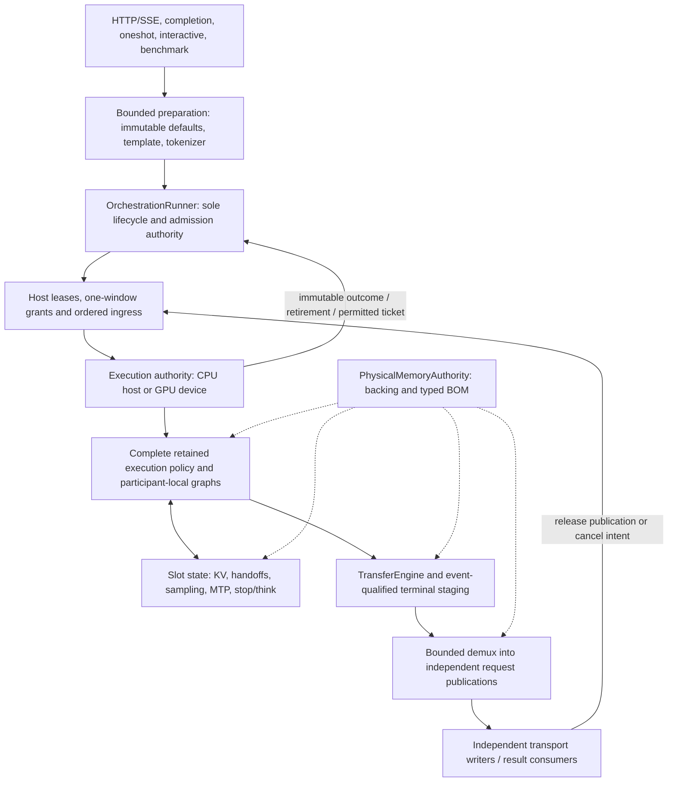

# Continuous batching: proposed serving design

**Date:** 2026-11-05

**Status:** Revision 3, responding to both independent reviews, including the original CB-01 through CB-20, their second-pass residuals, and CB-21 through CB-26. Proposed contracts only; **not implementation-ready or runtime-qualified**. The user authorized documenting a narrow serving-boundary policy proposal, not adoption of that proposal. Current project maxims remain unchanged. No document correction closes a native proof.

**Related records:** [Research and pinned source evidence](research_continuous_batching_20261105.md) · [Independent review and finding dispositions](review_continuous_batching_20261105.md).

**Provenance:** The isolated branch `feat/continuous-batching-design` starts at develop `ef1f54b0962d63531a9b33e06ca676e5124d05cc`. The initial research inspected `5e2a881aa99a9a4b428110a64b8ff64694c8b6b8`, an **unmerged descendant 100 commits ahead**, not an older develop snapshot. The research distinguishes its original descendant-pinned evidence from the explicitly develop-pinned follow-up controller/capacity audit; review evidence identifies its baseline. No ARM changes are imported by these documents.

This design adopts recorded-input controller/kernel replay and the distinction between detailed records and size-limited dashboards as explicit requirements. Those policy statements exist in the inspected descendant but are absent from the develop policy text. This is a detailed design record, not a tuning dashboard.

## 1. Goal, decisions, and remaining proof obligations

The goal is **batched serving / continuous batching**: independent client requests share useful execution work, and new requests enter as others finish without waiting for the entire cohort. Merely accepting concurrent sockets is insufficient.

The revised direction is:

> Extend `OrchestrationRunner` into the single multi-request lifecycle authority. Keep persistent request slots separate from compact work rows, and let the execution authority—not HTTP—own generation decisions.

Proposed decisions:

| Concern | Revision-3 proposal | Qualification status |
|---|---|---|
| Lifecycle owner | Existing `OrchestrationRunner`; every mode/topology migrates to its per-row seam at capacity one before capacity increases | No second owner or automatic scalar fallback |
| Serving boundary | Closed typed ingress and bounded-window terminal completions for streaming and non-streaming | Proposed policy amendment only; adoption remains blocked at G1 |
| First physical mode | Fixed-slot, full-context KV, plus independently sized response storage | Its own PMA/capacity/economy gate; not paged KV |
| First multi-request shape | One request's canonical prefill chunk per prefill transaction, alternating with grouped decode windows | Aggregated prefill and fused prefill/decode are separate unqualified optimizations |
| First capacity increase | One CPU endpoint, one CUDA device, or one ROCm device | Development target; all existing topologies first retain capacity-one parity |
| Pipeline | One model transaction in flight per domain/request; independent event-ordered lifecycle I/O | No speculative host model submissions; copy ownership in §9.6 |
| HIP selection | Lifecycle/selector after ingress, before the named model transaction | Extra selector receipt explicitly counted; native branch tickets may add more |
| Publication | Two shared staging banks; detached queues/framing/accumulation sized per response lease | Slot reuse does not release response storage |
| Numerical policy | Request-intrinsic windows/chunks/depth learning; explicit prefix/placement trace | Same-plan no-movement solo/batch token-byte guarantee is a required proof |
| Retirement | Distinct lifecycle-only operation; output eligibility uses host-owned one-window grants | Neither operation invents an empty generation |

Phase A preserves currently supported rank-local TP, PP, global/cross-rank TP, multi-domain ExpertOverlay and heterogeneous operation through the same capacity-one seam. **Capacity greater than one on those topologies remains unqualified** until its own gates pass. Capability one is an explicit implementation bound, not a fallback when a higher requested capacity fails.

The first increased-capacity envelope and the smaller diagnostic proof in §14 are not release modes. Default penalties, stochastic sampling, thinking budgets, prefix caching, optimized kernels and currently supported frontend behavior cannot be dropped to advertise batching.

## 2. Existing source does not yet provide this interface

The research documents the positive foundations, but several current contracts are cohort-wide or scalar:

- `DeviceGenerationAdmissionRequest` carries one budget, admission kind, depth policy and ordinary sampling law for its rows. `DeviceGenerationInitialization` carries one kind and session epoch. Current continuation checks require a fixed cohort to enter together and reject mixed completion/host-stepped state.
- The ordinary captured sampler binds scalar law values, `request_count = 1`, and one penalty-history view. A law-identity change invalidates/rebuilds that graph; this is not a per-row dynamic sampler table.
- Public batched setup uses one `active_sampling_params_`. A lower-level seed array does not establish independently supplied per-request laws/seeds at the serving interface.
- Batched verifier continuation rejects penalty-mutated sampling. Model defaults include nonzero presence penalties for important Qwen profiles, so this is a default-traffic gap, not an obscure option.
- Thinking-budget handling currently reduces the host loop to a one-token budget and injects forced tokens through `forceDecodeToken`. SSE publication currently calls `sink.write` inside the sole inference worker's admitted job.
- Ring KV backing is allocated per slot and full context. Prefix restore copies into a slot. PMA's existing child allocation claims describe physical backing allocations, not logical page grants inside an already materialized allocation.
- `IKVCache::StateResetBoundary::SequenceRetirement` is a useful existing seam, but it does not alone retire sampler, MTP, recurrent, publication, or model-runtime ownership.
- The MPI command vocabulary and several prefix/runtime-summary interfaces are single-request. Terminal prefill logits, ready/pending conditions and prelaunched sidecar handoffs also have runner-global ownership today; interleaving requests requires persistent slot state, not shared scratch.
- Resident capacity, generation request capacity, HTTP response admission and the fixed-cohort benchmark use different inputs/interfaces. They do not constitute one resolved serving envelope.
- `MTPSpecRequestBatchOwner` is a host per-call helper with an in-flight mutation lockout, not the GPU serving controller.

These are mandatory implementation prerequisites. Wrapping the current runner in an asynchronous queue would not solve them. See the review record for pinned source paths and concrete failure scenarios.

## 3. One lifecycle owner and one application-facing seam

`OrchestrationRunner` already owns model context, request lifecycle, sampling policy, MTP control and the MPI follower loop. Keep that ownership. Its backend implementation places CPU state on the host and GPU state on the device; the semantic lifecycle is still singular.

The former proposed `ContinuousBatchEngine` above the runner is **withdrawn as a second owner**. A transport/preparation adapter may handle parsing and delivery, but it cannot own another execution controller, KV lifecycle, placement policy, memory ledger, or model scheduler.



The host does not infer live execution state from the diagram's arrows. The permitted payloads are enumerated in §5.

### 3.1 Proposed external interface semantics

| Operation | Meaning | Excluded interpretation |
|---|---|---|
| Submit immutable prepared intent | Validate request compatibility and reserve bounded queue/response ownership, or reject explicitly | A GPU slot is already active; caller may mutate runner policy |
| Consume a publication lease | Observe immutable committed output or a terminal record | Borrow live device state or retain shared batch staging |
| Cancel a request handle | Submit lifecycle intent for that immutable request lifetime | Free an in-flight slot or interrupt an arbitrary kernel |

A `RequestHandle` identifies an external `RequestId`; it exists before execution admission. The sole lifecycle owner later creates a `ServingSlotBinding = (serving instance, slot, generation)`. The serving-instance identity prevents an old handle/ticket authenticating a reloaded runtime. One binding is replicated across all participants when multi-device support is implemented; per-domain physical addresses are derived from it. Domains must not mint independent generations for the same request.

All application modes migrate: Benchmark, Completion, SingleShot, Interactive, HTTP streaming and HTTP non-streaming. The sequence is explicit:

1. **Phase A — ownership refactor at capacity one:** move every currently supported topology/mode to the same per-row lifecycle, preserving its existing observable behavior, admission semantics and numerical policy. Prove existing gates and recorded parity before removing the replaced scalar ownership/API plumbing. Do not bundle a changed window or delimiter policy into a “no behavior change” claim.
2. **Policy qualification at capacity one:** after formal adoption of §5, qualify the shared window/control policy and device-native reasoning semantics for all existing topologies/modes. A changed policy gets an explicit version and reviewed evidence; historical token baselines are never silently regenerated. If old streaming/non-streaming semantics disagree, resolve the discrepancy explicitly rather than claiming both are unchanged.
3. **Phase B — qualified capacity increases:** raise resident capacity only within a typed `ServingCapacityCapability` and the resolved plan. Initially target single endpoints. An explicit higher request is rejected when unqualified, never clamped to one. Capacity one and larger capacities use the same owner, interface and supported kernels.

The unmodified scalar implementation is only the pre-migration starting point. It is not retained as a runtime alternative after replacement. Native semantics, feature parity and policy adoption—not merely interface compilation—gate cutover.

### 3.2 Preparation is not model execution

Preparation uses an immutable model-policy/template/tokenizer snapshot, merges defaults, validates stop/think/tool/sampling intent, and produces immutable prompt data. It cannot call `setSamplingParams`, `setStopTokens`, `clearCache`, or a generation operation.

Either prove the tokenizer/template implementation is safe for concurrent reads, or use a dedicated bounded preparation owner separate from inference submission. Unsupported combinations and malformed requests are rejected before execution mutation and before committing an SSE success response. Queue acceptance and execution admission remain distinct; queue cancellation/overload does not create GPU state.

## 4. Two state machines, not a host mirror

The host record is a **product of independent ownership machines**, not one request-progress enum:

| Component | Host-owned states/facts |
|---|---|
| Response lease | Preparing → Queued/Attached → Delivering → Closed; may outlive execution |
| Execution lease | Unbound → Admitting → Resident → TerminalObserved → Retiring → Released |
| Publications | Bounded set of reserved/in-flight/detached/drained publication leases for that response |
| Window grant | At most one outstanding permission per slot-generation, backed by destination storage |

For example, `(response=Delivering, execution=Released, publications={p1,p2})` is valid. Terminal response closure waits for its own publications/framer and terminal delivery outcome; execution release waits for its state/event borrowers, not the socket.

`Resident` means a host execution lease is held. It says nothing about the GPU row's phase, current position, learner or selected work. Host transitions consume its own reservations and authenticated immutable receipts.

The execution authority separately owns the slot machine, conceptually:

```text
Vacant -> Initializing -> PrefillReady / DecodeReady / OutputBlocked
       -> Executing -> Ready or Terminal -> Retiring -> Vacant
```

GPU phases, lengths, learner state, work selection, stop/think state, and commit decisions never become mutable host fields. `OutputBlocked` means the execution owner has no usable window grant; the host never writes that phase. The host does not track per-request `RunningTransaction` or `Committed` as decoded GPU progress.

Three leases remain distinct:

| Lease | Retains | Retirement rule |
|---|---|---|
| Response | Preparation/queue, detached output, framer and external response lifetime | Delivery outcome and all response-owned publications retire |
| Execution | One serving-slot generation and its request state | Exact execution/state/transfer borrowers retire |
| Publication | Detached immutable request output | That request's consumer/framer releases it |

Cache reader leases are separate. A terminal execution does not imply all borrowed storage is free; a slow consumer does not retain a slot once output is detached and execution borrowers are gone.

Slot generations are at least 64-bit, monotonic for their slot, and never reused. Exhaustion fails closed before admission; wrapping is not permitted. A stale execution ticket or invalid internal binding is fatal before state mutation. A legitimate external cancellation of an already terminal request is handled through its terminal identity, not converted into a raw command against a reused slot.

## 5. Normative proposed host/device boundary

**Policy proposal, not adopted policy.** On 2026-11-05 the user selected “Document narrow proposal”. This authorizes writing the proposal below; it does not amend maxims 8/9/11, approve forbidden operations, or authorize runtime changes. G1 has two separate prerequisites: formal policy adoption and then native proof. Tests cannot substitute for the first.

The proposed narrow amendment would:
- Define the bounded serving transaction as a complete bounded-generation unit for streaming **and non-streaming**, with request-local windows (§7). Non-streaming delivery may accumulate multiple immutable window results.
- Permit only the enumerated typed admission/policy-install, cancellation and output-grant ingress at declared boundaries; it never authorizes a host model planner or controller shadow.
- Permit awaiting an exact terminal result/control receipt at that boundary, plus the backend's explicitly enumerated HIP selection/branch tickets. HIP's additional selector completion is a real cost, not hidden in “one wait per window”.
- Continue to forbid per-token/per-stage/per-leaf waits, stream/device-wide synchronization, live-state polling, host callbacks, hot-path allocation/rebinding, eager execution, recapture and ordinary model-state H2D/D2H.

The intended exception is one completion observation per actual terminal operation/required ticket—not a license to split model work into arbitrary operations and wait on each. §8 enumerates the proposed operation catalog and receipt count. Until adopted, the design is policy-blocked, even if a prototype could be made to run.

A source sanitizer must enforce the closed ingress enum and narrowly owned terminal-completion API, rejecting raw synchronization and unlisted host/device transfers elsewhere. Replay must authenticate epochs/generations and prove that token values, controller state and timing-derived priorities cannot enter the control ingress.

| Direction and payload | Permitted authority and timing | Prohibited use |
|---|---|---|
| H2D initial prompt/admission data | Immutable prepared request, serving slot/generation, admitted envelope, ordered before activation | Rebinding captured pointers or deriving a new prompt from observed decode progress |
| H2D sampling/stop/think policy rows | Complete policy at new-slot admission; generation-qualified reset installs a new lifetime | Changing a resident sampler or forcing tokens because host text parsing observed progress |
| H2D cancellation | External lifecycle intent, ordered and bound to the original request lifetime | Interrupting a kernel, freeing a live slot, or directing model control |
| H2D window grant | One host-owned permission per slot-generation, backed by reserved response destination storage; ordered, single-use identity | Writing positions, depth, phase, live counts, or selecting participating rows |
| D2H window-terminal publication | Committed live tokens, bounded reasoning/injection framing positions, typed outcome/accounting and grant-completion receipts | A mutable controller/KV/verifier/sampler snapshot or arbitrary progress polling |
| D2H lifecycle/selection terminal receipt | Command acknowledgement, native retirement receipt, and the allowed retained-operation ticket | A readback of model position, selected row list, live learner state or scheduler age |
| D2H permitted HIP scheduler ticket | Fixed-size authenticated identity naming an already retained complete transaction; only metadata authorized by that backend policy | Carrying token contents, positions, learner vectors, or host-authored branching decisions |
| Explicit prefix/KV tier I/O | Existing intentional storage boundary, with TransferEngine, leases and producer/consumer events | Ad hoc in-window D2H/H2D to manufacture a missing snapshot |

Policy rows are installed only for a new generation-qualified lifetime, never as a mid-request update channel. Output-credit release is entirely host-owned; it may enable a new grant, not a device credit-counter write. Scheduling age is device-derived (§11); host timestamps/priorities are not an additional ingress class. The host validates only known identity (§6) and submits a device-named retained branch, never one inferred from decoded output.

The existing HIP ticket includes narrowly scoped committed-token cadence evidence. That does not authorize reconstructing model state. In the target design, the device/domain authority determines maintenance due; the host may submit/forward only the authenticated maintenance edge allowed by the backend contract. Counting SSE tokens to decide `maybeApplyMoERebalance` is not retained as a serving control loop.

### 5.1 Thinking budgets and forced sequences

Reasoning-budget enforcement and reasoning-phase classification have **one execution authority**. The canonical token-level rule consumes the exact tokenizer pieces for committed token IDs and matches the model template's exact closing marker across piece boundaries. It is not equality against one preferred delimiter tokenization. The admitted immutable tokenizer/marker transducer must handle alternate segmentations, partial bytes and marker spans inside a piece; any unsupported tokenizer semantics are a qualification gap, not permission to let host parsing disagree.

Execution publishes bounded marker-close/removal spans and forced-injection positions in the terminal output metadata. Coordinates are committed-output token ordinal plus byte offset where needed, not a live KV/controller position channel. Host UTF-8/reasoning presentation consumes those coordinates as authoritative, including repeated structural closes and end-of-response partial fragments; it does not rediscover a competing phase. It retains a bounded presentation tail sufficient for a marker spanning two publications instead of prematurely emitting potential marker bytes; that storage joins the response/framer BOM, not a host reasoning controller. Tool presentation remains separately defined and cannot feed model decisions.

The versioned rule counts committed, non-forced reasoning tokens, including the declared treatment of a token that completes a delimiter. The proposed rule excludes that closing token; partial-marker tokens before it still count. Budget zero begins the prescribed continuation-encoded injection at the first eligible position. An earlier committed stop/cancel wins terminal arbitration. Empty injection policy and template-free requests have explicit admitted semantics, not guessed delimiter evidence.

At a forced position the execution policy overrides the target sample with the prescribed token and rejects speculative drafts at that position. Earlier valid drafts may commit; later speculative state rolls back. Forced tokens update model/history/output state exactly once, do not consume an ordinary sampled-token decision, and do not count as sampled reasoning. A transaction clipped by or containing forced positions skips adaptive depth learning rather than treating forced rejection as poor model acceptance; the same versioned rule applies in solo/batch and every backend. The composed trace includes these force positions and skipped observations. Exact device matcher, tokenizer-piece metadata, sampler/verification interaction and formatting parity remain G1/G2/G7 proofs.

The current host `forceDecodeToken`/one-token-budget loops must retire with the shared policy. Canonical semantics and any historical frontend discrepancy must be reviewed at capacity one before increasing capacity (§3.1); no exclusive reasoning-budget singleton path is installed.

### 5.2 One-window execution grants

The runner's **host-owned destination reservation** is the sole authority to issue a `WindowGrant`. It binds serving instance, slot/generation, a non-reused grant ID, the immutable window policy and an opaque destination reservation. At most one is outstanding per binding. It permits at most one complete request-local output window; it does not supply a target position, mutable remaining count or depth.

A grant may remain unspent while that request executes its canonical prefill chunks. The reserved output destination remains held until the first window completes or cancellation/retirement returns the unused grant. Device selection may defer the request, but cannot consume the grant twice, resize its window, or produce output without it. Generation eligibility is derived from a usable grant plus device-owned readiness.

Window completion/retirement returns a typed receipt for the grant. The host releases unused reservation extent or transfers ownership of committed payload into the response's detached publications. It issues the next grant only after the previous one is resolved and sufficient response storage exists. A publication drain can make storage available, but never writes a model phase. Counts here describe leases/reservations, not a second physical-memory ledger.

## 6. Required per-row ABI and sampling substrate

The current cohort ABI must be replaced or extended through one typed authority. The following is a semantic sketch, not a finalized binary layout:

| Per-row field/family | Required meaning |
|---|---|
| Serving instance, slot and 64-bit generation | Stable logical identity shared by all participants; no reuse across runtime replacement |
| Admission kind | NewRequest or ContinueResponse independently per row; inactive rows are explicit |
| Immutable request policy identity | Model/template/sampling/control-policy version and admitted envelope |
| Response/context/window budgets | Per-request response limit; intrinsic window quantum and commit boundary; never resized by load |
| Sampling-law row | Greedy/stochastic mode, temperature, top-k/top-p, penalties and supported sequence-history policy |
| Resolved seed | Nonzero immutable request seed after admission-time entropy resolution |
| Stop/think row | Device-owned stop matching, reasoning budget and forced-sequence state |
| MTP row | Per-request depth policy, learner state, verifier/publication and rollback ownership |
| Persistent state references | Slot-addressed KV/recurrent/history and bounded terminal scratch, with immutable storage geometry |
| Prefill/decode/MTP handoff | Persistent terminal logits/hidden state, sampled/unsampled condition ownership and sidecar completion (§9.5) |
| Lifecycle/publication identity | Command ordering, outstanding grant identity, terminal arbitration and retirement dependencies |

A serving-window epoch qualifies the transaction, but it does not replace slot generations. Continuing A and admitting C in the same serving window must not reset A's learner or authorize C using B's prior ticket.

Host ticket validation binds only host-known facts: serving-instance identity, sealed ingress/window epoch, retained catalog/workspace generation and a digest of the **admitted binding snapshot owned by the host execution leases**. The ticket names that exact immutable snapshot, not whichever host set exists after processing retirement receipts. Host snapshots may include a binding still retiring; device selection checks actual readiness and generation.

The host does **not** validate a device-selected participation set, row count or depth trajectory. A device-authored participation digest may be compared across participants for agreement, in the spirit of `hasSameDispatchDecision`, but is never a host-selected-set oracle. Per-row generation checks happen on device before state access. Exact fixed-size encoding and agreement are still native proofs; slot selection is device data, not an embedded `seq_idx`.

### 6.1 Sampler law is runtime request data

Temperature, top-k/top-p, penalties and seeds must be read through admitted per-row tables on CPU, CUDA and ROCm. Different request laws must not trigger recapture or singleton serialization. The retained graph identity still includes table addresses **and** schema, capacity, precision, device, workspace generation, geometry, kernel/launch policy, and every genuinely embedded scalar. It is not reduced to addresses alone.

Per-request penalty state is a separate BOM obligation. A vocabulary-sized INT32 count table costs `4 × vocabulary_size` bytes per slot—about 608,000 bytes (0.58 MiB) at 152,000 tokens—before sequence-history, DRY, rollback, or sampler workspaces. A count table alone does not implement DRY's sequence-history semantics.

The typed compatibility key includes only genuine immutable execution incompatibilities. Mutable request laws and explicit seeds must not be included merely because today's captured sampler embeds them. Greedy and stochastic co-scheduling must have a genuine grouped implementation; a series of exclusive homogeneous cohorts is not feature parity by itself.

## 7. Numerical and RNG contract

For the same admitted plan—including capacity, kernels, precision and policy version—co-scheduling must not change a request's target/verifier arithmetic or committed/harvested state. **On one endpoint with no placement moves, the same immutable request, resolved seed, prefix-restore boundary and external control trace must produce committed token bytes identical to solo serving under that plan**, whether streamed or accumulated. Ordinary completion comparisons have no external cancellation; cancelling after the same wall-clock delay is not the same logical control trace.

The comparison trace is closed rather than “whatever decisions happened”:

| Trace field | Authority and invariance |
|---|---|
| Prompt/tokenizer/model, kernel/precision and policy identities | Immutable admitted input/configuration |
| Resolved seed, sampler law, stop/think/injection policy | Immutable request input; seed-zero entropy resolves once |
| Prefix-restore boundary and checkpoint identity | Explicit comparison precondition; cache availability may change the boundary |
| Absolute prefill chunk/checkpoint/LLEP grid | Request/configuration-intrinsic; not remaining batch capacity |
| Request-window boundaries and internal MTP budgets/depth decisions | Request-intrinsic policy and its own committed observations; never host load/timing |
| Forced-sequence and terminal positions | Derived from the same request policy/committed token stream; external cancellation is explicit trace input |
| Placement epochs and switch positions | Explicit domain trace, applied at the same logical request positions |

Prefix boundary **remains in this contract**. This design does not claim unproved cold-prefill versus cache-hit byte identity at different boundaries; existing prefix correctness requirements still apply. A stronger cross-boundary byte guarantee needs exact canonical checkpoint/export/import evidence, not a change to the comparator after a failure.

Dynamic residency remains the production default. For moving/heterogeneous deployments the oracle replays the same placement-epoch sequence and switch positions. A different placement history is not called a batching-equivalent trace, and unsupported topologies receive no weaker arithmetic guarantee.

### 7.1 Request-local work and window plans

- A prefill transaction carries **one request's next canonical chunk**, never an aggregate of unrelated prompts in this first design. Chunk/checkpoint boundaries are an absolute-position grid derived from request/configuration and required prefix/recurrent/LLEP checkpoints.
- Thus prefill M equals that request's solo chunk M. Prove every supported solo prefill geometry and interleaved handoff, but do not claim aggregate-prefill invariance. Decode/verifier kernels must be row-invariant across all admitted `resident_slots × verifier_rows` geometries, including each expert's live M and all applicable N/K/formats.
- LLEP locality concerns **assignment**, not just aligned windows: choice depends only on that request's window and placement epoch, or every eligible replica must be byte-equivalent with the same numerical kernels and row-invariant live-M dispatch.
- Prefill and grouped decode alternate as complete operations. Single-request chunks deliberately bound the new numerical surface, but burst arrivals queue chunks and may worsen TTFT/prefill throughput. Measure that cost; do not claim aggregated-prefill economics.
- Aggregated prefill and fused prefill/decode require separately admitted implementations and their larger M-range, arithmetic and economy proofs. They are not automatic alternate paths.

Define a positive window quantum `W` once from the admitted model/control envelope, independent of load, response form or batch occupancy. The existing 16-token streaming quantum is a candidate baseline, not a new unmeasured universal default; `W` must accommodate the maximum admitted new-commit/correction bound. Its exact value and version are sealed in the plan.

If `c` is this request's committed generated-token count, its next regular window ends at `W × (floor(c/W) + 1)`, bounded by its immutable response limit. First prefill-produced output and carried correction rows count once under the same ownership rule. Scheduling may defer the window but cannot shorten or extend it. EOS, admitted forced/stop semantics and external cancellation are explicit terminal/control exceptions, not load-budget clipping.

Internal MTP budgets use this intrinsic remaining window, the request's policy and any replayed placement boundary. Budget-limited learning skips are therefore identical in solo/batch; no transaction-wide spare capacity enters the learner. A common policy applies to streaming and non-streaming alike. Adoption of this policy is separate from Phase A's behavior-preserving refactor because current non-streaming generation normally uses the full remaining response budget.

### 7.2 RNG coordinates

The stochastic key is:

```text
(request-resolved seed, logical output position, draw purpose)
```

RequestId, slot, slot generation, batch row, arrival order and request ordinal **do not enter that key**. An explicit nonzero seed is preserved across submissions. Seed-zero entropy is resolved once at admission and stored with that request; it is not regenerated at each batch transaction or slot reuse within the lifetime.

MTP verification remains byte-equivalent to serial-row evaluation of the same recorded inputs/policy. Depth decisions are recorded to check replay, not supplied retrospectively to excuse load-dependent behavior: under the intrinsic-window policy they must derive from that request's identical observations. A different speculative policy has a different trace and may preserve a distribution without preserving token bytes. No load-aware depth policy is part of this first design.

## 8. Complete transactions and pipeline depth

Operation kinds are typed: `LifecycleSelect`, `PrefillChunk`, `DecodeWindow`, and terminal `Idle` outcome. Lifecycle/selector work is not an empty generation; it never invokes the generation commit that rejects `EmptyTransaction`. Vacant, prefilling, retiring and no-grant rows are Inactive to decode. A selected prefill chunk may validly emit no output without masquerading as a decode transaction.

Ingress is sealed before selection. The execution authority applies it, selects eligible work and either reports lifecycle/idle completion or executes the complete admitted model operation. A conditional-capable backend includes selection and the selected complete work in its retained parent. HIP uses the explicitly chosen selector-first protocol below. Neither path is a host loop over model layers or live row counts.

Initial execution pipeline depth is **one model transaction per domain**, and at most one per request. There is no speculative t+1 model submission formed from incomplete t state. Two publication banks permit safe staging/demux overlap; they do not imply two in-flight model transactions.

Slot reuse requires the actual retirement receipt and event frontier, not an arbitrary number of elapsed windows. If deeper pipelining is introduced, admission lag, command epochs, event ownership, stale-command behavior and exclusive arenas must be redesigned and proved. A blanket two-window delay is not a substitute for those lifetimes.

New ingress is applied at the next selector/parent boundary, not halfway through its selected model operation. Cancellation may wait for the current finite operation and its actual retirement frontier, but never for a new output grant or token. No wall-clock bound is claimed without measurement. Measure selector, required HIP branch-ticket, terminal-publication, demux, ingress and submission bubbles separately. Pending lifecycle I/O is accounted independently (§9.6).

### 8.1 HIP selector-first protocol and branch inventory

Choose **selection after ingress**, not tail selection based on old grants:

1. Seal ordered ingress and its host-known binding snapshot in persistent storage. Submit the retained `LifecycleSelect` graph.
2. Obtain its fixed-size authenticated terminal ticket/receipts. Validate only §6's host-known identity.
3. Submit the named retained complete model operation, or park after a terminal Idle/lifecycle-only result. Do not modify the sealed ingress while that operation owns it.
4. Resolve terminal output/grants and admit the next ingress epoch. If native MTP requires additional device-selected retained branches, submit only those authenticated tickets; their receipts are counted too.

A selector followed by one model graph requires **two terminal completion observations**, not one. A window requiring additional native HIP branch tickets costs more; the catalog must state that decomposition and count exactly rather than promising “two waits per window”. No new ordinary model-state readback is permitted. These boundary observations are within the **unadopted** proposal in §5, not a claim existing maxims already authorize them.

The selector and lifecycle-only/Idle cases join the graph/receipt inventory. Before implementation approval, enumerate the retained catalog across:

- canonical prefill buckets and execution geometry;
- ordinary and admitted MTP depth/control forms;
- precision/KV formats and true immutable policies;
- required maintenance/lifecycle variants.

State the exact graph count, persistent capture/workspace bytes, generation/identity rules and PMA BOM lines. Do not assume mixed per-row depths fit the current single-depth ticket. Host preparation may establish a deterministic prompt-derived chunk grid; after admission, live work selection and depth decisions remain device-owned. Alternation avoids requiring fused prefill/decode combinations, but does not itself prove the catalog is small or economical.

## 9. Physical memory modes and prefix ownership

### 9.1 First mode: fixed-slot, full-context backing

This is the existing ring-cache physical model, named explicitly. Plan admission accounts per execution slot for full configured main KV, recurrent/history/MTP and handoff state plus bounded terminal scratch. Shared staging is sized by admitted transaction geometry; detached output, framers and non-streaming accumulation are sized by **response leases**, which can outlive/reuse execution slots. Runtime request admission assigns preadmitted ownership without charging the same backing again.

The lifecycle slot catalogue records logical occupancy, not another free-byte ledger. PMA retains the backing allocation authority. Its existing suballocation leases must not be presented as a logical-page grant primitive they do not implement.

In this mode, guaranteed growth means the occupied slot can satisfy the admitted request's context/output bounds. The current unspecified output limit resolves to remaining context; no extra concurrency is gained by pretending that default is a short output. Fixed slots need a real Release capacity/economy gate. If their footprint is unacceptable, the mode is not a finished solution.

Prefix-cache resident backing can be charged once for multiple readers. **Live fixed slots contain private restored copies**, so their bytes remain charged separately. This design does not claim zero-copy live-prefix sharing in the current caches.

The serving-owned host preparation, response, staging and framer BOM uses existing PMA **owner reservations plus `claimAllocation` for each actual backing allocation**, retaining the physical lease through final free. No new PMA primitive is needed for that backing. Complete HTTP/library integration is still unimplemented; numeric queue/credit limits alone do not prove it. Logical page grants inside already materialized KV storage remain the separate missing primitive in §9.2.

### 9.2 Paged KV is a separate unqualified physical mode

Paged storage requires native append, attention, export/import, prefix, rollback and retirement contracts for every supported KV format, including TurboQuant, on CPU/CUDA/ROCm. It cannot appear as an implicit consequence of adding request slots.

A future logical grant inside materialized backing must be a typed PMA-owned primitive with exact consume/return ownership and event-ordered retirement, not a private allocator subtracting free bytes. Multi-rank admission must issue one topology-wide ordered grant decision while materialization stays with each rank's real backing authority; participants cannot independently reorder grant consumption.

Elastic oversubscription/preemption/offload is another explicit policy requiring complete recurrent/MTP/transfer/capture contracts. It is not an emergency response to a failed fixed-slot or paged admission.

### 9.3 Classify state before implementing reset or restore

Every affected field must be classified before Phase A's ownership refactor is considered complete:

| Ownership class | Examples | Reset/harvest rule |
|---|---|---|
| Slot | KV, GDN/short-conv, terminal logits/hidden state, ready/pending conditions, sidecar handoff, sampler history, stop/think state, MTP learner and request-local demand | Slot-qualified reset; only request-neutral model state enters reusable prefix snapshots |
| Transaction | Compact row maps, scratch, collective operands, temporary commit metadata | Retire at the exact transaction/event frontier |
| Domain | Durable expert placement, global rebalance policy/cadence, prepared assets, communicator/runtime ownership | Never reset or import from another request's prefix snapshot |

Current graph-builder reset/restore and model-runtime snapshot hooks span these categories. Adding a new slot must not restore archived placement or histograms over a live sibling. Domain state is excluded from mutable slot snapshots; immutable compatibility/placement-epoch identity remains part of their fingerprint. If a required dependency cannot be separated, that path stays unqualified rather than replaying an old domain snapshot.

Prefix lookup may be provisional while queued, but blocks are pinned only at execution admission. Harvest/restore are slot-generation-qualified lifecycle operations at canonical checkpoints, outside model capture, using TransferEngine and ordered events. The current `harvestPrefix` interface lacks the required slot identity and must change. Recurrent state cannot be rewound to invent a missed checkpoint.

Do not relabel stale harvests under a newer placement epoch or rewind domain placement to make a hit usable. Record actual hit, restore, discard, eviction and checkpoint rates under concurrent movement; a low hit rate cannot be hidden by a correctness-only test.

### 9.4 One typed serving-capacity input

A proposed `ServingCapacityRequest` contains intent for resident slots `S`, maximum response leases `R`, and queued/preparing requests `Q`. Automatic intent is explicit; an authored positive capacity is exact, never silently reduced. Planning resolves one immutable `ResolvedServingCapacity` through the qualified capability and PMA BOM. All consumers borrow that result.

Resolved constraints include `S ≥ 1`, `Q ≥ 0`, `R ≥ S + Q`, and the hard total `preparing-or-queued + execution-attached + detached-delivering responses ≤ R`. Detached deliveries compete for response leases, not execution slots; a full response pool can explicitly reject new admission even when a model slot is free. Bounded delivery deadlines prevent abandoned consumers holding it forever. These are ownership counts, not independent free-byte estimates.

The result fixes KV slot geometry, per-row controller/sampler/handoff capacity, verifier M, shared terminal staging, response/queue backing, dependent terminal-head policy and capture identity. Canonical prefill token-row geometry is a distinct typed execution-geometry input, not another spelling of request concurrency. Window policy and response byte bounds are sealed alongside the capacity.

Implementation must retire or disambiguate `--batch-size`, `--mtp-max-request-batch`, their duplicate runtime/planning capacities and the HTTP-only hard-coded limit. The current `kDefaultCapacity = 32` counts **accepted responses including active and queued**, not 32 extra queued requests; preserve its actual admission semantics during Phase A rather than copying the number into a different unit. Proposed public spellings are `--serving-resident-slots`, `--serving-response-leases`, `--serving-queue-capacity` under one typed config object; **none is an implemented CLI option**. Update parser, lossless config, planner, help, docs and tests together when implemented, without permanent aliases.

Retire fixed-cohort `*ForBenchmark`/decode-request-batch plumbing in the same migration. The replacement benchmark submits ordinary immutable requests through the installed seam: closed-concurrency refill and offered-arrival-rate workloads, including capacity one. It measures queue-inclusive TTFT/E2E, actual output gaps, SLO goodput, completed/unfinished work, memory and path counters. Isolated kernel/cohort diagnostics may remain separately named, but cannot certify serving performance.

### 9.5 Persistent prefill/decode handoff

Terminal prefill logits and hidden state survive every intervening request's work. A typed slot-owned handoff distinguishes unsampled ready logits from an already sampled/recorded condition and from a completed/pending first sidecar. It replaces runner-global `prefill_logits_ready_`, `ready_mtp_condition_`, `pending_mtp_condition_*` and `prelaunched_mtp_first_sidecar_*` ownership, not merely their booleans.

The BOM includes at least `sizeof(float) × vocabulary_size` per slot for FP32 terminal logits (about 608,000 bytes at 152,000 vocabulary), plus actual hidden, native sidecar, metadata and event storage. No unrelated request may overwrite these banks. A sampled correction is not sampled, emitted or inserted into history twice; GPU continuation uses the device-owned condition, never its host-published token as a shadow source.

Any prelaunch belongs to an admitted complete transaction/event tree; it is not eager next-request work outside the one-in-flight rule. Per-slot handoff remains valid until its exact consumer/event retires. Prefix snapshots may contain proven request-neutral terminal model state, but not a prior request's sampled condition, penalty/RNG/learner state or sample-dependent sidecar. New request admission installs its own policy.

### 9.6 Prefix/lifecycle I/O concurrency

Choose **overlap on disjoint slot/storage ownership**, not whole-domain serial restore/harvest. Pre-admit persistent restore and harvest copy lanes, exact non-null streams, independent staging and their PMA bounds. One in-flight model transaction is not a ban on those explicit tier-I/O operations.

- Restore C into C's exclusive initializing slot while A computes. All required KV/recurrent/handoff families publish their exact completion frontier. C is not eligible until event-aware publication proves readiness; A must not wait on C's unfinished copies.
- At C's canonical harvest point, freeze its source until an exact producer event permits copy into exclusive immutable snapshot staging. C resumes only after that copy releases its source. Slower RAM/SSD publication then borrows the detached snapshot, not C's mutable slot. A can continue throughout.
- If staging is unavailable, C remains at that checkpoint until its bounded lease is available; do not allocate secretly, rewind state, or silently disable required harvesting. Existing explicit cache-admission/eviction policy is not replaced by an undocumented skip.
- Cancellation/reuse waits for the old generation's actual copy/snapshot borrowers. TransferEngine owns copies, source retirement and readiness; no direct dirty-state edits, guessed streams or host polling of model progress.
- The native implementation must express selective readiness without putting a wait for an unselected C on A's whole-domain execution path. If it cannot, this concurrent path is unqualified; serialized copies are not an automatic substitute.

Measure copy bandwidth contention, snapshot-source freeze, staging backpressure, initial hit latency and decode stalls. Lifecycle I/O completions may wake the host as explicit storage-ownership facts; they are not a new source of model scheduling priorities.

## 10. Publication storage, credits, and terminal arbitration

### 10.1 Separate staging from consumer ownership

The current whole-window materialization and synchronous SSE write are not the target publication interface. The proposed chain is:

```text
GPU terminal staging -> event-ordered D2H -> host batch staging
                    -> bounded demux -> per-request immutable queues
                    -> request-local framers -> independent writers
```

- GPU staging is reusable only after the exact transfer/source-consumer completion event, never after a socket acknowledges data.
- Host batch staging is reusable after demux has finished reading it; an event alone cannot retire an outstanding CPU reader.
- Per-request consumers receive detached storage or separately owned immutable views that do not pin shared batch staging.
- A window grant reserves that response lease's maximum complete-window commitment before eligible model work; it never reserves the whole response against an execution slot.
- Credit includes token payload, encoding/escaping, tool/UTF-8/reasoning framer retention, non-streaming accumulation and other retained copies. Framer memory is not an off-ledger exception.
- Transfers contain only committed live payload and required metadata. Worst-case reserved space is not the transfer extent.

Two staging banks are a proposed shared admission cost, not proof that demux is nonblocking or economical. Detached output/framing/accumulation uses the response-capacity BOM, independent of slot reuse. No network writer runs on the inference submission owner.

### 10.2 Lifecycle progress must not require model progress

If every slot lacks a grant, cancellation and retirement still execute through typed **LifecycleSelect**, with preadmitted storage and reserved control/terminal receipt capacity independent of normal output. It never calls generation commit with zero emitted tokens. `SequenceRetirement` is one KV sub-operation; all state and I/O owners join the composite retirement.

Host credit return releases host publication ownership and may issue a new grant. The host submits lifecycle/selection work from pending intents, newly issued or outstanding grants, or permitted storage-ownership completions. On an authenticated Idle receipt it parks until one of those facts changes; it never polls row phases/positions or spins empty generation. Deferred grants remain explicitly outstanding; an Idle outcome cannot silently discard them. Idle with outstanding grants requires a concrete pending ownership/completion wake source; returning Idle while eligible granted work exists is a controller error, not permission to park forever.

A consumer that never reads cannot hold shutdown forever. Host transport clocks enforce the declared delivery deadline/slow-consumer policy, produce a delivery outcome, release transport-owned buffers and submit cancellation intent when required. These are I/O deadlines, not hidden inference deadlines or oversized collective timeouts. Draining shutdown closes admission, resolves bounded transport lifetimes and retires native owners; it does not kill arbitrary kernels.

### 10.3 Exactly-once outcomes

Maintain separate typed outcomes:

- `ExecutionOutcome`: committed completion, cancellation or execution failure, owned by execution/lifecycle authority.
- `DeliveryOutcome`: delivered, disconnected, timed out or framing/transport failure, owned by transport.

**First terminal committed in transaction/lifecycle order wins.** An EOS committed in t followed by cancellation in t+1 returns `AlreadyTerminal`; it does not publish another execution terminal or double-count usage. A disconnect after execution completion may change delivery outcome, not execution history.

Completed-request identity remains valid for idempotent external operations while its response lease exists. It cannot authorize a stale execution ticket. All generation-qualified command handling must distinguish a valid already-terminal request operation from corrupted/stale internal execution state before touching a reused slot.

## 11. Scheduling and request isolation

Keep queue count/bytes, resident slots, transaction work, and outstanding output as separate constraints. Physical storage for each remains admitted through its canonical owner.

The first policy gives granted decode windows regular service, schedules one canonical prefill chunk with anti-starvation, and charges MTP for verifier/proposal work rather than accepted-token percentage. Age is a device-owned, saturating 64-bit count of completed serving operations since admission/last service, with a stable admission-order tie break—not host wall-clock priority. Saturation never wraps a waiting request back to age zero. Host queue age remains passive observability. Scheduling may defer a request but never resize its intrinsic window/chunk or change request-local assignment. No-grant/inactive rows do not block healthy rows or lifecycle progress.

Equal token counts do not guarantee equal time. Attention context, model routing and precision matter. Strict prefill/decode isolation may require separately admitted compute; it cannot be claimed from chunking alone.

A compatibility key must be typed and minimal. Do not use request IDs, seeds, temperatures, or penalties as convenient grouping keys to disguise missing row-wise execution. Unsupported input is rejected precisely before state mutation; accepting default traffic only through exclusive singleton cohorts is not continuous-batching qualification.

## 12. Multi-device extension requirements

Capacity-one migration must preserve every currently supported topology. Higher multi-device capacity additionally requires:

1. One serving-slot identity/generation maps to every TP shard, PP stage and expert tier. Only the declared continuation owns sampling/control state.
2. Slot-qualified MPI commands carry ordered lifecycle/serving epochs and membership consensus; today's global setters/clear command are insufficient.
3. Graphs remain participant-local with explicit collectives and exact producer streams/events.
4. Ragged request work uses device-authored compaction/scatter to original coordinates or a proved native ragged protocol. Passing the first request's live count for a whole ragged bank is invalid.
5. Existing per-bank collective lowering is a useful correctness/economy comparator, not an automatic fallback. Measure launch count, latency, bytes and arithmetic order; no universal request-count crossover is asserted.
6. PP requires a specified microbatch schedule, exclusive concurrent arenas and at most one in-flight transaction per request. A single global in-flight transaction does not certify pipeline utilization.
7. Shared domain state and placement-epoch changes obey the numerical and snapshot contracts above.

Compact collectives must prove arithmetic equivalence as well as live communication volume; changing message geometry can change native reduction selection/order. Correct final tokens alone do not certify either invariant.

## 13. Feature parity and observability before cutover

Separate **cutover parity** from **target feature expansion**. Every result below remains unqualified for this proposed implementation. Each backend column expands over supported formats, greedy/stochastic policies, fixed/dynamic MTP depth and every currently supported topology. Existing response-form restrictions remain explicit.

### 13.1 Cutover matrix — blocks Phase A/policy cutover at G7

“Preserve” means prove every currently supported case and preserve its precise admission restrictions, not assume every possible combination already works.

| Feature | CPU ordinary | CPU MTP | CUDA ordinary | CUDA MTP | ROCm ordinary | ROCm MTP |
|---|---|---|---|---|---|---|
| Laws/seeds, budgets, stops, model-default penalties | Preserve | Preserve | Preserve | Preserve | Preserve | Preserve |
| Active DRY | Prove existing support | Prove existing support | Preserve explicit resident rejection | Preserve explicit rejection | Preserve explicit resident rejection | Preserve explicit rejection |
| Thinking budget, prescribed sequence and framing | Preserve/version declared policy changes | Preserve/version declared policy changes | Preserve/version declared policy changes | Preserve/version declared policy changes | Preserve/version declared policy changes | Preserve/version declared policy changes |
| Prefix, recurrent checkpoints, supported KV formats/tiers | Preserve | Preserve | Preserve | Preserve | Preserve | Preserve |
| Tool choice, reasoning/tool framing and stream usage | Preserve | Preserve | Preserve | Preserve | Preserve | Preserve |
| Token IDs/runtime summaries in supported response forms | Preserve | Preserve | Preserve | Preserve | Preserve | Preserve |
| Cancel, delivery, stats epochs, shutdown and capacity-one topology | Preserve | Preserve | Preserve | Preserve | Preserve | Preserve |

Inventory the exact current cases before cutover; this matrix is not a capability advertisement. No new rejection, silent penalty/prefix disablement or exclusive alternate implementation is permitted. G1 policy adoption and G3's versioned numerical/control contract also gate policy cutover. All modes, including benchmark, use the same installed seam.

### 13.2 Complete target — additional implementation gates

| Additional capability | CPU ordinary/MTP | CUDA ordinary/MTP | ROCm ordinary/MTP | Gate |
|---|---|---|---|---|
| Genuine independently admitted multi-request capacity | Required | Required | Required | G2–G8 per qualified topology; G9 for multi-device growth |
| Native per-request DRY sequence history where currently absent | Close any audited gap | Required new feature | Required new feature | G2 history/BOM plus G7 feature proof |

The currently rejected GPU DRY cases are **new features**, not prerequisites to a behavior-preserving capacity-one ownership refactor. They block claims of the complete target, not the narrower G7 cutover-parity claim. At higher capacities, supported laws/defaults still cannot be routed through hidden exclusive cohorts; a grouped sampler and its history are real implementation obligations.

Per-request accounting must define committed tokens, draft/verification work, stop reasons, prefix observations and execution/delivery outcomes. A shared kernel's wall time or shared physical bytes must not be charged in full to every request and then summed as if independent. Keep non-additive/shared costs at the domain level or use an explicit measured attribution definition. Existing per-request verifier fields are inputs to this design, not permission to duplicate global summaries.

Passive stats derive host lease/queue age from host-owned facts and execution work from immutable permitted publications. They never probe GPU state. Measurement-epoch reset cannot cancel requests, clear caches, or let an old request repopulate the new epoch.

## 14. Smallest useful proofs and delivery sequence

Documents first: approve the host/device table, numerical/placement contract, per-row ABI and lifecycle ownership. No runtime implementation or test run is authorized by this review response.

After those contracts are accepted, the first controller proof should replay **recorded** scalar inputs/initial state through the actual shared controller arithmetic extended per row:

- A continues while B reaches EOS.
- C enters B's retired slot at a new generation with NewRequest while A retains ContinueResponse.
- Old B execution tickets cannot authenticate C; late valid cancellation is already-terminal rather than a second outcome.
- Penalty history, seed coordinates, learner state and outputs match A's solo reference under the enumerated intrinsic-window/prefix/placement trace. Replay budget-limited learner skips at identical request-local boundaries.
- C's persistent logits/hidden/condition/sidecar handoff survives A's intervening windows without duplicate sampling/emission/history mutation.
- Output eligibility derives from a unique host-backed grant; withholding/draining a response queue changes timing, never window length. Repeated or stale grants cannot authorize new work.
- All-output-blocked cancellation and lifecycle-only retirement progress without a model token or normal output credit.

Do not invent observations for unimplemented paths or call repeated synthetic fixtures replay. New/changed controllers and GPU kernels require recorded-input replay registered explicitly in `ProductionTestPreflight`, alongside focused lifecycle/geometry tests and native integration gates.

The smallest subsequent GPU experiment may use one CUDA device and one ROCm device, fixed slots, greedy/stochastic MTP without penalties, prefix off, and alternating complete transactions. It proves only the named controller/capture subset. **It is not a supported mode and cannot certify default production traffic.** Production counters must show no recapture, only permitted publication/ticket transfers, and the applicable solo byte contract. The cutover matrix then closes existing penalties, reasoning, prefix and optimized behavior; the separate complete-target matrix closes new GPU history and capacity capabilities. CPU and absent hardware remain explicitly qualified or unqualified by actual evidence.

Economy gates use Release, actual shared execution, all supported M/N/K and positive CPU thread counts, live collective bytes, memory BOM, and isolated kernel profiling. Measure offered-load goodput, queue/active age, output-event gaps, cancellation/retirement latency, prefix hit/discard rates and pipeline bubbles. Completed-only percentiles or a throughput increase hiding growing queues are insufficient.

## 15. Open gates and decision register

All proof gates below remain open; none is closed by this document.

| Gate | Required decision/proof before qualification | Review findings |
|---|---|---|
| G1 Host/device serving contract | Formal adoption of the narrow policy proposal, then proof of typed ingress, terminal/ticket completion, shared phase/injection authority and source sanitizers | CB-01/01R, CB-08, CB-09, CB-21 |
| G2 Per-row controller/sampler ABI | Mixed admission, host-known ticket authentication, independent budgets/laws/history/grants, device forcing, finite identity | CB-02, CB-04, CB-05, CB-18R, CB-21, CB-24 |
| G3 Numerical invariance | Intrinsic windows/chunks/depth learning, closed trace, same-prefix/no-move solo byte contract, request-local LLEP and admitted-M dispatch | CB-03/03R, CB-16, CB-22 |
| G4 Physical mode and storage | One resolved serving capacity; fixed-slot and response-lifetime BOM/economy; separate future page-grant protocol | CB-06, CB-08R, CB-23, CB-26 |
| G5 State and prefix lifecycle | Slot/domain classification, persistent prefill/MTP handoff, selective event-ordered concurrent restore/harvest and exact retirement | CB-07, CB-16, CB-25, CB-26 |
| G6 Output and lifecycle liveness | Composite leases, one-window grants, inclusive credits, reserved control receipts, non-generation lifecycle operations, exactly-once outcomes | CB-08/08R, CB-09/09R, CB-21 |
| G7 Owner migration and cutover parity | Every current topology/mode at capacity one; separately qualify the shared policy; distinguish preserved support from target expansion | CB-12/12R, CB-14/14R, CB-15, CB-23 |
| G8 Native catalog and economy | HIP selector-first and all branch receipts, graph/workspace BOM, single-request-prefill TTFT, model/copy pipeline stalls | CB-13, CB-18/18R, CB-22, CB-25 |
| G9 Multi-device capacity qualification | Slot-qualified commands, consensus, compact/ragged collectives, stable arithmetic, PP scheduling and concurrent arenas | CB-10, CB-11, CB-17, CB-24 |

Product inputs also remain to be set: workload/context/output distributions, concurrency demand, TTFT/output-gap/E2E objectives, trust-domain prefix policy, queue limits, and delivery deadlines. They determine capacity/economy acceptance, not exemptions from ownership or numerical contracts.

The second review found the direction coherent but not implementation-ready. Revision 3 records proposed decisions and the requested narrow policy proposal; it is not a third independent approval. Formal policy adoption, detailed native contracts and all G1–G9 evidence remain outstanding. No runtime change, build/test run, commit or push is authorized by this document.
